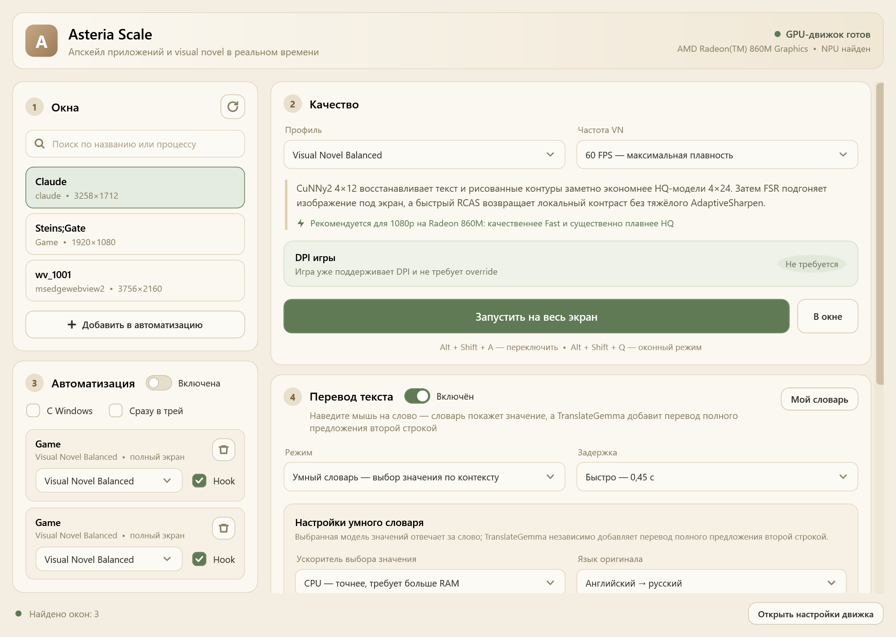
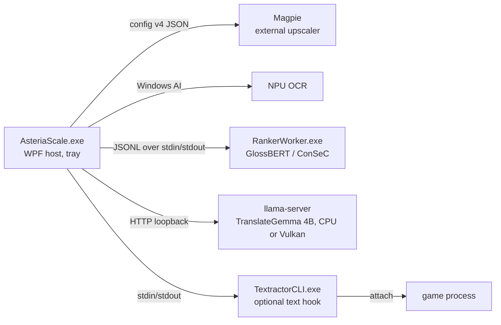

# Asteria Scale

English · [Русский](README.ru.md)

**On-device upscaling and hover translation for visual novels and other low-resolution
Windows apps.** Point at a line of English or Japanese text and a Russian translation
appears next to the cursor — OCR, dictionaries, word-sense disambiguation and the
optional neural sentence translation all run locally, with no cloud calls.



## What it does

- **Upscales any ordinary window** through the separately installed [Magpie](https://github.com/Blinue/Magpie)
  engine: eight presets (CuNNy2, Anime4K, AMD FSR, xBRZ chains), per-game automation
  profiles, and a per-app Windows DPI override for old DPI-unaware games.
- **Translates the text under the cursor** (English and Japanese → Russian): NPU OCR,
  optionally backed by a Textractor text hook that reads the exact line from the game
  process, and 12 layered offline dictionaries; for English, a context-aware sense ranker
  picks the dictionary meaning that fits the sentence, and an optional TranslateGemma 4B
  line translates the whole sentence.
- **Runs from the tray** and switches itself on per game.

## Engineering highlights

- **Offline pipeline with explicit contracts.** OCR → ~342k dictionary keys plus ~540k
  sentence pairs in 12 layers with a documented priority order and one canonical key
  normalization shared by the C# loader and the Python generator (a parity fixture is
  checked on both sides) → definition-aware word-sense ranker → optional local LLM.
- **Isolated model worker.** The sense ranker (GlossBERT or ConSeC on ONNX
  Runtime) runs in its own process behind a versioned JSONL protocol. Every request line
  gets exactly one drained response line, even on cancellation; a protocol violation
  kills the worker tree; switching modes or the optional idle unload returns the memory.
- **No silent fallback.** A requested NPU or Vulkan path either runs there or fails
  loudly; the host validates the provider, device and model identity the worker
  reports. Host and worker read provider capabilities from one shared table, pinned by a
  test, so they cannot disagree about what a cached decision was computed from.
- **Measurement discipline.** Model files are pinned by size and SHA-256; benchmark
  provenance hashes the exact dataset bytes. Frozen holdouts are reserved for one-shot
  confirmation, and every opening, accidental ones included, is logged. Promotion criteria are declared before a blind run — and when the
  sentence-translation gate failed (McNemar p = 0.064, three guard verdicts), the fixed
  configuration that later met every criterion on the same, now-spent set was *not*
  counted as a pass; a new blind set was created and left unopened instead.
- **Tracing order-dependent output.** TranslateGemma's output depended on request order.
  A direct llama-server probe localised the cause to Vulkan cooperative-matrix shaders, not
  prompt caching; the product now runs Vulkan without coopmat, and that path is part of
  the model's cache identity.
- **Groundwork for a second platform.** The translation core (~20k lines) is a separate
  `net10.0` library; calling a Windows-only API there fails the build (CA1416 as error).
  The ranker worker and three hard-coded binary names are still Windows-specific.

## Results

Word-sense disambiguation on the open sentence development set (46 sentences, 138
targets), same build:

| Ranker | Correct sense group | Scientific slice | Sentences with all targets correct |
|---|---:|---:|---:|
| GlossBERT (default) | 91 / 138 | 69 / 108 | 20 / 46 |
| SANDWiCH (removed) | 120 / 138 | 96 / 108 | 31 / 46 |
| ConSeC | 131 / 138 | 106 / 108 | 41 / 46 |

ConSeC: accepted precision 96.32 %, coverage 98.55 %, warm p50/p95 140/205 ms on CPU.
These are WSD numbers, not translation quality. Sentence translation is evaluated
separately with chrF2, COMET-22 and a sense-level intention-to-treat metric
([docs/BENCHMARKING.md](docs/BENCHMARKING.md), [docs/RESEARCH.md](docs/RESEARCH.md)).

SANDWiCH was evaluated as a third ranker and removed in November 2026: it trailed
ConSeC on every word-sense accuracy metric, used more memory and did not pass the
90 % accepted-sense gate. The app now offers GlossBERT (default) and ConSeC (an
opt-in CPU research profile).

## Architecture



| Project | Role |
|---|---|
| `src/AsteriaScale` | WPF host and everything Windows-specific: UI and overlays, tray, hotkeys, Magpie control, DPI, Windows AI OCR, Textractor |
| `src/AsteriaScale.Core` | Platform-neutral translation core: dictionaries, morphology, sense-ranking host, phrase translation, caches |
| `src/AsteriaScale.RankerProtocol` | Contract shared by host and worker: JSONL protocol, provider traits, abstention threshold |
| `src/AsteriaScale.RankerWorker` | Isolated ONNX Runtime worker for the sense rankers |
| `tests/AsteriaScale.Tests` | Regression suite (55 smoke tests, including a real Magpie start/stop) |

## Tech stack

C# / .NET 10 · WPF and Win32 interop · Windows AI Text Recognition (NPU) · ONNX Runtime
(CPU, AMD Vitis AI NPU) · llama.cpp (CPU, Vulkan) · Python (dictionary builds, ONNX
export, benchmarking) · PowerShell build with MSIX identity signing.

About 36k lines of C# in `src/`, 25k lines of C# tests, 13k lines of Python tooling.

## How this project is built

A solo project by [@slava8519](https://github.com/slava8519). I own the product scope,
the architecture and its invariants, the evaluation protocol and the model decisions.
Most of the code was written with AI coding agents (Claude Code) working under the rules
in [AGENTS.md](AGENTS.md): a failing test before every behaviour fix, no silent
provider fallback, no access to frozen holdouts while tuning, and recorded review passes
([docs/AUDIT-ROADMAP.md](docs/AUDIT-ROADMAP.md),
[docs/audit/](docs/audit/pass-e-translation-quality.md)). Most commits carry a
`Co-Authored-By` trailer naming the AI model.

## Status and limitations

Version 0.9.3, a personal project.

- Windows 11 build 26100 or newer; OCR needs a compatible NPU.
- Russian is the only target language.
- Third-party model weights are not stored in the repository, and the required GlossBERT files
  have no public download yet, so a clean clone builds and passes the tests but cannot
  publish the app (details in [docs/DEVELOPMENT.md](docs/DEVELOPMENT.md)).
- A macOS version is planned as a native Swift app written from scratch on top of the
  platform-neutral core (decisions and open questions: [docs/MACOS.md](docs/MACOS.md)).

## Build and test

Requirements: Windows 11, .NET 10 SDK, Magpie 0.12.1 or newer for the engine test, and
Python 3.11+ as `python` on `PATH`.

```powershell
dotnet restore AsteriaScale.slnx
dotnet build AsteriaScale.slnx -c Release
dotnet run --project tests/AsteriaScale.Tests/AsteriaScale.Tests.csproj -c Release --no-build
```

Publishing (`./scripts/build.cmd`) additionally needs the pinned model files and a
one-time self-signed signing certificate; see [docs/DEVELOPMENT.md](docs/DEVELOPMENT.md).

## Documentation

The project documentation is in Russian; [docs/README.md](docs/README.md) is the map.

| Document | What it covers |
|---|---|
| [README.ru.md](README.ru.md) | User guide: install, translation modes, presets, data locations |
| [docs/ARCHITECTURE.md](docs/ARCHITECTURE.md) | Processes, the hover pipeline, dictionary layers, invariants, platform split |
| [docs/DEVELOPMENT.md](docs/DEVELOPMENT.md) | Build, tests and testing strategy, model artifacts, publishing, data regeneration |
| [docs/BENCHMARKING.md](docs/BENCHMARKING.md) | Translation benchmark protocol and tracks |
| [docs/RESEARCH.md](docs/RESEARCH.md) | Dated research and measurement log; the source of the numbers cited by the roadmap and audit |
| [docs/ROADMAP.md](docs/ROADMAP.md) | Planned work and its design |
| [docs/MACOS.md](docs/MACOS.md) | macOS version: owner's decisions, consequences of the project rules, open questions |
| [AGENTS.md](AGENTS.md) | Rules for AI coding agents (in English) |

## License

Source code and original documentation: MIT ([LICENSE](LICENSE)). Dictionary and
morphology data, apart from the project's own curated layers, are derived from
third-party sources and keep their own licences (mostly CC BY-SA; also EDRDG, CC BY 2.0 FR
and CC BY 4.0) — see [DATA-LICENSES.md](DATA-LICENSES.md). Magpie (GPLv3) and
Textractor are separate programs; model licences, including the Gemma Terms for the
optional TranslateGemma and CC BY-NC-SA for the research-only ConSeC install, are listed
in [THIRD_PARTY_NOTICES.md](THIRD_PARTY_NOTICES.md).
