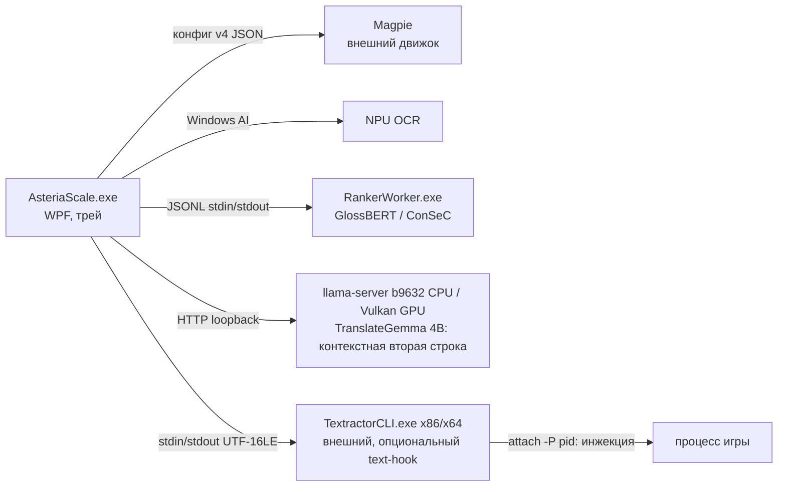

# Архитектура Asteria Scale

Документ описывает устройство проекта для разработчиков и ИИ-агентов. Пользовательское описание — в [README.ru.md](../README.ru.md), исследовательские заметки и калибровка — в [RESEARCH.md](RESEARCH.md).

## Состав решения

| Проект | Назначение |
|---|---|
| `src/AsteriaScale` | WPF-приложение и всё, что требует Windows: UI и оверлеи, трей, горячие клавиши, Magpie, DPI, Windows AI OCR, Textractor и Windows-хост наведения (`HoverTranslationService`: распознавание, трекер курсора и показ карточек для `HoverCoordinator`) |
| `src/AsteriaScale.Core` | Платформенно-нейтральное ядро перевода (`net10.0`, без RID): словари и нормализация, морфология, выбор смысла, каркас и фразовый перевод, TranslateGemma-клиент, кэши, настройки, оркестрация наведения (`HoverCoordinator`; хосту, который отвечает на запросы, она отдаёт исход каждого наведения `HoverOutcome`, снимок состояния моделей `HoverModelStatus` и выгрузку по его запросу, а модель фраз в ней необязательна), текстовые правила OCR без пиксельных единиц (`OcrTextRules`) и пиксельная геометрия OCR (`OcrGeometry`: строка и слово у курсора, сборка предложения из строк, группировка блоков, границы захвата; рамки — пиксели кадра, границы — пиксели экрана хоста), признаки вида карточки по строке движка (`HoverEngineLabelClassifier`), типизированное происхождение результата (`HoverProvenance`) и метки движка, которые задаёт хост (`HoverEngineLabels`). Вызовы Windows-API сюда не попадают: CA1416 — ошибка сборки. Строковые имена Windows-бинарников CA1416 не ловит: архивы llama.cpp `win-cpu-x64`/`win-vulkan-x64` с `llama-server.exe` пока зашиты в ядро и для macOS должны прийти от хоста. Путь ranker-воркера и каталог его моделей хост передаёт через `RankerWorkerLocation` (по умолчанию — прежний `Ranker/AsteriaScale.RankerWorker.exe` рядом с exe), а каталоги данных — через `CoreDataLayout`. Основа будущей macOS-версии ([MACOS.md](MACOS.md)) |
| `src/AsteriaScale.RankerProtocol` | Общий JSONL-протокол v4 между приложением и definition-aware ranker-воркером, а также то, о чём обе стороны обязаны договориться: порог воздержания (`RankerAbstention`), привязка вхождения цели (`RankerTargetAnchor`), признаки провайдеров (`RankerProviderTraits`) |
| `src/AsteriaScale.CoreHost` | Ядро отдельным процессом для macOS-приложения (решение M11): строгий протокол JSONL v1 через stdin/stdout, ровно один ответ на запрос, stderr только для диагностики. Аргументы запуска задают все корни данных (`CoreDataLayout`) и совпадают с `tests/AsteriaScale.Tests.MacOS/CoreHost/launch-args-v1.txt`; протокол переходит с fd 0 и 1 на собственные дескрипторы, а дочерние процессы получают `/dev/null`; один экземпляр на каталог пользователя; `core.shutdown` и SIGTERM завершают работу упорядоченно, EOF stdin без `core.shutdown` означает гибель приложения, и перед любым выходом CoreHost завершает свою группу процессов. После `core.init` он — хост `HoverCoordinator` ядра (`Host/CoreSession.cs`): выделение из запроса — распознанный текст (те же `OcrTextRules`), карточки — события `hover.primary`/`hover.phrase` с типизированным происхождением, метки — набор Apple Vision, модели фраз до 20.5 нет; он же обслуживает настройки (единственный писатель `settings.json`, на первом запуске явно выбирает ConSeC на CPU), состояние, прогрев и выгрузку моделей, историю показанного (по `hover.displayed`), «Мой словарь» и род говорящего, а ошибки модели значений отдаёт русским текстом с кодом (`Host/RankerErrorText.cs`). Платформенно-нейтральный `net10.0` без RID, ссылается только на ядро, собственный код совместим с NativeAOT; работает только на macOS, не входит в `AsteriaScale.slnx` |
| `macos/AsteriaScale` | SwiftPM-пакет нативного macOS-приложения (решения M2 и M11), собирается одними Command Line Tools, без Xcode-проекта. Библиотека `AsteriaScaleKit` (Foundation и Darwin, без окна): клиент протокола JSONL v1 со строгим разбором каждого кадра (`CoreConnection`), запуск CoreHost через `posix_spawn` в собственной группе процессов с пустой маской сигналов (`ChildProcess`), `CoreSupervisor` (проверки `core.hello`, `core.init`, пинг, перезапуск с нарастающей паузой, упорядоченная остановка; группа процессов завершается до сбора зомби), блокировка единственного экземпляра (`InstanceLock`), очистка группы, оставшейся после убитого приложения (`OrphanSweep`), пути и аргументы CoreHost по `launch-args-v1.txt` (`AppPaths`), горячие клавиши по умолчанию ⌥T, ⌥D, ⌥V, чтение настроек (только через `settings.update`: `settings.json` пишет один CoreHost) и состояния моделей, исходы наведения для оверлея (`HoverReport`), bundle id `io.github.slava8519.AsteriaScale` (M13) и все русские строки интерфейса (`RU`, без слова «ядро», M15). Приложение `Sources/AsteriaScale` (AppKit, SwiftUI, Carbon): значок в строке меню со строкой состояния «Перевод: готов / перезапуск… / недоступен» и строкой модели значений, глобальные горячие клавиши Carbon, неактивирующий оверлей, прозрачный для мыши, поверх полноэкранных окон, окна «Настройки» и «Проверка перевода» (там и только там — свободный текст CoreHost), упорядоченный выход по «Выход», SIGTERM и SIGINT и сценарий самопроверки `--self-test`. `tools/macos/build-app.sh` собирает `Asteria Scale.app` (CoreHost и воркер — в `Contents/Helpers`, данные — в `Contents/Resources/Data`, ни одного файла модели), подписывает изнутри наружу с hardened runtime и запускает только во временном домашнем каталоге. Тесты — Swift Testing через `tools/macos/test-swift.sh`, с поддельным и настоящим CoreHost, и самопроверка собранного бандла. Не входит в `AsteriaScale.slnx` |
| `src/AsteriaScale.RankerWorker` | Изолированный консольный процесс: GlossBERT или ConSeC для умного словаря и EN semantic evidence на ONNX Runtime. `win-x64`: CPU и NPU (Windows ML/VitisAI); `osx-arm64`: только CPU — эти же исходники компилирует по ссылке `src/AsteriaScale.RankerWorker.MacOS` (без `Content`, не входит в `AsteriaScale.slnx`) |
| `tests/AsteriaScale.Tests` | Консольный smoke-набор (без xUnit); gated-режимы по аргументам CLI. `tests/AsteriaScale.Tests.MacOS` — macOS-подмножество того же набора с общим `Program.cs` (Windows-only части под `#if WINDOWS`) и проверками CoreHost (`CoreHost/`), не входит в `AsteriaScale.slnx` |
| `scripts/` | Сборка, установка, запуск, генерация словарей (`build-dictionaries.py`) |
| `assets/` | Данные: словари TSV.gz (`Dictionaries/`), морфословарь (`Morphology/`), таблица hook-кодов для Textractor (`TextHook/`), бенчмарк-наборы ранжировщика (`Ranker/`) и исторические наборы полного перевода (`Translation/`; их CLI-режимы удалены вместе с Qwen-конвейером) |
| `packaging/Identity` | MSIX identity-пакет для Windows AI API |

## Процессная модель



- **Magpie** установлен отдельно (GPLv3) и выполняет захват и HLSL-апскейл. Asteria только редактирует его `config.json` (идемпотентно, с резервной копией `*.before-asteria.json`) и управляет жизненным циклом — см. `MagpieConfigEditor`, `MagpieEngineService`.
  Автозапуск защёлкивается сразу после успешной отправки fullscreen-команды,
  но до ожидания подтверждения, по экземпляру процесса `(PID + start time)`,
  а не по сменяемому HWND: ошибка подтверждения или пересоздание окна
  VN-движком не могут породить повторный focus/toggle-цикл. Ошибки до отправки
  команды повторяются только после короткой паузы.
  Автоматический путь использует только служебное окно Magpie и никогда не
  посылает глобальную комбинацию клавиш; keyboard fallback остаётся только у
  явного ручного запуска. Очистка зависшей сессии проверяет жизнь исходного
  экземпляра процесса и наличие у него пригодного top-level окна, а не только
  существование прежнего HWND: Win+D/Alt+Tab сохраняют масштабирование, но
  действительно headless-процесс после recovery grace не удерживает Magpie.
- **RankerWorker** — дочерний процесс со строгим протоколом (см. «Протокол ranker-воркера» ниже).
  Стабильный профиль по умолчанию — закреплённый GlossBERT; independent ConSeC
  доступен как явно выбираемый экспериментальный CPU-профиль. UI называет ConSeC
  `ConSeC — лучший для науки, CPU` по результату открытого sentence-бенчмарка.
  Профиль модели и execution provider — разные настройки: у ConSeC нет
  NPU-варианта, поэтому его выбор явно переводит ranker на CPU, а не маскирует
  fallback. Профили SANDWiCH и GlossDeBERTa удалены 8 ноября 2026; сохранённое
  значение `sandwich` или `deberta` в `settings.json` нормализуется к GlossBERT
  без сброса файла. Изоляция позволяет полностью вернуть память модели при
  выгрузке.
- **TranslateGemma 4B** — выключенный по умолчанию экспериментальный переводчик
  текущего EN→RU-предложения во второй строке «Умного словаря». Он не меняет
  основной словарный результат или решение semantic ranker; отдельный
  sense-conditioned кандидат и gate могут читать принятый смысл и скрытую
  историю Textractor.
  `TranslateGemmaTranslationService`
  владеет отдельным `llama-server` b9632, слушающим только loopback с
  одноразовым API-ключом. Backend выбирается явно и является частью runtime/model
  identity: CPU использует закреплённую CPU-сборку с `--n-gpu-layers 0`, а
  Vulkan — отдельную закреплённую сборку с `--device Vulkan0`, полным offload,
  отключённым автоматическим fit и `GGML_VK_DISABLE_COOPMAT=1`. Без последнего
  cooperative-matrix-шейдеры делают текст зависимым от предыдущих запросов
  процесса. Этот численный путь входит в Vulkan identity (`…-nocoopmat`), и
  hover-пайплайн берёт identity запроса у экземпляра переводчика, а не из
  константы. Успешный `/health` сам по себе не доказывает
  GPU-исполнение: Vulkan-путь дополнительно проверяет выбранный Vulkan0 device и полный
  offload `35/35`. Ошибка Vulkan не запускает CPU — основной словарный результат
  остаётся рабочим, а независимая строка деградирует явно.
  Модель и runner не входят в публикацию и устанавливаются отдельно после
  явного принятия Gemma Terms.
- **TextractorCLI** — опциональный text-hook (`TextHookEnabled`, по умолчанию
  выключен) из установленного пользователем Textractor (`TextractorDirectory`).
  `TextHookService` выбирает `x86\` или `x64\TextractorCLI.exe` по разрядности
  игры, запускает его скрытым с UTF-16LE на stdin/stdout и отправляет
  `attach -P<pid>` и hook-коды, то есть Textractor внедряется в процесс игры.
  Строки хука дают точный текст реплики и скрытую историю в пределах
  `PreviousContextLimits`; если CLI не найден или не запустился, hover остаётся
  на OCR.

## Протокол ranker-воркера

Хост (`GlossBertDictionarySelectorService` в ядре) запускает
`Ranker\AsteriaScale.RankerWorker.exe --provider cpu|npu --cpu-model … --model-directory …`
и говорит с ним JSON Lines по stdin/stdout: одна строка запроса — ровно одна
строка ответа (инвариант 6). Типы `RankerRequest`/`RankerResponse` лежат в
`src/AsteriaScale.RankerProtocol/RankerProtocol.cs`; текущая версия — `"4"`
(`RankerProtocolV2.Version`, имя класса историческое). Команды: `hello` при
старте процесса, `warm`, `select`, `shutdown`. Пример `select` в форме из
smoke-фикстур (`GlossBertDictionarySelectorServiceTests`); числа ответа взяты из
поддельного воркера теста, а не из модели:

```text
→ {"version":"4","command":"select","requestId":"shape","context":"He sat on the bank.","target":"bank","characterIndex":14,"sourceLanguage":"English","candidates":["bank: financial institution","bank: land beside water"],"candidateGroupIds":[17,29]}
← {"version":"4","requestId":"shape","ok":true,"index":29,"abstained":false,"margin":0.5,"score":0.9,"confidence":0.9,"provider":"CPUExecutionProvider","device":"CPU","modelVersion":"GlossBERT:0cc3b83af5496e27ebcc95ef0cf37ea0a9281a7a:fp32-dynamic:…","pipeline":"cross","errorCode":null,"error":null}
```

`candidateGroupIds` параллельны `candidates`, и `index` ответа — один из этих
стабильных GroupId, а не позиция глосса. При воздержании `index` равен `null`, а
`abstained` — `true`. Ошибка приходит в том же конверте с `ok:false`,
`errorCode` и `error`. Хост (`ValidateResponse`) сверяет версию, `requestId`,
заявленные provider/device и префикс `modelVersion` закреплённой модели до того,
как читать `ok`. Контракт выбора смысла и NPU-проверка описаны в
[src/AsteriaScale.RankerWorker/README.md](../src/AsteriaScale.RankerWorker/README.md).

## Разделение платформ и общие признаки провайдеров

`src/AsteriaScale.Core` — обычный `net10.0` без `RuntimeIdentifier`; он ссылается
только на `AsteriaScale.RankerProtocol` и не имеет NuGet-зависимостей. `CA1416`
объявлен ошибкой (`WarningsAsErrors` в `AsteriaScale.Core.csproj`), поэтому API,
помеченный как Windows-only, ломает уже Windows-сборку. Типы ядра сохранили прежнюю видимость: большинство `internal`, но часть публична
(например, `AppSettings`, `LocalDictionaryService`,
`GlossBertDictionarySelectorService`). `InternalsVisibleTo` выдан только
`AsteriaScale`, `AsteriaScale.Tests` и `AsteriaScale.CoreHost` — macOS-хосту
ядра (`Properties/AssemblyInfo.cs`): новому потребителю
internal-членов нужна своя строка. `RootNamespace` ядра — `AsteriaScale`, и перенесённые файлы
сохранили пространства имён (`AsteriaScale.Services`, `AsteriaScale.Models`),
поэтому сборку типа показывает путь файла, а не namespace.

В ядро идёт то, чему хватает BCL и `RankerProtocol`: словари и нормализация,
морфология, выбор смысла, каркас и фразовый перевод, клиент TranslateGemma,
кэши, настройки. WPF, P/Invoke (`Interop/NativeMethods.cs`), реестр
(`DpiCompatibilityService`, `StartupService`), Windows AI OCR, Magpie,
Textractor, трей и хоткеи остаются в `src/AsteriaScale`.

CA1416 не ловит строковые имена Windows-бинарников. В ядре их три:

- путь `Ranker\AsteriaScale.RankerWorker.exe` — теперь только значение по
  умолчанию `RankerWorkerLocation.BesideBaseDirectory`: хост может передать
  `GlossBertDictionarySelectorService` свой путь воркера и каталог моделей
  (`RankerWorkerLocation`, оба абсолютные), а `selector.WorkerLocation`
  показывает, что именно будет запущено;
- архивы `llama-b9632-bin-win-cpu-x64.zip` и `llama-b9632-bin-win-vulkan-x64.zip`
  (`RunnerArchiveFileName`, `VulkanRunnerArchiveFileName` в
  `TranslateGemmaTranslationService`);
- `llama-server.exe`, который `TranslateGemmaTranslationService` ищет в
  распакованном runner.

Для другой платформы оставшиеся два имени тоже должен передавать хост (20.5).

Разделение потребовало трёх швов, все в `src/AsteriaScale.Core/Services`:

- `OcrResults.cs` — записи, которые OCR-бэкенд отдаёт ядру (`HoverOcrResult`,
  `ScreenOcrResult`, `OcrRecognition` и геометрия строк/слов). Раньше они
  лежали рядом с `WindowsAiOcrService` и тянули в конвейер типы Windows App SDK.
  Рамки строк и слов в них — пиксели кадра (начало слева сверху, y вниз),
  прямоугольники (`CaptureBounds`, `ScreenOcrBlock.Bounds`) — целые пиксели
  экрана хоста; на этих единицах держатся пороги `OcrGeometry`.
- `PreviousContextLimits` — `3` предыдущие реплики и `1 200` символов. По этим
  числам `TextHookService` в хосте собирает контекст, а
  `SmartPhraseTranslationGuard` в ядре отвергает больший.
- `HoverDiagnostics` — журнал `CoreDataLayout.HoverLogFile`
  (`%LOCALAPPDATA%\AsteriaScale\hover-translation.log` на Windows, ротация при
  512 КБ); в него пишут конвейер, `HoverCoordinator` и Windows-хост наведения
  (`HoverDiagnostics.LogError`). Если каталог пользователя не определён,
  сообщение отбрасывается, а не пишется относительно текущего каталога.

**`CoreDataLayout`** (`src/AsteriaScale.Core/Services/CoreDataLayout.cs`) —
единственный источник каталогов данных ядра. Две половины определяются
независимо: поставляемые данные (`BundledDataRoot`: `Dictionaries/`,
`Morphology/ru-morph.tsv.gz`) и данные пользователя (`UserDataRoot`, а также
`CacheRoot`, `LogRoot` и `PhraseModelRoot`, по умолчанию внутри
`UserDataRoot`). Имена файлов прежние (таблица «Данные на машине
пользователя»). Windows-хост ничего не задаёт: при первом чтении
`CoreDataLayout.Current` берёт каталог физического exe (то же правило, что у
воркера) и `%LOCALAPPDATA%\AsteriaScale`. Пустой или относительный
LocalApplicationData оставляет пользовательскую половину неопределённой: её
свойства бросают `InvalidOperationException` с русским текстом, а словари и
морфология по-прежнему читаются. Другой хост вызывает
`CoreDataLayout.Configure(new CoreDataLayout(…))` один раз, до первого чтения
(повторный вызов и вызов после чтения — ошибка); каждый корень обязан быть
абсолютным. `TextHook/` остаётся заботой WPF-хоста.

**`RankerProviderTraits`** (`src/AsteriaScale.RankerProtocol`) — общая таблица
признаков execution provider: хост и воркер читают их отсюда, а не решают каждый
сам, «CPU ли это»:

| Признак | Смысл | CPU | NPU |
|---|---|---|---|
| `WireName` | значение `--provider` воркера | `cpu` | `npu` |
| `ExecutionProvider` / `Device` | что воркер обязан сообщить; хост сверяет в `ValidateResponse` | `CPUExecutionProvider` / `CPU` | `VitisAIExecutionProvider` / `NPU` |
| `EnrichedGlosses` | глоссы в обогащённом виде; форма входит в ключ кэша решений | да | нет |
| `BiEncoderPrefilter` | разрешён конвейер `bi+cross` | да | нет |
| `AlternativeModels` | разрешены модели кроме GlossBERT (сейчас ConSeC) | да | нет |

Хост сопоставляет `GlossBertRankerProvider` с признаками в
`GlossBertDictionarySelectorService.cs`, воркер — `RankerProvider` в
`WorkerOptions.cs`. Необъявленный провайдер даёт `ArgumentOutOfRangeException`;
`GetEngineLabel` и `GetModelCacheId` — исчерпывающие switch, поэтому новый
провайдер не унаследует CPU-identity кэша. Новый провайдер добавляется так:
экземпляр со всеми шестью признаками в `RankerProviderTraits` и в `All`, значения
в обоих перечислениях и обоих `Traits()`, ветви в `GetEngineLabel`,
`GetModelCacheId` и в метке смысла не-Windows набора `HoverEngineLabels`,
обновлённые закреплённые значения в smoke-тесте «Ranker provider traits»
(`RankerProviderTraitsTests`: значения, оба сопоставления и round-trip
аргументов хост → `WorkerOptions.TryParse`) и строки нового провайдера в
таблице меток `HoverProvenanceTests` (она сверяется с `HoverProvenance.All`). Смена
признака меняет вход модели или identity кэша, поэтому требует тех же
доказательств, что и любая правка ranker. Настройка ONNX-сессии внутри воркера
(`RankerEngine.cs`: проверка NPU-исполнения, формы тензоров, artifact tag в
`modelVersion`) по-прежнему сравнивает `RankerProvider` напрямую — новый
провайдер должен пройти и эти места. Туда же относится платформенный запрет
NPU вне Windows: первая проверка внутри `EnsureLoadedAsync` под
`#if !WINDOWS` отвечает `npu_provider_unavailable` до аренды любых артефактов,
а регистрация провайдера через каталог Windows ML в
`CreateNpuSessionOptionsAsync` стоит под `#if WINDOWS`.

## Конвейер hover-перевода

Оркестрация наведения живёт в ядре: `HoverCoordinator<TAnchor>` владеет сервисами моделей (`HoverCoreServices`), режимом, прогревом и выгрузкой, отменой устаревшей работы, порядком «карточка загрузки → основная карточка → запись в кэш результатов → строка фразы», историей показанного, статусами и сохранением рода говорящего; сам конвейер «Умного словаря» — `SmartHoverPipeline`. Всё платформенное он получает через `IHoverHost<TAnchor>` (`HoverHostContracts.cs`): распознавание текста, трекер курсора, показ и скрытие карточек, вспомогательные окна и освобождение ресурсов хоста в две фазы — до и после закрытия истории. Хосту, который отвечает на запросы (CoreHost на macOS), координатор дополнительно отдаёт исход каждого наведения (`StartHover` → `HoverOutcome`: результат показан, показывать нечего, наведение перестало быть актуальным, отменено, ошибка), снимок состояния моделей (`GetModelStatus` → `HoverModelStatus`: словари, модель значений — используется ли, работает ли воркер, его идентичность и код последней ошибки `GlossBertDictionarySelectorService.LastErrorCode`, модель фраз; снимок ничего не ждёт и не загружает) и выгрузку по запросу хоста (`RequestUnload`, причина `HostRequested`: тот же объединяющий проход выгрузки под арендой обслуживания, что после смены настроек, — он выгружает то, что не нужно текущим настройкам, и не запрашивает сжимающую сборку мусора). Модель фраз в `HoverCoreServices` необязательна: хост без неё (macOS до 20.5) передаёт `null`, координатор её не прогревает, не выгружает и не ждёт, а статус готовности «Умного словаря» при включённой в настройках второй строке говорит «TranslateGemma недоступна на этой платформе». Windows-хост этим не пользуется. `HoverTranslationService` в Windows-хосте — такой хост с прежним публичным API: Windows AI OCR и text-hook, WPF-оверлеи, редактор рода и его горячая клавиша. Сервисы ядра создаются раньше окон WPF, а при выходе освобождаются окна, трекер и OCR → история → Textractor → модели, как до переноса. Таймер 90 мс (`HoverTracking`) следит за курсором; при стабильности позиции (радиус 15 px, задержка 350–1500 мс) запускается распознавание и перевод. Пользовательский UI и runtime поддерживают только `Smart` и `Dictionary`; сохранённые старые настройки `Neural`/`Screen` при загрузке мигрируют в `Smart`, но соответствующих маршрутов больше нет.

### Карта кода

| Этап | Классы | Сборка |
|---|---|---|
| Курсор: таймер 90 мс, радиус 15 px, задержка | `HoverTracking` | `AsteriaScale` (хост) |
| Оркестрация: режим, прогрев и выгрузка, порядок карточек, отмена, история, статусы, род говорящего; для хоста, отвечающего на запросы, — исход наведения, снимок состояния моделей и выгрузка по его запросу | `HoverCoordinator` (`HoverHostContracts.cs`: `IHoverHost`, записи карточек, `HoverPolicy`; `HoverCoreServices`; `HoverOutcome`; `HoverModelStatus`) | ядро |
| Хост наведения: OCR или hook, трекер, показ карточек, редактор рода, ресурсы хоста | `HoverTranslationService` (`IHoverHost<CursorHover>`) | хост |
| OCR под курсором: захват, распознавание Windows AI и фильтр рамок слов (`ExtractRecognition`), кэш распознавания экземпляра, два захвата «Умного словаря», диагностика | `WindowsAiOcrService` → записи из `OcrResults.cs` | хост → `AsteriaScale.Core` |
| Пиксельная геометрия OCR: строка и слово у курсора (радиус 95 px, вес 1,6 по вертикали), сборка предложения и таблички с именем из рамок строк, группировка блоков экрана, границы захвата (размер «Словаря» 900×340 передаёт хост, у «Умного словаря» — до 2400×720) и зона их повторного использования. Рамки строк и слов и курсор `SelectNearPoint` (`float`, относительно кадра) — пиксели кадра (начало слева сверху, y вниз); монитор, границы захвата и курсор помощников границ — целые пиксели экрана хоста | `OcrGeometry` (Windows-хост подключает её через `using static`; `NativeMethods.Point` неявно преобразуется в `System.Drawing.Point`) | ядро |
| Текстовые правила OCR: очистка и починка mixed-script, извлечение предложения и проверка его полноты, согласие двух наблюдений, повторное использование неизменившегося кадра | `OcrTextRules` (Windows-хост подключает их через `using static`) | ядро |
| Строка и история игры | `TextHookService` (TextractorCLI), лимиты `PreviousContextLimits` | хост; лимиты — ядро |
| Режим `Dictionary` | `LocalDictionaryService.LookupAsync` | ядро |
| Режим `Smart`, шаги 1–11 ниже | `SmartHoverPipeline.ResolveSmartHoverAsync` → `LocalDictionaryService`, `SmartDictionaryHeuristicRanker`, `SmartDictionarySenseResolver`, `SmartDictionaryResultCache`, `GlossBertDecisionCache` | ядро |
| IPC с ranker-воркером; код последней ошибки воркера для строки состояния (`LastErrorCode`, сбрасывается успешным запросом) | `GlossBertDictionarySelectorService`; путь воркера и каталог моделей — `RankerWorkerLocation` | ядро |
| Выбор смысла GlossBERT / ConSeC | `RankerEngine` | `AsteriaScale.RankerWorker`, отдельный процесс |
| Вторая строка, шаг 12 ниже | `SmartHoverPipeline.TranslatePhraseLineAsync` → `SmartPhraseContextBuilder`, `SmartPhraseIdiomRewriter`, `TranslationScaffoldBuilder`, `SemanticSenseEvidenceFactory`, `SensePreservationGate`, `SmartPhraseTranslationGuard`, `SmartPhraseTranslationCache` | ядро |
| Генерация через `llama-server` | `TranslateGemmaTranslationService` | ядро |
| Карточка | `HoverTranslationOverlay` | хост |
| Вид карточки по строке движка: словарь, TATOEBA, «без модели», кэш, ускоритель смысла CPU/NPU, «НЕ УВЕРЕН», «НЕДОСТУПЕН», широкий заголовок для этих статусов, подпись строки фразы; чтение сохранённой метки любого хоста обратно в происхождение (`ReadProvenance`, в том числе в виде из истории) | `HoverEngineLabelClassifier` (WPF-карточка подключает его через `using static`) | ядро |
| Происхождение результата и метки хоста: 7 источников (словарь, эвристика, TATOEBA, кэш, ранжировщик, «не уверен», «недоступен»; у трёх последних — CPU или NPU), строки движка и имя источника текста в статусах прогрева. Windows-набор `WindowsAiNpuOcr` (по умолчанию) возвращает прежние строки байт в байт, macOS-набор `AppleVision` — «APPLE VISION  •  …» без «NPU OCR» и «VULKAN». Результат конвейера и карточка координатора несут происхождение, строка фразы — бэкенд | `HoverProvenance`, `LabelledProvenance`, `HoverEngineLabels` (`HoverProvenance.cs`) | ядро; набор меток выбирает хост |
| История показанных переводов | `TranslationHistoryService` | ядро |
| Журнал ошибок, выгрузка моделей | `HoverDiagnostics`, `ModelActivityGate` | ядро |
| Каталоги словарей, морфологии и данных пользователя | `CoreDataLayout` | ядро |

### Режим «Умный словарь» (порядок этапов)

1. `LocalDictionaryService.LookupWithSenseMetadataAsync` — словарный поиск + sense-метаданные.
2. Trusted user/VN-hard фраза и однозначная broad-фраза → показываются сразу;
   неоднозначная broad-фраза и VN-soft со sense-метаданными остаются в обычном
   пути разрешения многозначности.
3. `SmartDictionaryHeuristicRanker.TrySelectFromContextTranslation` — точное Tatoeba-предложение с однозначным выравниванием.
4. `SmartDictionarySenseResolver.GroupCandidates` — группировка смыслов: слияние почти эквивалентных определений, fail-open POS-фильтр (порог уверенности 0.9).
5. `CreateRankerPlan` — морфология и регистр решаются заранее; смыслы с одинаковым видимым русским результатом объединяются в один outcome (**GroupId == индекс в visibleTranslations**).
6. Один видимый результат → без модели. Иначе `SmartDictionaryHeuristicRanker.TrySelect` — детерминированные правила (past-agreement, вид глагола, семантические cue-правила, POS).
7. `SmartDictionaryResultCache` — persistent LRU; ключи SHA-256, исходный текст на диск не пишется.
   Ключ описывает **ровно тот контекст, который получает выбранная модель**.
   Для GlossBERT и ключ, и вход воркера строит один
   `TargetCenteredContextBuilder` (роадмап №14.2B); для ConSeC ключ содержит
   точное неизменённое предложение и канонический индекс цели, потому что его
   sentence input размечает уже worker.
   Раньше ключ был уже входа (окно ±5 слов против всей строки), из-за чего две
   разные реплики с общим ближайшим окружением переиспользовали одно решение;
   этот размен снят. «Далёкий» контекст теперь определяется token budget,
   а не произвольным радиусом: то, что модель физически не видит, ключ не
   разделяет.
8. `GlossBertDecisionCache` — исторически названный, но **общий и
   provider-neutral** persistent LRU обоих потребителей
   воркера (hover и полнотекстовый каркас). В отличие от пункта 7 его ключ —
   точный отпечаток того, что уходит в воркер: провайдер, идентичность модели,
   версия протокола, `VersionToken`, эпоха `SenseRankingEpoch`, предложение,
   цель, **канонизированный** индекс цели, outcomes и glosses с GroupId.
   `characterIndex` приводится к началу того вхождения цели, которое привязал бы
   воркер (`RankerTargetAnchor` в общей protocol-сборке), поэтому позиция
   курсора из hover и начало токена из каркаса попадают в одну запись.
   Для pair-профилей контекст — результат `TargetCenteredContextBuilder`:
   реплика длиннее `MaximumWords` обрезается **симметрично вокруг цели**, а не
   справа. Это защищает от LongestFirst-обрезки в `PairTokenizer`, которая на
   длинной строке могла выбросить сам целевой span вместе с маркерами. ConSeC
   использует отдельный exact-source domain без синтетических кавычек; его
   получает **полное исходное предложение** и не проходит через 32-словное окно.
   Его identity включает `pretokenizer-v3`, `context-full-v1`, sequence cap и
   явный anchor index, так
   что кэши разных preprocessing-контрактов не пересекаются.
   Кэшируются принятые решения и воздержания; ошибки — никогда. Попадание
   пропускает инференс, но **не** валидацию провайдера и модели: warm-up
   выполняется до чтения кэша.
9. Definition-aware воркер принимает решение только при margin ≥ 0.25 между
   **группами**, иначе воздержание — пользователю показываются словарные варианты.
   GlossBERT размечает точное вхождение цели кавычками и оценивает пары
   context/gloss одним cross-encoder; оценки сводятся к уже существующим
   стабильным GroupId, поэтому инвариант `GroupId == индекс` и единый
   margin-контракт сохраняются. ConSeC
   получает неизменённое предложение и отдельный канонический индекс target,
   вставляет свои `<d>...</d>`/`DEF_SEP` маркеры внутри worker и возвращает
   `pipeline=consec-independent`. Он не усекает последовательность: длина
   свыше 512 токенов является явной ошибкой, после которой hover безопасно
   сохраняет словарный результат.
10. **Регистр — свойство смысла, а не дефект поверхности** (роадмап №14.2C).
    Метка в sense-sidecar (`груб.`, `жарг.`, `разг.`, `устар.`, `диал.`, `лит.`)
    выводится генератором из тегов **английского** смысла
    (`_kaikki_style_prefix`) и наследуется всеми его переводами, поэтому она
    описывает оригинал. `SenseRegisters.Parse` сводит её к `SenseRegister`
    (сильнейший маркер выигрывает; `перен.` регистром **не** является — это
    семантика, а не резкость). `SelectSurfaceForm` выбирает поверхность по
    **совпадению** с регистром смысла: прежняя политика «безопасной» поверхности
    систематически смягчала источник, а обратный дрейф запрещён так же —
    нейтральный смысл не усиливается.
11. `SelectSurfaceForm` — выбор русской поверхностной формы выбранного смысла:
   сначала пригодность поверхности, затем согласование прошедшего времени, вид,
   безопасный регистр и стабильный порядок источника. Повреждённая или
   mixed-script поверхность не может победить чистую только из-за источника.
    Semantic ranker никогда не выбирает форму — только смысл. Независимый переводчик
   следующего пункта показывает отдельную строку и не меняет эту поверхность.
12. После готовности любого английского результата «Умного словаря» основной
    результат **сразу показывается и больше не меняется**. Затем опциональная
    `TranslateGemma 4B` строит независимую по отображению вторую строку. Её запуск не зависит от
    provenance основного результата: допускаются отсутствие словарной записи,
    воздержание или ошибка ranker, trusted/exact-путь, Tatoeba, эвристика,
    единственный outcome и свежий либо кэшированный выбор ранжировщика.

    `SmartPhraseContextBuilder` выделяет **полное предложение** вокруг
    OCR-якоря (1–64 слова, до 1000 символов), не захватывая соседние предложения.
    Переносы визуально обёрнутой OCR-строки не считаются границей. Превышение
    общего бюджета отклоняет всю вторую строку — частичное предложение никогда
    не отправляется модели. При совпавшем text-hook используется текущая строка
    Textractor с тем же якорем. Якорь переносится **по предложению, а не по
    строке**: номер вхождения цели считается внутри предложения, показанного
    OCR, и применяется только внутри того hook-предложения, которое несёт те же
    слова. Одна строка Textractor обычно содержит несколько предложений, поэтому
    сквозной счёт привязывал повтор из соседнего. Единственное вхождение не
    нуждается в номере и переносится всегда; повтор без сопоставимого
    предложения оставляет контекст за OCR. Ведущая отдельная строка имени говорящего,
    bracketed speaker tag или безопасный `Name:`-prefix отделяется от CURRENT и
    сохраняется как типизированный `CurrentSpeakerContext`; поэтому однословные
    VN-неологизмы также можно переводить независимо. «Безопасность» едина для
    всех трёх разметок и является свойством **слова, а не способа разметки**:
    двоеточие не доказывает нашлёпку с именем. Отклоняются UI-метки
    (`Warning:`, `Note:`) и reporting clause — ведущий детерминатив или
    притяжательное плюс закрытый набор финитных глаголов атрибуции, потому что
    `The doctor said: …` это одна реплика, а не имя и реплика. Набор глаголов
    намеренно уже `ComplementTakingVerbs`: `Hope`, `Will`, `May`, `Grace`
    остаются именами говорящих. OCR принимает отдельную
    подпись только при двух совпавших наблюдениях, а text-hook — только из того
    же PID/потока и ближайшей свежей строки. Кэш распознавания кадра этого
    правила не ослабляет: он переиспользует **согласие кадра**, а полнота
    предложения и подтверждённость подписи — свойства выбора, поэтому
    пересчитываются на каждом наведении (`OcrTextRules.ApplyConfirmedFrameGates`).
    Подтверждённое имя хранится в записи кэша, иначе попадание заново вывело бы
    из геометрии ту подпись, которую два наблюдения забраковали. Затем `SmartPhraseIdiomRewriter` может
    заменить только узко доказанный английский оборот на однозначную английскую
    парафразу, если оборот пересекает hovered target. Сейчас это только закрытый
    шаблон `butter <object-pronoun> up`; буквальные, неполные и неизвестные
    случаи остаются без изменений. `feel off` намеренно остаётся исходным:
    live-проверка показала, что TranslateGemma переводит его естественнее без
    парафразы, а два смысла по-прежнему различает основной словарный lane.
    EN→EN-слой не меняет primary.

    До генерации neural-enabled `TranslationScaffoldBuilder` последовательно
    разрешает до 12 остальных неоднозначных source-форм полного исходного
    предложения. Наведённая цель уже обработана primary lane и не запускает
    повторный inference. При EN→EN idiom rewrite WSD всё равно читает исходный
    `SourcePhrase`, а детерминированные термины — effective `ModelInputPhrase`.
    Принятые sentence-wide смыслы входят в provider-neutral evidence для
    независимого conditioned-кандидата TranslateGemma.

    Первый raw `/completion` сохраняет точный официальный direct EN→RU prompt
    TranslateGemma: единственный переводимый payload — текущее английское
    предложение либо его детерминированная EN→EN-парафраза. Без принятого sense
    evidence длинная/ролевая реплика, hidden hook-контекст, scaffold-термины или
    отклонённый direct допускают прежний один APE/post-edit с direct-черновиком.
    При наличии sense evidence APE заменяется независимым conditioned-кандидатом
    B: он снова переводит CURRENT с нуля и получает выбранное английское
    определение, выбранную русскую лексическую опору и до четырёх отличимых
    отвергнутых поверхностей. Direct A в этот prompt не входит.

    Direct A не зависит от опор, поэтому `GenerateDirectDraftAsync` запускает
    его сразу после карточки, параллельно с sentence-wide WSD (E18). До старта
    `ValidateRequest` проверяет request без каркаса: каркас только добавляет
    термины и подсказки, а все source-side проверки есть уже в нём, поэтому до
    модели не доходит ничего, что отклонил бы полный request. Гейт получает этот
    черновик и не генерирует A повторно; черновик принимается только при
    совпадении нормализованного входа и model identity. Попадание в кэш или
    отклонённый request отменяют черновик.

    `SensePreservationGate` независимо проверяет A и B. Для каждого Ordinal
    source морфологический evaluator выдаёт `NotApplicable`, `Satisfied`,
    `Unresolved`, `Mixed` или `Conflict`; формы вроде `берег`/`берегу` совпадают,
    но `банк`/`банкет` — нет; вложенная отвергнутая поверхность `в порядке`
    внутри принятой `не в порядке` не создаёт ложный `Mixed`, если отдельно она
    больше не встречается. Без character span
    повторённый source и несовместимые решения для одного source получают
    `NotApplicable` и не попадают в conditioned prompt. Кандидаты сравниваются
    лексикографически: display safety, обязательные user/VN terms, сохранность
    полярности в обе стороны и чисел, состояния primary-hint слова под курсором,
    затем минимум совокупных `Conflict`, `Mixed`, `Unresolved`, максимум `Satisfied`
    и advisory terms. Одна найденная evidence-пара поглощает только своё вхождение
    полярности; русское отрицательное согласование (`никто … не`) считается одной
    смысловой единицей, поэтому соседнее добавленное или потерянное `не` не
    маскируется. При полном равенстве остаётся
    официальный direct; известный род говорящего разрешает conditioned-кандидату
    выиграть только семантически не худшую ничью. Если лучший A/B всё ещё
    содержит `Conflict`, `Mixed`, `Unresolved` или structural-нарушение, допускается
    ровно один адресный repair с кодом нарушения. Цикла нет:
    максимум три generation на реплику. Финальный `Unresolved` можно показать
    fail-open как естественный парафраз, но нельзя записать в persistent cache.

    До трёх предыдущих строк того же PID и точного hook-потока передаются как
    типизированные `context_only` JSON entries. Род текущего говорящего идёт
    отдельно как `masculine`/`feminine`; имя и ключ игры модели не передаются.
    Род применяется только к формам текущего говорящего, не к адресату или
    третьему лицу. История и опоры не входят в current payload и не показываются.
    Черновик A и последующие проходы берут lock раздельно: у черновика свой
    90-секундный бюджет, у B/repair либо APE — второй общий. Худший случай на
    один проход не изменился, на реплику — не больше двух бюджетов. Conditioned и
    repair prompts имеют консервативный потолок 4800 символов для закреплённого
    контекста 2048 токенов: сначала удаляется самая старая скрытая история,
    затем advisory terms/proper names и второстепенные sense-группы; подсказка
    слова под курсором имеет явный primary-priority, а обязательные user/VN terms
    и CURRENT не обрезаются. Если ни одна однозначная sense-группа не помещается,
    conditioned-проход не запускается; обычный context/gender APE всё ещё допустим,
    но получает запрос без spanless/несовместимых sense hints.

    `SmartPhraseTranslationGuard` проверяет общую пригодность второй строки:
    полное исходное и effective-предложение, согласованность transform identity,
    identity модели, размер, русский текст, отсутствие управляющих символов,
    prompt echo обеих английских форм, объяснений и постороннего английского
    кроме устойчивых собственных имён. Один безопасный ведущий маркер списка
    (`1.`/`1)`/bullet) и метка `Перевод:` снимаются до общей проверки. Guard
    дополнительно отклоняет добавленное из истории имя говорящего, внешнюю
    обёртку кавычками, начальное многоточие и частично скопированную английскую
    цитату. Он требует high-confidence deterministic terms и отклоняет
    явную отвергнутую ranker-поверхность и mixed selected+rejected; естественные
    синонимы без отрицательного evidence остаются допустимы на display-boundary.
    Persistent SHA-LRU v7 включает исходное/effective-предложение, упорядоченную
    скрытую историю, род текущего говорящего, semantic plan, identity преобразования, proper names,
    model identity и prompt version; model identity включает выбранный
    CPU/Vulkan backend, профиль offload и численный путь Vulkan (coopmat),
    поэтому результаты разных runtime не
    пересекаются. Кэш сохраняет route (`Direct`, `ContextPostEdit`,
    `SenseConditioned`, `SenseRepair`) и точные source-группы, реально вошедшие
    в выбранный prompt. Финальные structural-loss, `Unresolved`/`Mixed`/`Conflict`
    не кэшируются;
    benchmark отличает supplied evidence от действительно применённого даже
    после cache hit. Исходный английский текст на диск не записывается.
    Даже cache hit сначала прогревает runtime и проверяет закреплённые
    model/runner artifacts. Ошибка установки, запуска, timeout или отклонение
    guard оставляет основной результат на месте и показывает во второй строке
    «Перевод фразы недоступен»; скрытого генеративного fallback нет.

    **Прогрессивный показ (E18).** Если после A последует ещё проход (гейт или
    APE), `RefineDirectAsync` передаёт A конвейеру до этого прохода. Конвейер
    показывает A предварительной строкой с пометкой «уточняется…» только при
    двух условиях. Первое: A проходит тот же display guard, что и финальная
    строка. Второе: гейт не видит в A уже известного дефекта — `Conflict` или
    `Mixed` у слова под курсором, потерянной полярности или числа. Показывать
    смысл, который гейт уже считает неверным, — значит дать прочитать ошибку
    как ответ. Предварительная строка не кэшируется и не пишется в историю.
    Финальная строка заменяет её на той же карточке, даже если текст совпал:
    так снимается пометка. Если последующий проход упал или финал не прошёл
    guard, остаётся показанный A, а не «недоступно»; это тот же fallback, что у
    самого гейта. Показывать A до готовности каркаса нельзя: обязательные
    термины и собственные имена для guard берутся из каркаса. Поэтому первая
    строка появляется не раньше, чем `max(каркас, A)`.

## Семантические опоры TranslateGemma

`TranslationScaffoldBuilder` и `SemanticSenseEvidenceFactory` используются
только для независимой второй строки TranslateGemma. Построитель просматривает
полное текущее английское предложение, находит доверенные MWE и разрешает до
12 неоднозначных целей через выбранный ranker. Детерминированные термины,
английские определения, выбранные и отличимые отвергнутые русские поверхности
передаются как ограниченные опоры conditioned/gated-маршрута, но не заменяют исходное предложение и не навязывают готовую русскую
формулировку. Воздержание ranker не считается ошибкой: TranslateGemma получает
исходную реплику без спорной опоры.

Все destructive unload словарей, общего ranker-worker и TranslateGemma
проходят через `ModelActivityGate`, в том числе выгрузка по запросу хоста
(`HoverCoordinator.RequestUnload`). Maintenance lease ждёт завершения текущего
запроса и не допускает остановку worker или `llama-server` посреди нового.
Словари, ranker и TranslateGemma выгружаются независимо; ошибка одного владельца
не пропускает очистку остальных.

## Структура словарей

`LocalDictionaryService` загружает слои из двух каталогов `CoreDataLayout`: `<exe>/Dictionaries` (bundled, `BundledDictionaryDirectory`) и `%LOCALAPPDATA%\AsteriaScale\Dictionaries` (пользовательские, `UserDictionaryDirectory`, высший приоритет); значения — для Windows-хоста.

Приоритет слоёв (первый выигрывает; broad-слои объединяются):

1. **Пользовательские** `eng-rus*.tsv(.gz)` / `jpn-rus*.tsv(.gz)` — авторитетны, перекрывают всё.
2. **VN-hard** (`*-vn.tsv(.gz)`) — небольшой display-safe слой, перекрывающий
   broad-слои и разрешённый для детерминированных опор TranslateGemma. Сам факт
   нахождения записи здесь не превращает её в обязательную русскую формулировку.
3. **Broad-слои** (FreeDict, ru-Wiktionary, en-Wiktionary и `*-vn-soft.*`) —
   значения **объединяются** в стабильном порядке источника
   (`MergeBundledMeanings`, лимиты 32 значения / 4 КБ). VN-soft остаётся
   доступным sense-sidecar и GlossBERT.
   Порядок слияния следует `DictionaryPriority`, поэтому при переполнении
   теряется **хвост — значения самых низкоприоритетных слоёв**. Бюджет слияния
   намеренно больше потолка показа `MaximumDisplayedValueLength` (380): иначе
   `Limit` никогда бы не обрезал значение, не дописывал бы «…», и урезанный
   список выглядел бы для пользователя полным. Для ~1.5 % самых многозначных
   ключей хвост не доходит до карточки — там работает sense-sidecar (роадмап
   №1 «Покрытие sense-sidecar»).
4. **Scaffold-only** (`*-scaffold.*`) — отдельная карта проверенных терминов
   для TranslateGemma APE. Эти строки не попадают в карточку «Умного словаря»,
   residual repair или обычный фразовый поиск.
5. **Диалоговый слой** (`*-dialogue.*`, Tatoeba/MASSIVE) — целые предложения,
   отдельный словарь «предложение → перевод» `_dialogueEnglishTranslations`
   (для японского — `_dialogueJapaneseTranslations`); не участвует во фразовом
   поиске, служит контекстом и exact-sentence evidence.

Sense-метаданные (`eng-rus*-senses.tsv.gz`) — ленивый sidecar для умного словаря
и sentence-wide evidence TranslateGemma: перевод + английское определение + регистр + часть речи.
Из sidecar исключаются только пользовательские и VN-hard ключи; VN-soft специально
не получает preferred-флаг и дополняет общий инвентарь смыслов.

Формат TSV и источники данных: [assets/Dictionaries/README.md](../assets/Dictionaries/README.md). Регенерация: `scripts/build-dictionaries.py`.

## Инварианты (нарушать нельзя)

1. **Каноническая форма ключей.** Все ключи всех слоёв нормализуются при загрузке той же функцией, что и ключи поиска (`NormalizeEnglish`: NFC, invariant lowercase с закреплёнными expanding folds, `’`→`'`, схлопывание пробелов и удаление только внешней display-пунктуации; внутренние цифры и пунктуация сохраняются; `NormalizeJapanese`: только японские символы). Python-генератор (`normalize_english`) обязан давать ту же форму. Ключ предложения — отдельная token-only форма без пунктуации и цифр (`NormalizeEnglishSentenceKey` / `normalize_english_sentence_key`), в точности как в генераторе.
2. **GroupId == индекс.** `CreateRankerPlan` нумерует outcomes последовательно; `visibleTranslations` упорядочены по GroupId; кэш валидирует индекс против кандидатов. Дедупликация в трёх местах (resolver `NormalizeRussianSurface`, кэш `NormalizeCandidate`, воркер `GroupScores`) должна оставаться согласованной.
3. **Никакого тихого fallback провайдера.** Запрос NPU исполняется на NPU или падает с ошибкой; воркер обязан вернуть заявленные provider/device/model, хост валидирует (`ValidateResponse`). Несовместимый драйвер → словарный результат, выбор CPU — только явный. На macOS NPU-провайдера нет: запрос NPU — явная ошибка `npu_provider_unavailable`.
4. **Воздержание только по margin.** Порог `0.25` заморожен по dev-набору; менять его или критерии принятия решения можно только после прогона `--ranker-benchmark` (см. [RESEARCH.md](RESEARCH.md)). Значение объявлено один раз в `RankerAbstention.MarginThreshold` (общая protocol-сборка) и входит в ключи обоих кэшей решений: перекалибровка обязана инвалидировать сохранённые вердикты, иначе воздержания, которые новый порог превратил бы в решения, продолжат читаться с диска.
5. **Fail-open POS-фильтр.** Фильтр не применяется, если оставляет < 2 групп или не меняет состав; неполные метаданные не могут стереть все смыслы.
6. **Дисциплина IPC.** После записи запроса в stdin воркера транзакция не отменяется: ровно один ответ вычитывается из stdout, иначе следующий запрос получит чужой ответ. Ошибка протокола → kill всего дерева процесса. stderr дренируется отдельно и никогда не смешивается с JSONL.
7. **Замороженные наборы.** `ranker-holdout*.json` не используются при подборе модели, порога, промтов или группировки — только для финального подтверждения; каждое открытие фиксируется в RESEARCH.md.
8. **Хеши артефактов.** Размеры и SHA-256 модели закреплены в `RankerEngine.cs` и `assets/Ranker/README.md` (бандл ConSeC — в `ConsecArtifactBundle.cs`, TranslateGemma и runner llama.cpp — в `TranslateGemmaTranslationService.cs`); и воркер, и `TranslateGemmaTranslationService` отказываются работать с несовпадающими файлами.

## Общие лингвистические модули

`EnglishContextLexicon` (служебные слова, неправильные глаголы с леммами, `IsLikelyPastForm`, токенизация) и `RussianMorphology` (прошедшие формы, инфинитив, семельфактив). POS-инференс **сознательно раздельный**: `SmartDictionaryHeuristicRanker` выбирает финальный ответ и должен быть узким; `SmartDictionarySenseResolver` только фильтрует кандидатов для модели и может быть шире. Не объединяйте их «для чистоты».

## Данные на машине пользователя

Пути Windows-хоста. Все строки, кроме журнала автозапуска масштабирования,
конфига Magpie и DPI override, — данные ядра: их пути ядро берёт из
`CoreDataLayout`, с этими же именами файлов; другой хост задаёт свои корни
(для macOS — решение T8 в [MACOS.md](MACOS.md)).

| Что | Где |
|---|---|
| Настройки | `%LOCALAPPDATA%\AsteriaScale\settings.json` |
| Журнал ошибок перевода | `%LOCALAPPDATA%\AsteriaScale\hover-translation.log` (ротация при 512 КБ) |
| Журнал автозапуска масштабирования | `%LOCALAPPDATA%\AsteriaScale\scale-lifecycle.log` (без заголовков окон, ротация при 256 КБ) |
| Кэш умного словаря | `%LOCALAPPDATA%\AsteriaScale\smart-dictionary-cache.v2.json` |
| Общий кэш решений semantic ranker (историческое имя файла) | `%LOCALAPPDATA%\AsteriaScale\glossbert-decisions.v1.json` |
| Кэш принятых предложений TranslateGemma | `%LOCALAPPDATA%\AsteriaScale\smart-phrase-translations.v7.json` |
| История показанных переводов (панель разбора, экспорт в Anki) | `%LOCALAPPDATA%\AsteriaScale\translation-history.v1.json` |
| Опциональные TranslateGemma/llama.cpp artifacts | `%LOCALAPPDATA%\AsteriaScale\Models\TranslateGemma` |
| Пользовательские словари | `%LOCALAPPDATA%\AsteriaScale\Dictionaries` |
| Конфиг Magpie | `%LOCALAPPDATA%\Magpie\config\v4\config.json` (+ backup `.before-asteria.json`) |
| DPI override игр | `HKCU\Software\Microsoft\Windows NT\CurrentVersion\AppCompatFlags\Layers`; точные значения до изменения — в `settings.json` |

**Где исходный текст всё-таки попадает на диск.** Все три кэша выше хранят
только SHA-256-отпечаток запроса и результат — исходная английская реплика в них
не пишется. Единственное исключение — `translation-history.v1.json`
(`TranslationHistoryService`): это продуктовая функция, а не кэш, поэтому она
намеренно сохраняет исходный текст и контекст в открытом виде (до 200 записей,
поля обрезаются до 1000 символов) — иначе панель разбора и экспорт в Anki
бессмысленны. История чистится через `Clear()` в окне пользовательского словаря.
Утверждение «исходный текст на диск не пишется» относится к кэшам и не
распространяется на неё.

`DpiCompatibilityService` применяет стандартный per-app флаг `HIGHDPIAWARE`
только к выбранному игровому EXE. Перед записью он сохраняет полное прежнее
значение compatibility layers, удаляет конфликтующие `DPIUNAWARE` /
`GDIDPISCALING` и сохраняет остальные флаги. Откат разрешён только при точном
совпадении текущего значения с записанным Asteria: внешние изменения никогда
не затираются. Уже существующий ручной override распознаётся как внешний и не
переходит под управление приложения.
