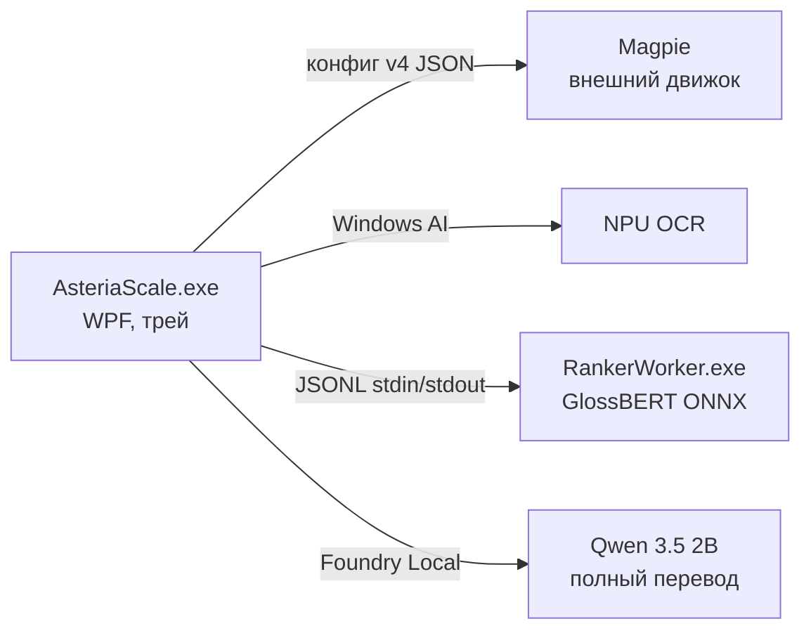

# Архитектура Asteria Scale

Документ описывает устройство проекта для разработчиков и ИИ-агентов. Пользовательское описание — в [README.md](../README.md), исследовательские заметки и калибровка — в [RESEARCH.md](RESEARCH.md).

## Состав решения

| Проект | Назначение |
|---|---|
| `src/AsteriaScale` | WPF-приложение: UI, трей, управление Magpie, OCR, перевод, словари |
| `src/AsteriaScale.RankerProtocol` | Общий JSONL-протокол v2 между приложением и GlossBERT-воркером |
| `src/AsteriaScale.RankerWorker` | Изолированный консольный процесс: GlossBERT на ONNX Runtime (CPU FP32 / AMD Vitis NPU) |
| `tests/AsteriaScale.Tests` | Консольный smoke-набор (без xUnit); gated-режимы по аргументам CLI |
| `scripts/` | Сборка, установка, запуск, генерация словарей (`build-dictionaries.py`) |
| `assets/` | Данные: словари TSV.gz, бенчмарк-наборы ранжировщика |
| `packaging/Identity` | MSIX identity-пакет для Windows AI API |

## Процессная модель

- **Magpie** установлен отдельно (GPLv3) и выполняет захват и HLSL-апскейл. Asteria только редактирует его `config.json` (идемпотентно, с резервной копией `*.before-asteria.json`) и управляет жизненным циклом — см. `MagpieConfigEditor`, `MagpieEngineService`.
- **RankerWorker** — дочерний процесс со строгим протоколом (см. ниже). Изоляция позволяет полностью вернуть память модели при выгрузке.
- **Qwen** хостится через Foundry Local; используется только для полного нейросетевого и экранного перевода (`FoundryTranslationService`).

## Конвейер hover-перевода

`HoverTranslationService` — оркестратор. Таймер 90 мс следит за курсором; при стабильности позиции (радиус 15 px, задержка 350–1500 мс) запускается распознавание и перевод. Четыре режима: `Smart`, `Dictionary`, `Neural`, `Screen`.

### Режим «Умный словарь» (порядок этапов)

1. `LocalDictionaryService.LookupWithSenseMetadataAsync` — словарный поиск + sense-метаданные.
2. Фраза или кураторская запись → показывается сразу, модель не запускается.
3. `SmartDictionaryHeuristicRanker.TrySelectFromContextTranslation` — точное Tatoeba-предложение с однозначным выравниванием.
4. `SmartDictionarySenseResolver.GroupCandidates` — группировка смыслов: слияние почти эквивалентных определений, fail-open POS-фильтр (порог уверенности 0.9).
5. `CreateRankerPlan` — морфология и регистр решаются заранее; смыслы с одинаковым видимым русским результатом объединяются в один outcome (**GroupId == индекс в visibleTranslations**).
6. Один видимый результат → без модели. Иначе `SmartDictionaryHeuristicRanker.TrySelect` — детерминированные правила (past-agreement, вид глагола, семантические cue-правила, POS).
7. `SmartDictionaryResultCache` — persistent LRU; ключи SHA-256, исходный текст на диск не пишется.
8. GlossBERT-воркер: принимает решение только при margin ≥ 0.25 между **группами**, иначе воздержание — пользователю показываются словарные варианты.
9. `SelectSurfaceForm` — выбор русской поверхностной формы выбранного смысла (согласование прошедшего времени, вид, безопасный регистр, стабильный порядок источника). Модель никогда не выбирает форму — только смысл.

Fallback на полный перевод Qwen возможен **только** при отсутствии записи или ошибке ранжировщика и **только** в явно выбранном пользователем режиме `Автоматически` (или по Alt+Shift+D в режиме «по команде»).

## Структура словарей

`LocalDictionaryService` загружает слои из двух каталогов: `<exe>/Dictionaries` (bundled) и `%LOCALAPPDATA%\AsteriaScale\Dictionaries` (пользовательские, высший приоритет).

Приоритет слоёв (первый выигрывает; broad-слои объединяются):

1. **Пользовательские** `eng-rus*.tsv(.gz)` / `jpn-rus*.tsv(.gz)` — авторитетны, перекрывают всё.
2. **Кураторский VN** (`*-vn.*`) — перекрывает broad-слои.
3. **Broad-слои** (FreeDict, ru-Wiktionary, en-Wiktionary) — значения **объединяются** в стабильном порядке источника (`MergeBundledMeanings`, лимиты 32 значения / 4 КБ).
4. **Диалоговый слой** (`*-dialogue.*`, Tatoeba) — целые предложения, отдельное множество `_dialogueEnglishSentences`; не участвует во фразовом поиске, служит контекстом и sentence-fallback.

Sense-метаданные (`eng-rus*-senses.tsv.gz`) — ленивый sidecar только для умного режима: перевод + английское определение + регистр + часть речи. Ключи, покрытые пользовательским/кураторским слоем, из sidecar исключаются.

Формат TSV и источники данных: [assets/Dictionaries/README.md](../assets/Dictionaries/README.md). Регенерация: `scripts/build-dictionaries.py`.

## Инварианты (нарушать нельзя)

1. **Каноническая форма ключей.** Все ключи всех слоёв нормализуются при загрузке той же функцией, что и ключи поиска (`NormalizeEnglish`: lowercase, `’`→`'`, схлопывание пробелов; `NormalizeJapanese`: только японские символы). Python-генератор (`normalize_english`) обязан давать ту же форму. Ключ предложения — токены через пробел без пунктуации (`NormalizeEnglishSentenceKey`), в точности как в генераторе.
2. **GroupId == индекс.** `CreateRankerPlan` нумерует outcomes последовательно; `visibleTranslations` упорядочены по GroupId; кэш валидирует индекс против кандидатов. Дедупликация в трёх местах (resolver `NormalizeRussianSurface`, кэш `NormalizeCandidate`, воркер `GroupScores`) должна оставаться согласованной.
3. **Никакого тихого fallback провайдера.** Запрос NPU исполняется на NPU или падает с ошибкой; воркер обязан вернуть заявленные provider/device/model, хост валидирует (`ValidateResponse`). Несовместимый драйвер → словарный результат, выбор CPU — только явный.
4. **Воздержание только по margin.** Порог `0.25` заморожен по dev-набору; менять его или критерии принятия решения можно только после прогона `--ranker-benchmark` (см. [RESEARCH.md](RESEARCH.md)).
5. **Fail-open POS-фильтр.** Фильтр не применяется, если оставляет < 2 групп или не меняет состав; неполные метаданные не могут стереть все смыслы.
6. **Дисциплина IPC.** После записи запроса в stdin воркера транзакция не отменяется: ровно один ответ вычитывается из stdout, иначе следующий запрос получит чужой ответ. Ошибка протокола → kill всего дерева процесса. stderr дренируется отдельно и никогда не смешивается с JSONL.
7. **Замороженные наборы.** `ranker-holdout*.json` не используются при подборе модели, порога, промтов или группировки — только для финального подтверждения; каждое открытие фиксируется в RESEARCH.md.
8. **Хеши артефактов.** Размеры и SHA-256 модели закреплены в `RankerEngine.cs` и `assets/Ranker/README.md`; воркер отказывается работать с несовпадающими файлами.

## Общие лингвистические модули

`EnglishContextLexicon` (служебные слова, неправильные глаголы с леммами, `IsLikelyPastForm`, токенизация) и `RussianMorphology` (прошедшие формы, инфинитив, семельфактив). POS-инференс **сознательно раздельный**: `SmartDictionaryHeuristicRanker` выбирает финальный ответ и должен быть узким; `SmartDictionarySenseResolver` только фильтрует кандидатов для модели и может быть шире. Не объединяйте их «для чистоты».

## Данные на машине пользователя

| Что | Где |
|---|---|
| Настройки | `%LOCALAPPDATA%\AsteriaScale\settings.json` |
| Журнал ошибок перевода | `%LOCALAPPDATA%\AsteriaScale\hover-translation.log` (ротация при 512 КБ) |
| Кэш умного словаря | `%LOCALAPPDATA%\AsteriaScale\smart-dictionary-cache.v2.json` |
| Пользовательские словари | `%LOCALAPPDATA%\AsteriaScale\Dictionaries` |
| Конфиг Magpie | `%LOCALAPPDATA%\Magpie\config\v4\config.json` (+ backup `.before-asteria.json`) |
