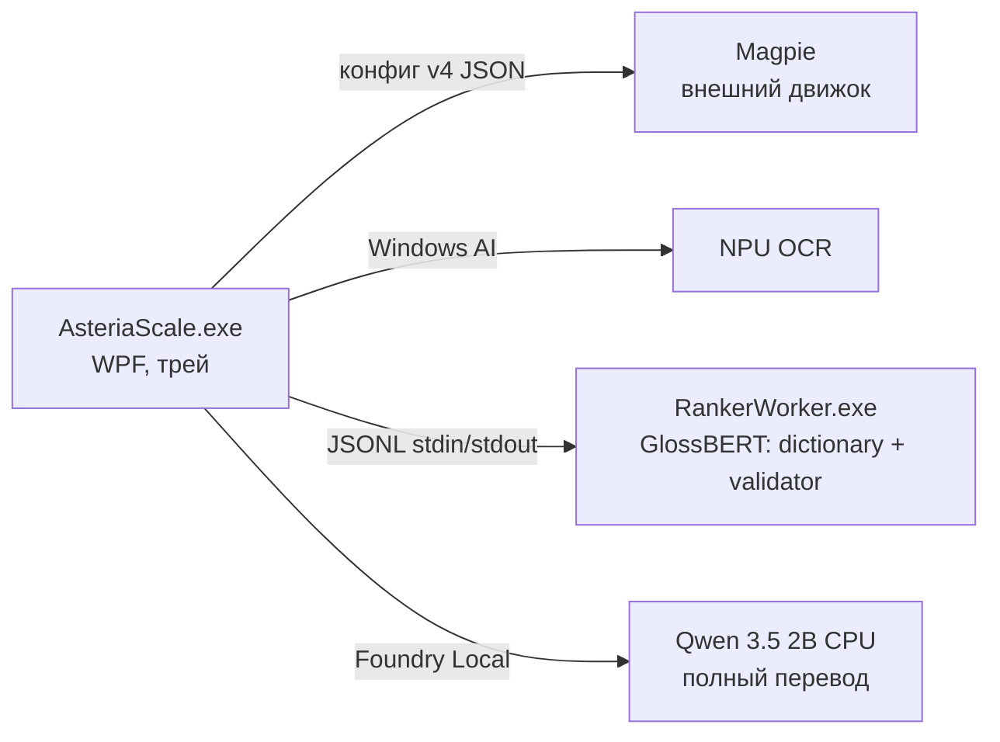

# Архитектура Asteria Scale

Документ описывает устройство проекта для разработчиков и ИИ-агентов. Пользовательское описание — в [README.md](../README.md), исследовательские заметки и калибровка — в [RESEARCH.md](RESEARCH.md).

## Состав решения

| Проект | Назначение |
|---|---|
| `src/AsteriaScale` | WPF-приложение: UI, трей, управление Magpie, OCR, перевод, словари |
| `src/AsteriaScale.RankerProtocol` | Общий JSONL-протокол v2 между приложением и GlossBERT-воркером |
| `src/AsteriaScale.RankerWorker` | Изолированный консольный процесс: GlossBERT для умного словаря и EN semantic validator на ONNX Runtime (CPU FP32 / AMD Vitis NPU) |
| `tests/AsteriaScale.Tests` | Консольный smoke-набор (без xUnit); gated-режимы по аргументам CLI |
| `scripts/` | Сборка, установка, запуск, генерация словарей (`build-dictionaries.py`) |
| `assets/` | Данные: словари TSV.gz, бенчмарк-наборы ранжировщика |
| `packaging/Identity` | MSIX identity-пакет для Windows AI API |

## Процессная модель

- **Magpie** установлен отдельно (GPLv3) и выполняет захват и HLSL-апскейл. Asteria только редактирует его `config.json` (идемпотентно, с резервной копией `*.before-asteria.json`) и управляет жизненным циклом — см. `MagpieConfigEditor`, `MagpieEngineService`.
- **RankerWorker** — дочерний процесс со строгим протоколом (см. ниже). Изоляция позволяет полностью вернуть память модели при выгрузке.
- **Qwen** хостится через Foundry Local; используется только для полного нейросетевого и экранного перевода (`FoundryTranslationService`). До исправления конфликта execution-provider-ов в Foundry 0.10.2 закреплён точный CPU-вариант `qwen3.5-2b-text-generic-cpu:1`; автоматического fallback на другой провайдер нет.

## Конвейер hover-перевода

`HoverTranslationService` — оркестратор. Таймер 90 мс следит за курсором; при стабильности позиции (радиус 15 px, задержка 350–1500 мс) запускается распознавание и перевод. Четыре режима: `Smart`, `Dictionary`, `Neural`, `Screen`.

### Режим «Умный словарь» (порядок этапов)

1. `LocalDictionaryService.LookupWithSenseMetadataAsync` — словарный поиск + sense-метаданные.
2. Trusted user/VN-hard фраза и однозначная broad-фраза → показываются сразу;
   неоднозначная broad-фраза и VN-soft со sense-метаданными остаются в обычном
   пути разрешения многозначности.
3. `SmartDictionaryHeuristicRanker.TrySelectFromContextTranslation` — точное Tatoeba-предложение с однозначным выравниванием.
4. `SmartDictionarySenseResolver.GroupCandidates` — группировка смыслов: слияние почти эквивалентных определений, fail-open POS-фильтр (порог уверенности 0.9).
5. `CreateRankerPlan` — морфология и регистр решаются заранее; смыслы с одинаковым видимым русским результатом объединяются в один outcome (**GroupId == индекс в visibleTranslations**).
6. Один видимый результат → без модели. Иначе `SmartDictionaryHeuristicRanker.TrySelect` — детерминированные правила (past-agreement, вид глагола, семантические cue-правила, POS).
7. `SmartDictionaryResultCache` — persistent LRU; ключи SHA-256, исходный текст на диск не пишется.
8. GlossBERT-воркер: принимает решение только при margin ≥ 0.25 между **группами**, иначе воздержание — пользователю показываются словарные варианты.
9. `SelectSurfaceForm` — выбор русской поверхностной формы выбранного смысла:
   сначала пригодность поверхности, затем согласование прошедшего времени, вид,
   безопасный регистр и стабильный порядок источника. Повреждённая или
   mixed-script поверхность не может победить чистую только из-за источника.
   Модель никогда не выбирает форму — только смысл.

Fallback на полный перевод Qwen возможен **только** при отсутствии записи или ошибке ранжировщика и **только** в явно выбранном пользователем режиме `Автоматически` (или по Alt+Shift+D в режиме «по команде»).

## Конвейер полного перевода

`TranslationScaffoldBuilder` используется во **всех английских full-text
маршрутах**: обычном `Neural`, автоматическом и ручном полном fallback режима
`Smart`, а также пакетном `Screen`. Text-hook лишь улучшает источник реплики и
дальше входит в те же маршруты. Японский каркас остаётся пустым до реализации
японского smart-словаря из roadmap №9.

Построитель просматривает всю английскую реплику: каждый контентный токен
ищется вместе с пересекающими его MWE, отдельно проверяется полное предложение
Tatoeba/MASSIVE и отдельная карта scaffold-only. Это широкий **поиск
кандидатов**, но не пословная сборка перевода.
Обязательный `ScaffoldTerm` создаётся только детерминированно: из
пользовательских записей, явно размеченных scaffold-only якорей, совместимого
sentence-выравнивания или контекстной эвристики с confidence не ниже `0.95`.
VN-hard сам по себе управляет карточкой и residual repair, но не получает
mandatory confidence. Более низкая полоса
`0.90–0.94` дала ложные обязательные смыслы (`saw → пилить`, `fifth → квинта`)
и потому не используется; одиночное значение шумного broad-слоя без
контекстного подтверждения также не навязывается модели.

Оставшиеся неоднозначные планы последовательно получает GlossBERT. Его
margin-only решение при `margin >= 0.25` сопоставляется по исходному `GroupId`
и сохраняется как `ScaffoldSenseHint`: исходное английское слово, английское
определение выбранного смысла, выбранная и все отвергнутые русские поверхности.
Это данные для консервативной семантической проверки, **не обязательный термин
Qwen**. Воздержание не создаёт подсказку и не считается ошибкой.

`TranslationScaffoldGlossBertRanker` использует один внешний worker, которым
владеет hover-сервис. Провайдер выбирается явно; worker и точная модель
валидируются до чтения кэша, скрытого CPU/NPU fallback нет. Ключ решения
учитывает провайдер, идентичность модели, версию словаря, предложение, цель,
позицию, outcomes, определения и `GroupId`. Кэшируются принятые решения и
воздержания; ошибки не кэшируются. В batch запросы выполняются последовательно
из-за JSONL/IPC-контракта и используют общий на операцию circuit: первая ошибка
ранжировщика отключает neural-часть для оставшихся реплик, но детерминированный
каркас и Qwen продолжают работать.

Все разрушительные выгрузки Qwen, словарей и общего GlossBERT-worker проходят
через `ModelActivityGate`. Maintenance lease атомарно ждёт завершения текущего
перевода и не допускает новый до стабилизации всех владельцев. Владельцы
выгружаются независимо: ошибка одного не пропускает очистку остальных.

Дальше `FoundryTranslationService` действует так:

1. доверенный совместимый exact dialogue из Tatoeba/MASSIVE возвращается до запуска
   Qwen. Он обязан не конфликтовать с детерминированными авторитетными
   терминами; neural sense hints bypass не запрещают;
2. первый prompt Qwen содержит **только детерминированный каркас** конкретной
   реплики. `ScaffoldSenseHint` в первый запрос не попадает, поэтому GlossBERT
   не диктует русскую формулировку генеративной модели;
3. очищенный ответ проходит residual-English guard, проверку обязательных
   терминов и `NeuralSenseFidelityGuard`. Явная отвергнутая русская поверхность
   при отсутствии любой выбранной поверхности того же source — только
   **prefilter для semantic review**, а не доказательство ошибки. Выбранная
   поверхность сопоставляется широко лишь для подавления лишнего review, а
   отвергнутая — по консервативным закрытым парадигмам: общий префикс вроде
   `память` / `памятник` не создаёт конфликт;
4. если mandatory-термины соблюдены, для сработавшего prefilter разрешён ровно
   один structured review той же Qwen. Все служебные инструкции написаны на
   английском; prompt содержит English source, предыдущий русский перевод,
   детерминированную таблицу терминов и английские определения как
   **неавторитетные гипотезы**. Выбранные и отвергнутые neural-поверхности в
   него не попадают. Ответ обязан быть `KEEP` (естественный
   синоним/словоформа либо неподходящая GlossBERT-гипотеза) или
   `FIX|<исправленный перевод>`;
5. если пропущен mandatory-термин, semantic review не совмещается с его
   исправлением: единственный дополнительный вызов остаётся прежним
   deterministic fidelity retry, после чего sense-prefilter пересчитывается
   только для диагностики и выбора результата;
6. кандидат `FIX` или deterministic retry заменяет первый ответ только при
   строгом лексикографическом улучшении пары `(число пропущенных
   mandatory-терминов, число неразрешённых sense-флагов)`. Ухудшение первого
   компонента запрещено; при равенстве обязан уменьшиться второй. Для semantic
   review сама Qwen является окончательным смысловым арбитром: валидный
   `FIX|...` по протоколу снимает flag, но только если очищенный перевод
   содержательно отличается от первого. `KEEP` сохраняет первый ответ. Пустой,
   невалидный или повторяющий prompt ответ никогда его не заменяет и не
   кэшируется, поэтому следующая встреча реплики сможет повторить review;
7. ключ финального кэша включает режим, `LocalDictionaryService.VersionToken`,
   exact dialogue, детерминированные terms и neural sense hints, поэтому смена
   словаря или смысла не оставляет старый перевод. В кэш попадает только ответ,
   прошедший mandatory-проверку и semantic adjudication.

Ошибка построения каркаса всегда fail-open к пустому каркасу; настоящая отмена
не проглатывается. Приоритет словарных слоёв сохраняется и для exact sentence:
низкоприоритетная реплика не может обойти конфликтующий пользовательский или
scaffold-only термин.

## Структура словарей

`LocalDictionaryService` загружает слои из двух каталогов: `<exe>/Dictionaries` (bundled) и `%LOCALAPPDATA%\AsteriaScale\Dictionaries` (пользовательские, высший приоритет).

Приоритет слоёв (первый выигрывает; broad-слои объединяются):

1. **Пользовательские** `eng-rus*.tsv(.gz)` / `jpn-rus*.tsv(.gz)` — авторитетны, перекрывают всё.
2. **VN-hard** (`*-vn.tsv(.gz)`) — небольшой display-safe слой, перекрывающий
   broad-слои и разрешённый для residual-English repair. Сам факт нахождения
   записи здесь больше не превращает её в обязательный термин полного перевода.
3. **Broad-слои** (FreeDict, ru-Wiktionary, en-Wiktionary и `*-vn-soft.*`) —
   значения **объединяются** в стабильном порядке источника
   (`MergeBundledMeanings`, лимиты 32 значения / 4 КБ). VN-soft остаётся
   доступным sense-sidecar и GlossBERT.
4. **Scaffold-only** (`*-scaffold.*`) — отдельная карта проверенных терминов
   полного перевода. Эти строки не попадают в карточку «Умного словаря»,
   residual repair или обычный фразовый поиск.
5. **Диалоговый слой** (`*-dialogue.*`, Tatoeba/MASSIVE) — целые предложения,
   отдельное множество `_dialogueEnglishSentences`; не участвует во фразовом
   поиске, служит контекстом и sentence-fallback.

Sense-метаданные (`eng-rus*-senses.tsv.gz`) — ленивый sidecar для умного словаря
и EN full-text scaffold: перевод + английское определение + регистр + часть речи.
Из sidecar исключаются только пользовательские и VN-hard ключи; VN-soft специально
не получает preferred-флаг и дополняет общий инвентарь смыслов.

Формат TSV и источники данных: [assets/Dictionaries/README.md](../assets/Dictionaries/README.md). Регенерация: `scripts/build-dictionaries.py`.

## Инварианты (нарушать нельзя)

1. **Каноническая форма ключей.** Все ключи всех слоёв нормализуются при загрузке той же функцией, что и ключи поиска (`NormalizeEnglish`: NFC, invariant lowercase с закреплёнными expanding folds, `’`→`'`, схлопывание пробелов и удаление только внешней display-пунктуации; внутренние цифры и пунктуация сохраняются; `NormalizeJapanese`: только японские символы). Python-генератор (`normalize_english`) обязан давать ту же форму. Ключ предложения — отдельная token-only форма без пунктуации и цифр (`NormalizeEnglishSentenceKey` / `normalize_english_sentence_key`), в точности как в генераторе.
2. **GroupId == индекс.** `CreateRankerPlan` нумерует outcomes последовательно; `visibleTranslations` упорядочены по GroupId; кэш валидирует индекс против кандидатов. Дедупликация в трёх местах (resolver `NormalizeRussianSurface`, кэш `NormalizeCandidate`, воркер `GroupScores`) должна оставаться согласованной.
3. **Никакого тихого fallback провайдера.** Запрос NPU исполняется на NPU или падает с ошибкой; воркер обязан вернуть заявленные provider/device/model, хост валидирует (`ValidateResponse`). Несовместимый драйвер → словарный результат, выбор CPU — только явный.
4. **Воздержание только по margin.** Порог `0.25` заморожен по dev-набору; менять его или критерии принятия решения можно только после прогона `--ranker-benchmark` (см. [RESEARCH.md](RESEARCH.md)).
5. **Fail-open POS-фильтр.** Фильтр не применяется, если оставляет < 2 групп или не меняет состав; неполные метаданные не могут стереть все смыслы.
6. **Дисциплина IPC.** После записи запроса в stdin воркера транзакция не отменяется: ровно один ответ вычитывается из stdout, иначе следующий запрос получит чужой ответ. Ошибка протокола → kill всего дерева процесса. stderr дренируется отдельно и никогда не смешивается с JSONL.
7. **Замороженные наборы.** `ranker-holdout*.json` не используются при подборе модели, порога, промтов или группировки — только для финального подтверждения; каждое открытие фиксируется в RESEARCH.md.
8. **Хеши артефактов.** Размеры и SHA-256 модели закреплены в `RankerEngine.cs` и `assets/Ranker/README.md`; воркер отказывается работать с несовпадающими файлами.

## Общие лингвистические модули

`EnglishContextLexicon` (служебные слова, неправильные глаголы с леммами, `IsLikelyPastForm`, токенизация) и `RussianMorphology` (прошедшие формы, инфинитив, семельфактив). POS-инференс **сознательно раздельный**: `SmartDictionaryHeuristicRanker` выбирает финальный ответ и должен быть узким; `SmartDictionarySenseResolver` только фильтрует кандидатов для модели и может быть шире. Не объединяйте их «для чистоты».

## Данные на машине пользователя

| Что | Где |
|---|---|
| Настройки | `%LOCALAPPDATA%\AsteriaScale\settings.json` |
| Журнал ошибок перевода | `%LOCALAPPDATA%\AsteriaScale\hover-translation.log` (ротация при 512 КБ) |
| Кэш умного словаря | `%LOCALAPPDATA%\AsteriaScale\smart-dictionary-cache.v2.json` |
| Пользовательские словари | `%LOCALAPPDATA%\AsteriaScale\Dictionaries` |
| Конфиг Magpie | `%LOCALAPPDATA%\Magpie\config\v4\config.json` (+ backup `.before-asteria.json`) |
| DPI override игр | `HKCU\Software\Microsoft\Windows NT\CurrentVersion\AppCompatFlags\Layers`; точные значения до изменения — в `settings.json` |

`DpiCompatibilityService` применяет стандартный per-app флаг `HIGHDPIAWARE`
только к выбранному игровому EXE. Перед записью он сохраняет полное прежнее
значение compatibility layers, удаляет конфликтующие `DPIUNAWARE` /
`GDIDPISCALING` и сохраняет остальные флаги. Откат разрешён только при точном
совпадении текущего значения с записанным Asteria: внешние изменения никогда
не затираются. Уже существующий ручной override распознаётся как внешний и не
переходит под управление приложения.
