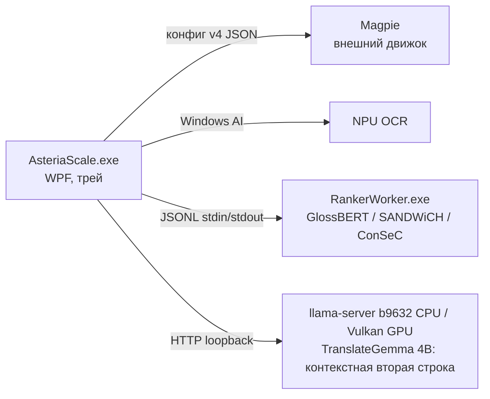

# Архитектура Asteria Scale

Документ описывает устройство проекта для разработчиков и ИИ-агентов. Пользовательское описание — в [README.md](../README.md), исследовательские заметки и калибровка — в [RESEARCH.md](RESEARCH.md).

## Состав решения

| Проект | Назначение |
|---|---|
| `src/AsteriaScale` | WPF-приложение: UI, трей, управление Magpie, OCR, перевод, словари |
| `src/AsteriaScale.RankerProtocol` | Общий JSONL-протокол v4 между приложением и definition-aware ranker-воркером |
| `src/AsteriaScale.RankerWorker` | Изолированный консольный процесс: GlossBERT, SANDWiCH или ConSeC для умного словаря и EN semantic evidence на ONNX Runtime |
| `tests/AsteriaScale.Tests` | Консольный smoke-набор (без xUnit); gated-режимы по аргументам CLI |
| `scripts/` | Сборка, установка, запуск, генерация словарей (`build-dictionaries.py`) |
| `assets/` | Данные: словари TSV.gz, бенчмарк-наборы ранжировщика |
| `packaging/Identity` | MSIX identity-пакет для Windows AI API |

## Процессная модель

- **Magpie** установлен отдельно (GPLv3) и выполняет захват и HLSL-апскейл. Asteria только редактирует его `config.json` (идемпотентно, с резервной копией `*.before-asteria.json`) и управляет жизненным циклом — см. `MagpieConfigEditor`, `MagpieEngineService`.
- **RankerWorker** — дочерний процесс со строгим протоколом (см. ниже).
  Стабильный профиль по умолчанию — закреплённый GlossBERT; готовый dual-encoder
  SANDWiCH и independent ConSeC доступны как явно выбираемые экспериментальные
  CPU-профили. UI называет ConSeC `ConSeC — лучший для науки, CPU` по результату
  открытого sentence-бенчмарка. Профиль модели и execution provider — разные
  настройки: SANDWiCH и ConSeC не имеют NPU-варианта, поэтому их выбор явно
  переводит ranker на CPU, а не маскирует fallback. Изоляция позволяет полностью
  вернуть память модели при выгрузке.
- **TranslateGemma 4B** — выключенный по умолчанию экспериментальный переводчик
  текущего EN→RU-предложения во второй строке «Умного словаря». Он не меняет
  основной словарный результат или решение semantic ranker, но его отдельный post-edit
  может читать принятый смысл и скрытую историю Textractor.
  `TranslateGemmaTranslationService`
  владеет отдельным `llama-server` b9632, слушающим только loopback с
  одноразовым API-ключом. Backend выбирается явно и является частью runtime/model
  identity: CPU использует закреплённую CPU-сборку с `--n-gpu-layers 0`, а
  Vulkan — отдельную закреплённую сборку с `--device Vulkan0`, полным offload и
  отключённым автоматическим fit. Успешный `/health` сам по себе не доказывает
  GPU-исполнение: Vulkan-путь дополнительно проверяет выбранный Vulkan0 device и полный
  offload `35/35`. Ошибка Vulkan не запускает CPU — основной словарный результат
  остаётся рабочим, а независимая строка деградирует явно.
  Модель и runner не входят в публикацию и устанавливаются отдельно после
  явного принятия Gemma Terms.

## Конвейер hover-перевода

`HoverTranslationService` — оркестратор. Таймер 90 мс следит за курсором; при стабильности позиции (радиус 15 px, задержка 350–1500 мс) запускается распознавание и перевод. Пользовательский UI и runtime поддерживают только `Smart` и `Dictionary`; сохранённые старые настройки `Neural`/`Screen` при загрузке мигрируют в `Smart`, но соответствующих маршрутов больше нет.

### Режим «Умный словарь» (порядок этапов)

1. `LocalDictionaryService.LookupWithSenseMetadataAsync` — словарный поиск + sense-метаданные.
2. Trusted user/VN-hard фраза и однозначная broad-фраза → показываются сразу;
   неоднозначная broad-фраза и VN-soft со sense-метаданными остаются в обычном
   пути разрешения многозначности.
3. `SmartDictionaryHeuristicRanker.TrySelectFromContextTranslation` — точное Tatoeba-предложение с однозначным выравниванием.
4. `SmartDictionarySenseResolver.GroupCandidates` — группировка смыслов: слияние почти эквивалентных определений, fail-open POS-фильтр (порог уверенности 0.9).
5. `CreateRankerPlan` — морфология и регистр решаются заранее; смыслы с одинаковым видимым русским результатом объединяются в один outcome (**GroupId == индекс в visibleTranslations**).
6. Один видимый результат → без модели. Иначе `SmartDictionaryHeuristicRanker.TrySelect` — детерминированные правила (past-agreement, вид глагола, семантические cue-правила, POS).
7. `SmartDictionaryResultCache` — persistent LRU; ключи SHA-256, исходный текст на диск не пишется.
   Ключ описывает **ровно тот контекст, который получает выбранная модель**.
   Для GlossBERT/SANDWiCH и ключ, и вход воркера строит один
   `TargetCenteredContextBuilder` (роадмап №14.2B); для ConSeC ключ содержит
   точное неизменённое предложение и канонический индекс цели, потому что его
   sentence input размечает уже worker.
   Раньше ключ был уже входа (окно ±5 слов против всей строки), из-за чего две
   разные реплики с общим ближайшим окружением переиспользовали одно решение;
   этот размен снят. «Далёкий» контекст теперь определяется token budget,
   а не произвольным радиусом: то, что модель физически не видит, ключ не
   разделяет.
8. `GlossBertDecisionCache` — исторически названный, но **общий и
   provider-neutral** persistent LRU обоих потребителей
   воркера (hover и полнотекстовый каркас). В отличие от пункта 7 его ключ —
   точный отпечаток того, что уходит в воркер: провайдер, идентичность модели,
   версия протокола, `VersionToken`, эпоха `SenseRankingEpoch`, предложение,
   цель, **канонизированный** индекс цели, outcomes и glosses с GroupId.
   `characterIndex` приводится к началу того вхождения цели, которое привязал бы
   воркер (`RankerTargetAnchor` в общей protocol-сборке), поэтому позиция
   курсора из hover и начало токена из каркаса попадают в одну запись.
   Для pair-профилей контекст — результат `TargetCenteredContextBuilder`:
   реплика длиннее `MaximumWords` обрезается **симметрично вокруг цели**, а не
   справа. Это защищает от LongestFirst-обрезки в `PairTokenizer`, которая на
   длинной строке могла выбросить сам целевой span вместе с маркерами. ConSeC
   использует отдельный exact-source domain без синтетических кавычек; его
   получает **полное исходное предложение** и не проходит через 32-словное окно.
   Его identity включает `pretokenizer-v3`, `context-full-v1`, sequence cap и
   явный anchor index, так
   что кэши разных preprocessing-контрактов не пересекаются.
   Кэшируются принятые решения и воздержания; ошибки — никогда. Попадание
   пропускает инференс, но **не** валидацию провайдера и модели: warm-up
   выполняется до чтения кэша.
9. Definition-aware воркер принимает решение только при margin ≥ 0.25 между
   **группами**, иначе воздержание — пользователю показываются словарные варианты.
   GlossBERT размечает точное вхождение цели кавычками и оценивает пары
   context/gloss одним cross-encoder. SANDWiCH использует собственные буквальные
   маркеры `[D] target [D]`, прогоняет каждую пару через официальные `encoder-nv`
   и `encoder-v`, усредняет positive-class probabilities и применяет официальный
   confidence-weighted reducer к уже существующим стабильным GroupId. Поэтому
   инвариант `GroupId == индекс` и единый margin-контракт сохраняются. ConSeC
   получает неизменённое предложение и отдельный канонический индекс target,
   вставляет свои `<d>...</d>`/`DEF_SEP` маркеры внутри worker и возвращает
   `pipeline=consec-independent`. Он не усекает последовательность: длина
   свыше 512 токенов является явной ошибкой, после которой hover безопасно
   сохраняет словарный результат.
10. **Регистр — свойство смысла, а не дефект поверхности** (роадмап №14.2C).
    Метка в sense-sidecar (`груб.`, `жарг.`, `разг.`, `устар.`, `диал.`, `лит.`)
    выводится генератором из тегов **английского** смысла
    (`_kaikki_style_prefix`) и наследуется всеми его переводами, поэтому она
    описывает оригинал. `SenseRegisters.Parse` сводит её к `SenseRegister`
    (сильнейший маркер выигрывает; `перен.` регистром **не** является — это
    семантика, а не резкость). `SelectSurfaceForm` выбирает поверхность по
    **совпадению** с регистром смысла: прежняя политика «безопасной» поверхности
    систематически смягчала источник, а обратный дрейф запрещён так же —
    нейтральный смысл не усиливается.
11. `SelectSurfaceForm` — выбор русской поверхностной формы выбранного смысла:
   сначала пригодность поверхности, затем согласование прошедшего времени, вид,
   безопасный регистр и стабильный порядок источника. Повреждённая или
   mixed-script поверхность не может победить чистую только из-за источника.
    Semantic ranker никогда не выбирает форму — только смысл. Независимый переводчик
   следующего пункта показывает отдельную строку и не меняет эту поверхность.
12. После готовности любого английского результата «Умного словаря» основной
    результат **сразу показывается и больше не меняется**. Затем опциональная
    `TranslateGemma 4B` строит независимую по отображению вторую строку. Её запуск не зависит от
    provenance основного результата: допускаются отсутствие словарной записи,
    воздержание или ошибка ranker, trusted/exact-путь, Tatoeba, эвристика,
    единственный outcome и свежий либо кэшированный выбор ранжировщика.

    `SmartPhraseContextBuilder` выделяет **полное предложение** вокруг
    OCR-якоря (1–64 слова, до 1000 символов), не захватывая соседние предложения.
    Переносы визуально обёрнутой OCR-строки не считаются границей. Превышение
    общего бюджета отклоняет всю вторую строку — частичное предложение никогда
    не отправляется модели. При совпавшем text-hook используется текущая строка
    Textractor с тем же якорем. Ведущая отдельная строка имени говорящего или
    bracketed speaker tag отделяется от CURRENT; поэтому однословные VN-неологизмы
    также можно перевести независимо. Затем `SmartPhraseIdiomRewriter` может
    заменить только узко доказанный английский оборот на однозначную английскую
    парафразу, если оборот пересекает hovered target. Сейчас это только закрытый
    шаблон `butter <object-pronoun> up`; буквальные, неполные и неизвестные
    случаи остаются без изменений. `feel off` намеренно остаётся исходным:
    live-проверка показала, что TranslateGemma переводит его естественнее без
    парафразы, а два смысла по-прежнему различает основной словарный lane.
    EN→EN-слой не меняет primary.

    До генерации neural-enabled `TranslationScaffoldBuilder` последовательно
    разрешает до 12 остальных неоднозначных source-форм полного исходного
    предложения. Наведённая цель уже обработана primary lane и не запускает
    повторный inference. При EN→EN idiom rewrite WSD всё равно читает исходный
    `SourcePhrase`, а детерминированные термины — effective `ModelInputPhrase`.
    Принятые sentence-wide смыслы входят в provider-neutral APE evidence.

    Первый raw `/completion` сохраняет точный официальный direct EN→RU prompt
    TranslateGemma: единственный переводимый payload — текущее английское
    предложение либо его детерминированная EN→EN-парафраза. Для длинной реплики,
    скрытого hook-контекста, детерминированных scaffold-терминов, принятого
    semantic sense evidence или отклонённого direct-ответа допускается **ровно один**
    отдельный APE/post-edit запрос. Он получает direct-черновик, до трёх
    предыдущих строк того же PID и точного hook-потока как типизированные
    `context_only` JSON entries; speaker metadata отделена и явно запрещена к
    выводу. Запрос также получает ограниченные смысловые опоры. История и опоры не входят
    в current payload, не показываются и не сканируются как текст для перевода.
    Оба запроса используют один lock и общий 90-секундный бюджет.

    `SmartPhraseTranslationGuard` проверяет общую пригодность второй строки:
    полное исходное и effective-предложение, согласованность transform identity,
    identity модели, размер, русский текст, отсутствие управляющих символов,
    prompt echo обеих английских форм, объяснений и постороннего английского
    кроме устойчивых собственных имён. Один безопасный ведущий маркер списка
    (`1.`/`1)`/bullet) и метка `Перевод:` снимаются до общей проверки. Guard
    дополнительно отклоняет добавленное из истории имя говорящего, внешнюю
    обёртку кавычками, начальное многоточие и частично скопированную английскую
    цитату. Он требует high-confidence deterministic terms и отклоняет
    явную отвергнутую ranker-поверхность при отсутствии выбранной; естественные
    синонимы без отрицательного evidence остаются допустимы.
    Persistent SHA-LRU v4 включает исходное/effective-предложение, упорядоченную
    скрытую историю, semantic plan, identity преобразования, proper names,
    model identity и prompt version; model identity включает выбранный
    CPU/Vulkan backend и профиль offload, поэтому результаты разных runtime не
    пересекаются. Исходный английский текст на диск не записывается.
    Даже cache hit сначала прогревает runtime и проверяет закреплённые
    model/runner artifacts. Ошибка установки, запуска, timeout или отклонение
    guard оставляет основной результат на месте и показывает во второй строке
    «Перевод фразы недоступен»; скрытого генеративного fallback нет.

## Семантические опоры TranslateGemma

`TranslationScaffoldBuilder` и `SemanticSenseEvidenceFactory` используются
только для независимой второй строки TranslateGemma. Построитель просматривает
полное текущее английское предложение, находит доверенные MWE и разрешает до
12 неоднозначных целей через выбранный ranker. Детерминированные термины и
английские определения принятого смысла передаются как ограниченные опоры APE,
но не заменяют исходное предложение и не навязывают готовую русскую
формулировку. Воздержание ranker не считается ошибкой: TranslateGemma получает
исходную реплику без спорной опоры.

Все destructive unload словарей, общего ranker-worker и TranslateGemma
проходят через `ModelActivityGate`. Maintenance lease ждёт завершения текущего
запроса и не допускает остановку worker или `llama-server` посреди нового.
Словари, ranker и TranslateGemma выгружаются независимо; ошибка одного владельца
не пропускает очистку остальных.

## Структура словарей

`LocalDictionaryService` загружает слои из двух каталогов: `<exe>/Dictionaries` (bundled) и `%LOCALAPPDATA%\AsteriaScale\Dictionaries` (пользовательские, высший приоритет).

Приоритет слоёв (первый выигрывает; broad-слои объединяются):

1. **Пользовательские** `eng-rus*.tsv(.gz)` / `jpn-rus*.tsv(.gz)` — авторитетны, перекрывают всё.
2. **VN-hard** (`*-vn.tsv(.gz)`) — небольшой display-safe слой, перекрывающий
   broad-слои и разрешённый для детерминированных опор TranslateGemma. Сам факт
   нахождения записи здесь не превращает её в обязательную русскую формулировку.
3. **Broad-слои** (FreeDict, ru-Wiktionary, en-Wiktionary и `*-vn-soft.*`) —
   значения **объединяются** в стабильном порядке источника
   (`MergeBundledMeanings`, лимиты 32 значения / 4 КБ). VN-soft остаётся
   доступным sense-sidecar и GlossBERT.
   Порядок слияния следует `DictionaryPriority`, поэтому при переполнении
   теряется **хвост — значения самых низкоприоритетных слоёв**. Бюджет слияния
   намеренно больше потолка показа `MaximumDisplayedValueLength` (380): иначе
   `Limit` никогда бы не обрезал значение, не дописывал бы «…», и урезанный
   список выглядел бы для пользователя полным. Для ~1.5 % самых многозначных
   ключей хвост не доходит до карточки — там работает sense-sidecar (роадмап
   №1 «Покрытие sense-sidecar»).
4. **Scaffold-only** (`*-scaffold.*`) — отдельная карта проверенных терминов
   для TranslateGemma APE. Эти строки не попадают в карточку «Умного словаря»,
   residual repair или обычный фразовый поиск.
5. **Диалоговый слой** (`*-dialogue.*`, Tatoeba/MASSIVE) — целые предложения,
   отдельное множество `_dialogueEnglishSentences`; не участвует во фразовом
   поиске, служит контекстом и exact-sentence evidence.

Sense-метаданные (`eng-rus*-senses.tsv.gz`) — ленивый sidecar для умного словаря
и sentence-wide evidence TranslateGemma: перевод + английское определение + регистр + часть речи.
Из sidecar исключаются только пользовательские и VN-hard ключи; VN-soft специально
не получает preferred-флаг и дополняет общий инвентарь смыслов.

Формат TSV и источники данных: [assets/Dictionaries/README.md](../assets/Dictionaries/README.md). Регенерация: `scripts/build-dictionaries.py`.

## Инварианты (нарушать нельзя)

1. **Каноническая форма ключей.** Все ключи всех слоёв нормализуются при загрузке той же функцией, что и ключи поиска (`NormalizeEnglish`: NFC, invariant lowercase с закреплёнными expanding folds, `’`→`'`, схлопывание пробелов и удаление только внешней display-пунктуации; внутренние цифры и пунктуация сохраняются; `NormalizeJapanese`: только японские символы). Python-генератор (`normalize_english`) обязан давать ту же форму. Ключ предложения — отдельная token-only форма без пунктуации и цифр (`NormalizeEnglishSentenceKey` / `normalize_english_sentence_key`), в точности как в генераторе.
2. **GroupId == индекс.** `CreateRankerPlan` нумерует outcomes последовательно; `visibleTranslations` упорядочены по GroupId; кэш валидирует индекс против кандидатов. Дедупликация в трёх местах (resolver `NormalizeRussianSurface`, кэш `NormalizeCandidate`, воркер `GroupScores`) должна оставаться согласованной.
3. **Никакого тихого fallback провайдера.** Запрос NPU исполняется на NPU или падает с ошибкой; воркер обязан вернуть заявленные provider/device/model, хост валидирует (`ValidateResponse`). Несовместимый драйвер → словарный результат, выбор CPU — только явный.
4. **Воздержание только по margin.** Порог `0.25` заморожен по dev-набору; менять его или критерии принятия решения можно только после прогона `--ranker-benchmark` (см. [RESEARCH.md](RESEARCH.md)). Значение объявлено один раз в `RankerAbstention.MarginThreshold` (общая protocol-сборка) и входит в ключи обоих кэшей решений: перекалибровка обязана инвалидировать сохранённые вердикты, иначе воздержания, которые новый порог превратил бы в решения, продолжат читаться с диска.
5. **Fail-open POS-фильтр.** Фильтр не применяется, если оставляет < 2 групп или не меняет состав; неполные метаданные не могут стереть все смыслы.
6. **Дисциплина IPC.** После записи запроса в stdin воркера транзакция не отменяется: ровно один ответ вычитывается из stdout, иначе следующий запрос получит чужой ответ. Ошибка протокола → kill всего дерева процесса. stderr дренируется отдельно и никогда не смешивается с JSONL.
7. **Замороженные наборы.** `ranker-holdout*.json` не используются при подборе модели, порога, промтов или группировки — только для финального подтверждения; каждое открытие фиксируется в RESEARCH.md.
8. **Хеши артефактов.** Размеры и SHA-256 модели закреплены в `RankerEngine.cs` и `assets/Ranker/README.md`; воркер отказывается работать с несовпадающими файлами.

## Общие лингвистические модули

`EnglishContextLexicon` (служебные слова, неправильные глаголы с леммами, `IsLikelyPastForm`, токенизация) и `RussianMorphology` (прошедшие формы, инфинитив, семельфактив). POS-инференс **сознательно раздельный**: `SmartDictionaryHeuristicRanker` выбирает финальный ответ и должен быть узким; `SmartDictionarySenseResolver` только фильтрует кандидатов для модели и может быть шире. Не объединяйте их «для чистоты».

## Данные на машине пользователя

| Что | Где |
|---|---|
| Настройки | `%LOCALAPPDATA%\AsteriaScale\settings.json` |
| Журнал ошибок перевода | `%LOCALAPPDATA%\AsteriaScale\hover-translation.log` (ротация при 512 КБ) |
| Кэш умного словаря | `%LOCALAPPDATA%\AsteriaScale\smart-dictionary-cache.v2.json` |
| Общий кэш решений semantic ranker (историческое имя файла) | `%LOCALAPPDATA%\AsteriaScale\glossbert-decisions.v1.json` |
| Кэш принятых предложений TranslateGemma | `%LOCALAPPDATA%\AsteriaScale\smart-phrase-translations.v4.json` |
| Опциональные TranslateGemma/llama.cpp artifacts | `%LOCALAPPDATA%\AsteriaScale\Models\TranslateGemma` |
| Пользовательские словари | `%LOCALAPPDATA%\AsteriaScale\Dictionaries` |
| Конфиг Magpie | `%LOCALAPPDATA%\Magpie\config\v4\config.json` (+ backup `.before-asteria.json`) |
| DPI override игр | `HKCU\Software\Microsoft\Windows NT\CurrentVersion\AppCompatFlags\Layers`; точные значения до изменения — в `settings.json` |

`DpiCompatibilityService` применяет стандартный per-app флаг `HIGHDPIAWARE`
только к выбранному игровому EXE. Перед записью он сохраняет полное прежнее
значение compatibility layers, удаляет конфликтующие `DPIUNAWARE` /
`GDIDPISCALING` и сохраняет остальные флаги. Откат разрешён только при точном
совпадении текущего значения с записанным Asteria: внешние изменения никогда
не затираются. Уже существующий ручной override распознаётся как внешний и не
переходит под управление приложения.
