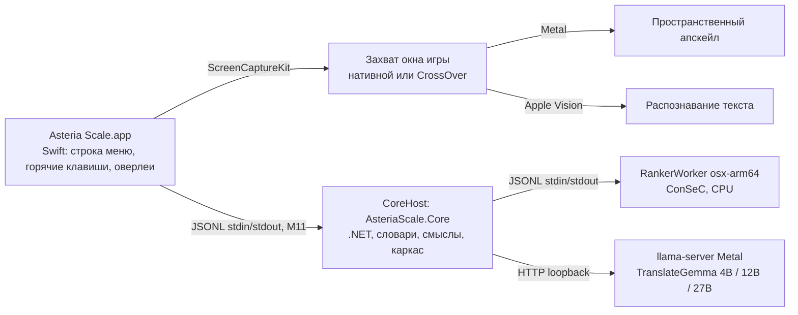

# macOS-версия Asteria Scale

Решения владельца по macOS-версии и то, что из них следует. Статус работ живёт
только в таблице «Трек III» [ROADMAP.md](ROADMAP.md) (карточка №20); здесь —
решения, предпосылки и открытые вопросы. Новое решение владельца добавляется в
таблицу «Принятые решения» с датой; пересмотр старого решения не стирает его, а
помечается новой строкой.

Машина разработки: Apple M4 Pro, 24 ГБ объединённой памяти, macOS 27, `osx-arm64`.

## Принятые решения

| # | Дата | Решение |
|---|---|---|
| M1 | 2026-11-09 | Приложение для macOS пишется **заново**, а не портируется с WPF-хоста `src/AsteriaScale`. |
| M2 | 2026-11-09 | Приложение — **нативное Swift**. Цель — качество нативного macOS-приложения, а не минимальный порт. |
| M3 | 2026-11-09 | Состав приложения: **апскейл окна игры, распознавание текста Apple Vision, значок в строке меню (аналог трея), глобальные горячие клавиши, оверлеи**. |
| M4 | 2026-11-09 | Апскейл обязан корректно работать с **играми, запущенными через CrossOver**, включая оба режима бутылки: **низкое разрешение и высокое разрешение** (High Resolution Mode). Это отдельные режимы со своими проверками, а не частный случай. |
| M5 | 2026-11-09 | **Textractor и любой text-hook на macOS не делаются.** Единственный источник текста — Apple Vision: решение универсально для любых движков, нативных и запущенных через CrossOver. |
| M6 | 2026-11-09 | TranslateGemma — в **трёх вариантах: 4B, 12B и 27B**, под разный объём памяти. |
| M7 | 2026-11-09 | Ранжировщик смыслов на macOS — существующий воркер `AsteriaScale.RankerWorker`, собранный под `osx-arm64`, на CPU, с моделью ConSeC. Бандл ConSeC — локальный бандл владельца (CC BY-NC-SA 4.0): в git, релизы и публичные хранилища не попадает. |
| M8 | 2026-11-09 | Три варианта TranslateGemma (M6) — **для обеих платформ**: Windows-версия тоже получает 12B и 27B. Общая часть и Windows — карточка №21 [ROADMAP.md](ROADMAP.md), macOS — №20.5. |
| M9 | 2026-11-09 | Апскейл на macOS — **того же качества, что на Windows**: качественный нейросетевой апскейл, как в Magpie (уровень пресетов Windows-версии на CuNNy2 и Anime4K), а не только простые фильтры. Спектр пресетов повторяет Windows-версию, включая быстрые (FSR EASU → RCAS) и пиксельные (xBRZ). |
| M10 | 2026-11-09 | Полный прогон Windows-сборки и smoke-набора на Windows владелец делает **после того, как macOS-сборка будет реализована полностью** (Трек III), а не после каждого этапа. До этого неизменность Windows-сборки при каждой правке общих исходников доказывается `tools/macos/check-windows-identity.sh`, а этапы Трека III сливаются в `main` по результатам проверки на macOS. |
| M11 | 2026-11-09 | Ответ на Q1: **ядро работает отдельным .NET-процессом** (CoreHost) со строгим протоколом JSONL поверх stdin/stdout — по образцу ranker-воркера и правила 6: ровно один ответ на запрос, stderr только для диагностики. Swift-приложение запускает его в собственной группе процессов и перезапускает при сбое или зависании; CoreHost сам запускает ranker-воркер и llama-server. Сейчас CoreHost собирается JIT, NativeAOT-сборка того же CoreHost — позже, когда JSON ядра перейдёт на source generation. NativeAOT-библиотека внутри приложения отвергнута. |
| M12 | 2026-11-09 | **Ядро меняется сразу**, без ожидания прогона на Windows: переносимая оркестрация наведения выносится из `HoverTranslationService` в ядро, и WPF-хост переводится на неё; швы ядра (путь воркера, каталоги данных и моделей, метки происхождения результата) делаются сейчас. Такие правки меняют Windows-код до прогона по M10, поэтому каждая обязана кросс-собираться на macOS и попадает в список «Windows-изменения до прогона на Windows» ниже. |

## Предпосылки и следствия действующих правил

Эти пункты не являются новыми решениями: они следуют из
[AGENTS.md](../AGENTS.md), [ARCHITECTURE.md](ARCHITECTURE.md) или из решений
выше и действуют без отдельного обсуждения.

- **Ядро переиспользуется.** `AsteriaScale.Core` и `AsteriaScale.RankerProtocol`
  выделены как платформенно-нейтральные (`net10.0`, без RID) именно ради этой
  версии; на macOS они уже собираются без изменений. Swift-приложение — новый
  хост поверх них, а не замена ядра. Как Swift вызывает C#-ядро — открытый
  вопрос Q1.
- **Windows-имена бинарников приходят от хоста.** Путь
  `Ranker/AsteriaScale.RankerWorker.exe` и архивы llama.cpp
  `win-cpu-x64`/`win-vulkan-x64` с `llama-server.exe` сейчас зашиты в ядро
  (ARCHITECTURE.md, состав решения); для macOS хост передаёт свои.
- **Без тихого fallback (жёсткое правило 3).** Запрос NPU-провайдера ранжировщика
  на macOS завершается явной ошибкой, а не переходом на CPU. Вариант
  TranslateGemma (4B/12B/27B) и backend (Metal/CPU) — часть идентичности модели:
  если выбранный вариант не помещается в память или не загрузился, это ошибка,
  видимая пользователю, а не молчаливый переход на меньший вариант.
  Рекомендованный по объёму памяти вариант можно предлагать по умолчанию, но
  выбор показывается явно.
- **Пины артефактов (жёсткое правило 8).** Каждый GGUF-вариант TranslateGemma и
  macOS-сборка llama.cpp закрепляются размером и SHA-256 так же, как сейчас
  Windows-артефакты. Windows-пины при этом не меняются.
- **Замеры на Apple Silicon — с новым базовым замером.** ONNX Runtime на arm64
  считает не побайтно так же, как на x64. Числа ConSeC с macOS сравниваются
  только с базовым замером на dev-наборе, снятым на macOS; holdout-наборы не
  открываются (жёсткие правила 4–5). Происхождение замера должно различать
  платформу.
- **Только пространственный апскейл.** Temporal-алгоритмы (в том числе
  MetalFX Temporal) требуют motion vectors и глубины из самой игры, которых при
  захвате чужого окна нет, — та же причина, что и на Windows.
- **Собственный захват и апскейл — только для macOS.** На Windows захват и
  апскейл по-прежнему делает Magpie, и собственный движок там вне скоупа
  ([ROADMAP.md](ROADMAP.md), «Чего сознательно нет»). Magpie под macOS нет,
  поэтому решение M3 вводит собственный захват и апскейл только в
  macOS-приложении. По качеству алгоритмов цель — уровень пресетов
  Windows-версии (M9); повторять остальной движок Magpie (все способы захвата,
  все его эффекты и настройки) цели нет.
- **Пользовательские строки — русские** (жёсткое правило 9), в том числе в
  Swift-приложении.

## Предварительная схема процессов

Связь Swift и ядра выбрана (M11); остальное — рабочая гипотеза для 20.3–20.5.

## Открытые вопросы

| # | Вопрос | Что известно |
|---|---|---|
| Q1 | Как Swift-приложение вызывает C#-ядро | **Решён 2026-11-09: M11** (отдельный процесс CoreHost, JSONL). Решили прототипы на этой машине: по задержке варианты не различаются (накладные расходы канала около 0,03–0,06 мс на вызов при задержке наведения 350–1500 мс). Различает изоляция сбоев: внутри приложения 5 из 8 видов сбоев ядра роняли весь процесс (SIGABRT/SIGSEGV), а отдельный процесс обнаруживается упавшим за 0,1–18 мс и перезапускается за 1,1–1,8 с. Кроме того, NativeAOT сразу требовал перевести 21 место рефлексивного JSON в ядре и общем протоколе на source generation. Цена выбора: ещё один процесс и около 30 МБ в простое (JIT). |
| Q2 | Как реализовать пресеты уровня Windows на Metal (M9) | Эффекты Magpie (CuNNy2, Anime4K, FSR EASU/RCAS, Adaptive Sharpen, SSim Downscaler, xBRZ) написаны на HLSL. Варианты: перенос шейдеров в Metal Shading Language как вычислительных проходов; запуск тех же нейросетей через Core ML или MPSGraph; MetalFX Spatial — только как кандидат для быстрых пресетов. Выбирать по качеству на эталонных сценах, задержке кадра и нагрузке на GPU Apple Silicon. Лицензию каждого эффекта проверять отдельно (см. №10 о лицензиях ArtCNN). |
| Q3 | Нюансы CrossOver | Что видит игра и какой масштаб у окна в режимах низкого и высокого разрешения бутылки; как это соотносится с параметром `RetinaMode` драйвера winemac.drv; какой размер кадра отдаёт ScreenCaptureKit в каждом режиме и как отображать координаты распознанного текста и оверлея; полноэкранный режим и смена разрешения внутри Wine; как надёжно опознавать окна игр в процессах Wine. Нужны опыты на реальных бутылках. |
| Q4 | TranslateGemma 12B и 27B | Источник GGUF, квантование, пины, версия llama.cpp с Metal, пороги памяти для выбора варианта. Пороги — по замеру, с учётом `recommendedMaxWorkingSetSize` Metal: на машине разработки (24 ГБ) 27B — пограничный случай. На Windows пороги свои: объём RAM для CPU-backend и видеопамяти для Vulkan (карточка №21). |
| Q5 | Разрешения и распространение | Запись экрана (ScreenCaptureKit); мониторинг ввода или универсальный доступ — в зависимости от способа регистрации горячих клавиш; подпись, нотаризация, способ доставки моделей. |
| Q6 | Минимальная версия macOS и архитектура | Предварительно — только Apple Silicon; минимальную версию macOS определить по используемым API (Vision, ScreenCaptureKit, MetalFX). Нижняя граница от воркера ранжировщика (№20.1) уже известна: нативная библиотека ONNX Runtime 1.27.1 для `osx-arm64` (`libonnxruntime.dylib`) требует macOS 14.0+, `libhf_tokenizers.dylib` из Tokenizers.DotNet 1.4.1 — 13.0+; проекты воркера и тестов собираются только под `osx-arm64`, Intel-Mac не поддерживаются. |
| Q7 | Японский текст | Apple Vision распознаёт японский; это пересекается с №9 и №16 роадмапа и решается вместе с ними. |

## Этапы

Предлагаемый порядок. Статус каждого этапа — только в таблице «Трек III»
[ROADMAP.md](ROADMAP.md).

1. **20.1** — воркер ранжировщика на `osx-arm64` (CPU, ConSeC) и тестовый набор,
   который запускается на macOS.
2. **20.2** — каркас Swift-приложения: строка меню, горячие клавиши, оверлеи,
   настройки; ядро как процесс CoreHost (M11), оркестрация наведения — в ядре
   (M12).
3. **20.3** — распознавание текста Apple Vision → конвейер «Умного словаря».
4. **20.4** — захват и апскейл (ScreenCaptureKit + Metal) с пресетами уровня
   Windows-версии, включая нейросетевые, и оба режима бутылок CrossOver.
5. **20.5** — TranslateGemma 4B/12B/27B на llama.cpp с Metal; общая часть
   выбора варианта — №21.
6. **20.6** — сборка, подпись и установка macOS-приложения.

## Windows-изменения до прогона на Windows

По M10 полный прогон Windows-сборки и smoke-набора выполняется в конце
Трека III, а по M12 Windows-код меняется уже сейчас. Каждая правка, после
которой `tools/macos/check-windows-identity.sh` печатает `DIFFERENT` (то есть
выходы Windows-сборки изменились, а сами сборки прошли), добавляется в эту
таблицу в том же коммите. По таблице владелец понимает, что проверить при
финальном прогоне. Правки, выходы которых скрипт доказал идентичными
(`IDENTICAL`), сюда не попадают.

| Коммит | Что изменено в Windows-коде | Что проверить на Windows |
|---|---|---|
| — | пока нет: все правки этапа 20.1 доказаны идентичными | — |
