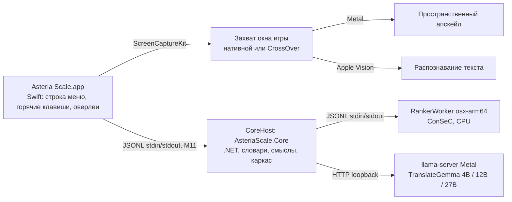

# macOS-версия Asteria Scale

Решения владельца по macOS-версии и то, что из них следует. Статус работ живёт
только в таблице «Трек III» [ROADMAP.md](ROADMAP.md) (карточка №20); здесь —
решения, предпосылки и открытые вопросы. Новое решение владельца добавляется в
таблицу «Принятые решения» с датой; пересмотр старого решения не стирает его, а
помечается новой строкой.

Машина разработки: Apple M4 Pro, 24 ГБ объединённой памяти, macOS 27, `osx-arm64`.

## Принятые решения

| # | Дата | Решение |
|---|---|---|
| M1 | 2026-11-09 | Приложение для macOS пишется **заново**, а не портируется с WPF-хоста `src/AsteriaScale`. |
| M2 | 2026-11-09 | Приложение — **нативное Swift**. Цель — качество нативного macOS-приложения, а не минимальный порт. |
| M3 | 2026-11-09 | Состав приложения: **апскейл окна игры, распознавание текста Apple Vision, значок в строке меню (аналог трея), глобальные горячие клавиши, оверлеи**. |
| M4 | 2026-11-09 | Апскейл обязан корректно работать с **играми, запущенными через CrossOver**, включая оба режима бутылки: **низкое разрешение и высокое разрешение** (High Resolution Mode). Это отдельные режимы со своими проверками, а не частный случай. |
| M5 | 2026-11-09 | **Textractor и любой text-hook на macOS не делаются.** Единственный источник текста — Apple Vision: решение универсально для любых движков, нативных и запущенных через CrossOver. |
| M6 | 2026-11-09 | TranslateGemma — в **трёх вариантах: 4B, 12B и 27B**, под разный объём памяти. |
| M7 | 2026-11-09 | Ранжировщик смыслов на macOS — существующий воркер `AsteriaScale.RankerWorker`, собранный под `osx-arm64`, на CPU, с моделью ConSeC. Бандл ConSeC — локальный бандл владельца (CC BY-NC-SA 4.0): в git, релизы и публичные хранилища не попадает. |
| M8 | 2026-11-09 | Три варианта TranslateGemma (M6) — **для обеих платформ**: Windows-версия тоже получает 12B и 27B. Общая часть и Windows — карточка №21 [ROADMAP.md](ROADMAP.md), macOS — №20.5. |
| M9 | 2026-11-09 | Апскейл на macOS — **того же качества, что на Windows**: качественный нейросетевой апскейл, как в Magpie (уровень пресетов Windows-версии на CuNNy2 и Anime4K), а не только простые фильтры. Спектр пресетов повторяет Windows-версию, включая быстрые (FSR EASU → RCAS) и пиксельные (xBRZ). |
| M10 | 2026-11-09 | Полный прогон Windows-сборки и smoke-набора на Windows владелец делает **после того, как macOS-сборка будет реализована полностью** (Трек III), а не после каждого этапа. До этого неизменность Windows-сборки при каждой правке общих исходников доказывается `tools/macos/check-windows-identity.sh`, а этапы Трека III сливаются в `main` по результатам проверки на macOS. |
| M11 | 2026-11-09 | Ответ на Q1: **ядро работает отдельным .NET-процессом** (CoreHost) со строгим протоколом JSONL поверх stdin/stdout — по образцу ranker-воркера и правила 6: ровно один ответ на запрос, stderr только для диагностики. Swift-приложение запускает его в собственной группе процессов и перезапускает при сбое или зависании; CoreHost сам запускает ranker-воркер и llama-server. Сейчас CoreHost собирается JIT, NativeAOT-сборка того же CoreHost — позже, когда JSON ядра перейдёт на source generation. NativeAOT-библиотека внутри приложения отвергнута. |
| M12 | 2026-11-09 | **Ядро меняется сразу**, без ожидания прогона на Windows: переносимая оркестрация наведения выносится из `HoverTranslationService` в ядро, и WPF-хост переводится на неё; швы ядра (путь воркера, каталоги данных и моделей, метки происхождения результата) делаются сейчас. Такие правки меняют Windows-код до прогона по M10, поэтому каждая обязана кросс-собираться на macOS и попадает в список «Windows-изменения до прогона на Windows» ниже. |
| M13 | 2026-11-09 | **Bundle id приложения — `io.github.slava8519.AsteriaScale`.** Он зафиксирован до первого разрешения «Запись экрана» (этап 20.3): macOS привязывает выданные разрешения к bundle id и подписи, поэтому после первого разрешения bundle id не меняется. |
| M14 | 2026-11-09 | **Глобальные горячие клавиши по умолчанию:** ⌥T — включить или выключить перевод при наведении, ⌥D — открыть окно «Проверка перевода», ⌥V — перевести текст из буфера обмена. Владелец принимает, что горячие клавиши Carbon перехватывают ⌥T, ⌥D и ⌥V во всей системе: в других приложениях эти сочетания больше не вводят свои символы († ∂ √ в раскладке ABC/US). Позже сочетания станут переназначаемыми. Чтение буфера обмена по ⌥V на macOS 15.4+ может вызвать системный запрос доступа к буферу. Известный риск: сообщалось, что macOS 15 отвергает глобальные сочетания только с ⌥ (без ⌃ или ⌘); на этой машине это не проверялось. Регистрацию и одно реальное нажатие проверяет реализация 20.2; если система откажет, приложение показывает русскую ошибку, а выбор сочетаний возвращается владельцу. |
| M15 | 2026-11-09 | **Состояние перевода в интерфейсе — словами пользователя:** «Перевод: готов», «Перевод: перезапуск…», «Перевод: недоступен». Внутреннее слово «ядро» в интерфейсе (меню, оверлей, окна) не используется; код ошибки может приводиться в подробностях. |

### Технические решения этапа 20.2 (по умолчанию; владелец может пересмотреть)

Из вопросов плана этапа 20.2 владелец ответил на три (M13–M15), а по остальным
поручил принять рекомендованный вариант. Поэтому строки ниже — не решения
владельца, а значения по умолчанию: они действуют, пока владелец их не
пересмотрит. Пересмотр записывается новой строкой M в таблице выше, а строка
здесь получает ссылку на неё.

| # | Решение по умолчанию | Альтернатива |
|---|---|---|
| T1 | Перенос оркестрации наведения в ядро (M12) сохраняет точный порядок Windows-версии: сервисы ядра создаются раньше окон WPF, а при выходе ресурсы освобождаются как прежде — трекер и OCR → история → Textractor → ядро (двухфазный хук освобождения у хоста). | Принять перестановку из прототипа и внести её в «Windows-изменения до прогона на Windows». |
| T2 | WPF-оверлей в 20.2 остаётся на признаках вида карточки по строке движка, дословно перенесённых в ядро. Его переход на типизированное происхождение — хвост 20.2: до прогона по M10 он не рискует отрисовкой. | Перевести WPF-оверлей на типизированное происхождение уже в 20.2. |
| T3 | Типизированное происхождение результата — 7 источников и признак `found`, один к одному с нынешними метками движка. | Сразу добавить поле `reason` (`notFound`, `singleSense`, `decisionCache`, `trustedPhrase`). |
| T4 | Метки движка на macOS (видны только в истории и журналах macOS) называют источник текста «APPLE VISION»: «APPLE VISION  •  СЛОВАРЬ» и так далее. | «VISION OCR …» или метки без источника текста. |
| T5 | CoreHost — проект `src/AsteriaScale.CoreHost`: платформенно-нейтральный `net10.0`, поставляется только на macOS и не входит в `AsteriaScale.slnx` (это проверяет именная проверка паритета). | Проект `.CoreHost.MacOS` только для macOS с защитой по RID `osx-arm64`. |
| T6 | Тесты CoreHost — четыре macOS-only регистрации в macOS-подмножестве (итог `+ 7 macOS checks`). | Отдельный тестовый проект со своей командой. |
| T7 | Первый запуск на macOS (нет `settings.json`): CoreHost явно записывает `smartDictionaryRankerModel=consec` и `smartDictionaryBackend=cpu` и сообщает об этом русским статусом; перевод при наведении выключен, как на Windows. Значения по умолчанию `AppSettings` не меняются: это общий код, и их правка видна в Windows-сборке. | Владелец копирует ещё и бандлы GlossBERT CPU и GlossEmbeddings, а по умолчанию остаётся GlossBERT. |
| T8 | Данные на macOS: настройки, пользовательские словари, история и три кэша — в `~/Library/Application Support/AsteriaScale` (как `%LOCALAPPDATA%\AsteriaScale` на Windows); журналы — в `~/Library/Logs/AsteriaScale`. | Кэши — в `~/Library/Caches/<bundle id>`. |
| T9 | Бандл ConSeC для приложения — настоящий каталог (не symlink), который владелец сам копирует командой `ditto` в `~/Library/Application Support/AsteriaScale/Models/Ranker`. Агенты его не копируют, не перемещают и не связывают ссылками; команда для владельца появится в DEVELOPMENT.md вместе с `tools/macos/build-app.sh`. Самопроверки разработки и `--run-isolated` читают `src/AsteriaScale.RankerWorker/Models` на месте, прямым запуском исполняемого файла. | — |
| T10 | Изоляция тестов: только на macOS `MacSmoke.Begin` настраивает `CoreDataLayout`, пользовательская половина которого — явная ошибка (Windows-сборка не меняется), а документированной командой становится герметичный `tools/macos/run-macos-subset.sh`. Общие тесты, которые это выявит, делаются герметичными по одному. | Один `CoreDataLayout.Configure` с временным корнем в начале общего `Program.cs`: это видно в Windows-сборке и сдвигает Windows gated-режимы. |
| T11 | Помощники (CoreHost и воркер) в 20.2 — self-contained single-file ReadyToRun с JIT: около 97 МБ каждый, `.app` около 255 МБ. NativeAOT-сборка CoreHost — позже (M11). | Обычный single-file: около 80 МБ, загружается медленнее. |
| T12 | Поставляемый CoreHost работает с `DOTNET_EnableDiagnostics=0` и `TMPDIR` в `~/Library/Application Support/AsteriaScale/Runtime/tmp`: не остаются FIFO отладчика и нет неаутентифицированного diagnostics IPC. Цена: к CoreHost из `.app` не подключаются управляемый отладчик и `dotnet-trace`; отлаживают framework-dependent сборку. | Оставить диагностику .NET включённой. |
| T13 | Пиксельная геометрия OCR переносится в ядро дословно в 20.3, вместе с решением о единицах координат (Q3). | Перенести её уже в 20.2. |
| T14 | Минимальная версия macOS (Q6) — 14.0; распознавание текста в 20.3 — через `VNRecognizeTextRequest`. | 15.0 и Swift-API `RecognizeTextRequest`. |
| T15 | Постоянная подпись (самоподписанная «Asteria Scale Local» или сертификат Apple Development после разовой установки Xcode) и ключ `build-app.sh --install` в `~/Applications` для запусков владельцем в настоящем домашнем каталоге решаются до 20.3. В 20.2 они не нужны: подпись ad-hoc, а в настоящем домашнем каталоге приложение запускает только владелец. | — |
| T16 | Отчёты о сбоях в `~/Library/Logs/DiagnosticReports` агенты не удаляют: новые отчёты они сообщают, а удаляет их владелец. Шести отчётов `AsteriaScale.CoreHost-2026-11-09-18*.ips`, оставленных прототипом, при записи этого раздела в каталоге уже нет. | — |
| T17 | Горячая клавиша рода говорящего и редактор рода говорящего на macOS — в 20.3; в 20.2 их нет. | — |

## Предпосылки и следствия действующих правил

Эти пункты не являются новыми решениями: они следуют из
[AGENTS.md](../AGENTS.md), [ARCHITECTURE.md](ARCHITECTURE.md) или из решений
выше и действуют без отдельного обсуждения.

- **Ядро переиспользуется.** `AsteriaScale.Core` и `AsteriaScale.RankerProtocol`
  выделены как платформенно-нейтральные (`net10.0`, без RID) именно ради этой
  версии; на macOS они уже собираются без изменений. Swift-приложение — новый
  хост поверх них, а не замена ядра. Как Swift вызывает C#-ядро — открытый
  вопрос Q1.
- **Windows-имена бинарников и каталоги данных приходят от хоста.** Путь
  ranker-воркера и каталог его моделей хост передаёт ядру через
  `RankerWorkerLocation`, а каталоги словарей, морфологии и данных пользователя —
  через `CoreDataLayout` (этап 20.2); по умолчанию остаются прежние
  Windows-пути. Архивы llama.cpp `win-cpu-x64`/`win-vulkan-x64` с
  `llama-server.exe` пока зашиты в ядро (ARCHITECTURE.md, состав решения); для
  macOS хост передаст свои в 20.5.
- **Без тихого fallback (жёсткое правило 3).** Запрос NPU-провайдера ранжировщика
  на macOS завершается явной ошибкой, а не переходом на CPU. Вариант
  TranslateGemma (4B/12B/27B) и backend (Metal/CPU) — часть идентичности модели:
  если выбранный вариант не помещается в память или не загрузился, это ошибка,
  видимая пользователю, а не молчаливый переход на меньший вариант.
  Рекомендованный по объёму памяти вариант можно предлагать по умолчанию, но
  выбор показывается явно.
- **Пины артефактов (жёсткое правило 8).** Каждый GGUF-вариант TranslateGemma и
  macOS-сборка llama.cpp закрепляются размером и SHA-256 так же, как сейчас
  Windows-артефакты. Windows-пины при этом не меняются.
- **Замеры на Apple Silicon — с новым базовым замером.** ONNX Runtime на arm64
  считает не побайтно так же, как на x64. Числа ConSeC с macOS сравниваются
  только с базовым замером на dev-наборе, снятым на macOS; holdout-наборы не
  открываются (жёсткие правила 4–5). Происхождение замера должно различать
  платформу.
- **Только пространственный апскейл.** Temporal-алгоритмы (в том числе
  MetalFX Temporal) требуют motion vectors и глубины из самой игры, которых при
  захвате чужого окна нет, — та же причина, что и на Windows.
- **Собственный захват и апскейл — только для macOS.** На Windows захват и
  апскейл по-прежнему делает Magpie, и собственный движок там вне скоупа
  ([ROADMAP.md](ROADMAP.md), «Чего сознательно нет»). Magpie под macOS нет,
  поэтому решение M3 вводит собственный захват и апскейл только в
  macOS-приложении. По качеству алгоритмов цель — уровень пресетов
  Windows-версии (M9); повторять остальной движок Magpie (все способы захвата,
  все его эффекты и настройки) цели нет.
- **Пользовательские строки — русские** (жёсткое правило 9), в том числе в
  Swift-приложении.

## Предварительная схема процессов

Связь Swift и ядра выбрана (M11); остальное — рабочая гипотеза для 20.3–20.5.

## Открытые вопросы

| # | Вопрос | Что известно |
|---|---|---|
| Q1 | Как Swift-приложение вызывает C#-ядро | **Решён 2026-11-09: M11** (отдельный процесс CoreHost, JSONL). Решили прототипы на этой машине: по задержке варианты не различаются (накладные расходы канала около 0,03–0,06 мс на вызов при задержке наведения 350–1500 мс). Различает изоляция сбоев: внутри приложения 5 из 8 видов сбоев ядра роняли весь процесс (SIGABRT/SIGSEGV), а отдельный процесс обнаруживается упавшим за 0,1–18 мс и перезапускается за 1,1–1,8 с. Кроме того, NativeAOT сразу требовал перевести 21 место рефлексивного JSON в ядре и общем протоколе на source generation. Цена выбора: ещё один процесс и около 30 МБ в простое (JIT). |
| Q2 | Как реализовать пресеты уровня Windows на Metal (M9) | Эффекты Magpie (CuNNy2, Anime4K, FSR EASU/RCAS, Adaptive Sharpen, SSim Downscaler, xBRZ) написаны на HLSL. Варианты: перенос шейдеров в Metal Shading Language как вычислительных проходов; запуск тех же нейросетей через Core ML или MPSGraph; MetalFX Spatial — только как кандидат для быстрых пресетов. Выбирать по качеству на эталонных сценах, задержке кадра и нагрузке на GPU Apple Silicon. Лицензию каждого эффекта проверять отдельно (см. №10 о лицензиях ArtCNN). |
| Q3 | Нюансы CrossOver | Что видит игра и какой масштаб у окна в режимах низкого и высокого разрешения бутылки; как это соотносится с параметром `RetinaMode` драйвера winemac.drv; какой размер кадра отдаёт ScreenCaptureKit в каждом режиме и как отображать координаты распознанного текста и оверлея; полноэкранный режим и смена разрешения внутри Wine; как надёжно опознавать окна игр в процессах Wine. Нужны опыты на реальных бутылках. |
| Q4 | TranslateGemma 12B и 27B | Источник GGUF, квантование, пины, версия llama.cpp с Metal, пороги памяти для выбора варианта. Пороги — по замеру, с учётом `recommendedMaxWorkingSetSize` Metal: на машине разработки (24 ГБ) 27B — пограничный случай. На Windows пороги свои: объём RAM для CPU-backend и видеопамяти для Vulkan (карточка №21). |
| Q5 | Разрешения и распространение | Запись экрана (ScreenCaptureKit); мониторинг ввода или универсальный доступ — в зависимости от способа регистрации горячих клавиш; подпись, нотаризация, способ доставки моделей. Уже решено: bundle id (M13), горячие клавиши Carbon по умолчанию (M14); по умолчанию постоянная подпись выбирается до 20.3 (T15), а бандл ConSeC владелец копирует сам (T9). |
| Q6 | Минимальная версия macOS и архитектура | Предварительно — только Apple Silicon; минимальную версию macOS определить по используемым API (Vision, ScreenCaptureKit, MetalFX). Нижняя граница от воркера ранжировщика (№20.1) уже известна: нативная библиотека ONNX Runtime 1.27.1 для `osx-arm64` (`libonnxruntime.dylib`) требует macOS 14.0+, `libhf_tokenizers.dylib` из Tokenizers.DotNet 1.4.1 — 13.0+; проекты воркера и тестов собираются только под `osx-arm64`, Intel-Mac не поддерживаются. По умолчанию для 20.2 и 20.3 минимальная версия — 14.0 (T14). |
| Q7 | Японский текст | Apple Vision распознаёт японский; это пересекается с №9 и №16 роадмапа и решается вместе с ними. |

## Этапы

Предлагаемый порядок. Статус каждого этапа — только в таблице «Трек III»
[ROADMAP.md](ROADMAP.md).

1. **20.1** — воркер ранжировщика на `osx-arm64` (CPU, ConSeC) и тестовый набор,
   который запускается на macOS.
2. **20.2** — каркас Swift-приложения: строка меню, горячие клавиши, оверлеи,
   настройки; ядро как процесс CoreHost (M11), оркестрация наведения — в ядре
   (M12).
3. **20.3** — распознавание текста Apple Vision → конвейер «Умного словаря».
4. **20.4** — захват и апскейл (ScreenCaptureKit + Metal) с пресетами уровня
   Windows-версии, включая нейросетевые, и оба режима бутылок CrossOver.
5. **20.5** — TranslateGemma 4B/12B/27B на llama.cpp с Metal; общая часть
   выбора варианта — №21.
6. **20.6** — сборка, подпись и установка macOS-приложения.

## Windows-изменения до прогона на Windows

По M10 полный прогон Windows-сборки и smoke-набора выполняется в конце
Трека III, а по M12 Windows-код меняется уже сейчас. Каждая правка, после
которой `tools/macos/check-windows-identity.sh` печатает `DIFFERENT` (то есть
выходы Windows-сборки изменились, а сами сборки прошли), добавляется в эту
таблицу в том же коммите. По таблице владелец понимает, что проверить при
финальном прогоне. Правки, выходы которых скрипт доказал идентичными
(`IDENTICAL`), сюда не попадают.

| Коммит | Что изменено в Windows-коде | Что проверить на Windows |
|---|---|---|
| `test: make the phrase-cache draft check order-independent and isolate sense-metadata user layers` | Только общие тесты: «Smart phrase translation hover integration» при попадании в кэш фраз принимает и черновик, который не успел стартовать (снимок `DraftCalls` перед вторым наведением; поздно стартовавший черновик обязан быть отменён), и отдельно проверяет, что `Task.Run` с уже отменённым токеном не запускает делегат; «Aligned dictionary sense metadata» берёт пользовательские слои из временного каталога. Код приложения не менялся. | Полный smoke: оба теста зелёные. Изоляция от `%LOCALAPPDATA%\AsteriaScale\Dictionaries` доказана на macOS прогоном во временном пустом домашнем каталоге (папка `Dictionaries` в нём не появляется); отдельной проверки на Windows не нужно. |
| `test: pin the engine strings of every smart-hover result` | Только общие тесты: новая регистрация «Smart hover engine strings» побайтно фиксирует строку движка каждого результата `SmartHoverPipeline` (словарь, SMART-FAST, TATOEBA, SMART-CACHE, CPU/NPU-СМЫСЛ, «НЕ УВЕРЕН», «НЕДОСТУПЕН») и строки фразы TranslateGemma. Код приложения не менялся. | Полный smoke: новая регистрация зелёная. Поддельный воркер ранжировщика в ней на Windows — встроенный Windows PowerShell, на macOS — `python3`; PowerShell-вариант на macOS не выполнялся, поэтому при падении регистрации на Windows сначала проверить его. |
| `feat(core): host-supplied worker location and data layout` | Ядро: путь ranker-воркера и каталог моделей задаёт `RankerWorkerLocation` (по умолчанию прежние `Ranker\AsteriaScale.RankerWorker.exe` и `Ranker\Models` рядом с exe); все каталоги данных берутся из `CoreDataLayout` — словари и морфология рядом с exe, настройки, «Мой словарь», история, три кэша, журнал наведения и модели TranslateGemma в `%LOCALAPPDATA%\AsteriaScale`, имена файлов прежние; пустой или относительный LocalAppData — явная ошибка вместо записи относительно текущего каталога; `--ranker-diagnostic` берёт путь воркера у селектора; `InternalsVisibleTo("AsteriaScale.CoreHost")`. Тесты: регистрации «Settings round trip» и «GlossBERT ranker protocol and host validation» проверяют прежние пути и новые отказы, число регистраций не изменилось. | Запуск из `dist/`: прежние настройки, «Мой словарь», история и кэши читаются из прежних файлов (нет «чистого» первого запуска), `hover-translation.log` пишется туда же; морфология загружена; `AsteriaScale.exe --ranker-diagnostic <out.json> cpu` и `npu` — прежние `workerPath` и `workerExists`, `success: true`; прогрев ConSeC CPU и GlossBERT NPU в приложении; TranslateGemma находит установленную модель; полный smoke (в «Settings round trip» на Windows пути сверяются с настоящим `%LOCALAPPDATA%`). |
| `refactor(core): move hover orchestration into Core (HoverCoordinator)` | Оркестрация наведения дословно перенесена из `HoverTranslationService` в ядро (`HoverCoordinator`); `HoverTranslationService` — адаптер WPF с прежним публичным API; порядок создания (сначала сервисы ядра, затем окна WPF) и порядок освобождения при выходе (трекер и OCR → история → Textractor → ядро) сохранены; цель редактора рода переназначается после запуска сохранения (только UI-поток); удалены неиспользуемые `LogError/LogDiagnostic`; новый общий тест «Hover coordinator ordering and lifecycle» фиксирует порядок карточек и тексты статусов. Единственная перестановка при создании: конвейер, `_enabled` и `ConfigureKeepWarm` (только ядро) выполняются до создания окон WPF. | Запуск из `dist/`: наведение в режимах «Словарь» и «Умный словарь»; отмена, когда курсор уходит; вторая строка TranslateGemma — предварительная и окончательная; история и экспорт в Anki («Мой словарь»); Ctrl+Shift+G и сохранение рода; значок HOOK/OCR с Textractor; выключение и включение перевода; смена режима; выгрузка в режиме экономии памяти; выход из приложения при прогретой TranslateGemma и подключённом Textractor (порядок освобождения); перезагрузка словарей после правки «Моего словаря»; полный smoke. Поддельный воркер ранжировщика в новой регистрации на Windows — встроенный Windows PowerShell (на macOS — `python3`); PowerShell-вариант на macOS не выполнялся. |
| `refactor(core): move unit-free OCR text rules into Core` | Текстовые правила OCR без пиксельных единиц дословно перенесены из `WindowsAiOcrService` в ядро (`OcrTextRules`): нормализация пробелов и починка смешанных кириллицы и латиницы, исправление `You'11` → `You'll`, извлечение предложения под курсором и проверка его полноты, согласие двух наблюдений и подтверждённая подпись говорящего, привязка слова к позиции в строке, отпечаток кадра и повторное использование распознавания в течение 30 с. `WindowsAiOcrService` подключает их через `using static`, вызовы в нём не менялись; часть перенесённых членов стала `internal` вместо `private`; ставшие лишними `using` убраны. Атрибут `[GeneratedRegex]` перенесён без изменений (проверено извлечением атрибутов). Захват, распознавание Windows AI и пиксельная геометрия (выбор строки у курсора, сборка предложения из строк, границы захвата, группировка блоков) остались в `WindowsAiOcrService` до 20.3. Тесты: «Sentence boundaries», «Smart OCR unchanged-frame cache guard», «Smart OCR sentence stabilization» и проверка омоглифов в «Local dictionary lookup» вызывают `OcrTextRules` и стали общими; имена, порядок и число регистраций прежние. | Запуск из `dist/`: OCR-наведение в режимах «Словарь» и «Умный словарь» на нескольких кадрах VN — выделяется то же предложение, что раньше (кавычки, многоточия, «Mr.»/«Dr.», японский текст), подпись говорящего сохраняется, вторая строка TranslateGemma появляется только для полного предложения; повторное наведение на неизменившийся кадр и после смены кадра; строка, где OCR смешал кириллицу и латиницу; `AsteriaScale.Tests.exe --ocr-image` и `--screen-ocr-image`; полный smoke (три OCR-регистрации и «Local dictionary lookup» зелёные). |
| `refactor(core): move overlay engine-label predicates into Core` | Признаки вида карточки по строке движка дословно перенесены из `HoverTranslationOverlay` в ядро (`HoverEngineLabelClassifier`, T2): режим «Словарь», TATOEBA, «без модели», кэш, ускоритель смысла CPU/NPU, «НЕ УВЕРЕН», «НЕДОСТУПЕН», широкий заголовок для этих двух статусов и подпись строки фразы («Фраза · TG4B · CPU» или «Фраза · TG4B · GPU», у предварительной — «уточняется…»). Оверлей подключает их через `using static`: сравнения, записанные прямо в `ShowLoading`, `ShowTranslation` и `PreferredHeaderWidth`, стали вызовами признаков с теми же выражениями, остальные вызовы не менялись. Строки движка, тексты и раскладка карточки не менялись. Удалён пересылающий `HoverTranslationService.IsPhraseHistoryEntry`, у которого не осталось вызовов. Тесты: проверки признаков в «Settings round trip» и «Smart phrase translation hover integration» вызывают ядро и стали общими; в «Settings round trip» добавлены побайтные эталоны всех Windows-строк движка, вид карточки для каждой из них, правило широкого заголовка и подпись строки фразы GPU; имена, порядок и число регистраций прежние. | Запуск из `dist/`: все виды карточки — «Словарь» (найдено и «НЕТ»), «Умный словарь» CPU и NPU («АНАЛИЗ» и «КОНТЕКСТ»), «НЕ УВЕРЕН» и «НЕДОСТУПЕН» (заголовок не обрезан), «TATOEBA», «БЕЗ МОДЕЛИ», «КЭШ», строка фразы CPU и GPU и «уточняется…»; `AsteriaScale.exe --overlay-diagnostic <out.png>` с `dictionary`, `smart` и `missing` — карточки выглядят как прежде; полный smoke («Settings round trip» и «Smart phrase translation hover integration» зелёные). |
