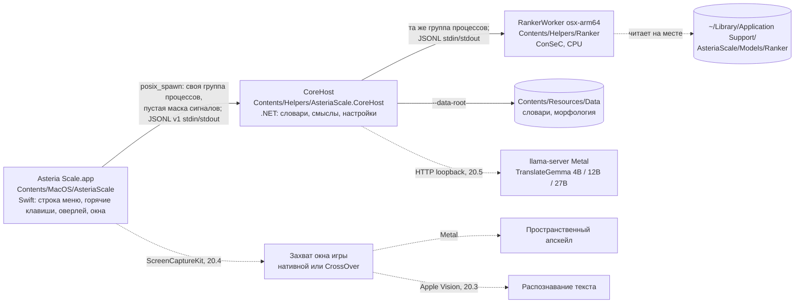

# macOS-версия Asteria Scale

Решения владельца по macOS-версии и то, что из них следует. Статус работ живёт
только в таблице «Трек III» [ROADMAP.md](ROADMAP.md) (карточка №20); здесь —
решения, предпосылки и открытые вопросы. Новое решение владельца добавляется в
таблицу «Принятые решения» с датой; пересмотр старого решения не стирает его, а
помечается новой строкой.

Машина разработки: Apple M4 Pro, 24 ГБ объединённой памяти, macOS 27, `osx-arm64`.

## Принятые решения

| # | Дата | Решение |
|---|---|---|
| M1 | 2026-11-09 | Приложение для macOS пишется **заново**, а не портируется с WPF-хоста `src/AsteriaScale`. |
| M2 | 2026-11-09 | Приложение — **нативное Swift**. Цель — качество нативного macOS-приложения, а не минимальный порт. |
| M3 | 2026-11-09 | Состав приложения: **апскейл окна игры, распознавание текста Apple Vision, значок в строке меню (аналог трея), глобальные горячие клавиши, оверлеи**. |
| M4 | 2026-11-09 | Апскейл обязан корректно работать с **играми, запущенными через CrossOver**, включая оба режима бутылки: **низкое разрешение и высокое разрешение** (High Resolution Mode). Это отдельные режимы со своими проверками, а не частный случай. |
| M5 | 2026-11-09 | **Textractor и любой text-hook на macOS не делаются.** Единственный источник текста — Apple Vision: решение универсально для любых движков, нативных и запущенных через CrossOver. |
| M6 | 2026-11-09 | TranslateGemma — в **трёх вариантах: 4B, 12B и 27B**, под разный объём памяти. |
| M7 | 2026-11-09 | Ранжировщик смыслов на macOS — существующий воркер `AsteriaScale.RankerWorker`, собранный под `osx-arm64`, на CPU, с моделью ConSeC. Бандл ConSeC — локальный бандл владельца (CC BY-NC-SA 4.0): в git, релизы и публичные хранилища не попадает. |
| M8 | 2026-11-09 | Три варианта TranslateGemma (M6) — **для обеих платформ**: Windows-версия тоже получает 12B и 27B. Общая часть и Windows — карточка №21 [ROADMAP.md](ROADMAP.md), macOS — №20.5. |
| M9 | 2026-11-09 | Апскейл на macOS — **того же качества, что на Windows**: качественный нейросетевой апскейл, как в Magpie (уровень пресетов Windows-версии на CuNNy2 и Anime4K), а не только простые фильтры. Спектр пресетов повторяет Windows-версию, включая быстрые (FSR EASU → RCAS) и пиксельные (xBRZ). |
| M10 | 2026-11-09 | Полный прогон Windows-сборки и smoke-набора на Windows владелец делает **после того, как macOS-сборка будет реализована полностью** (Трек III), а не после каждого этапа. До этого неизменность Windows-сборки при каждой правке общих исходников доказывается `tools/macos/check-windows-identity.sh`, а этапы Трека III сливаются в `main` по результатам проверки на macOS. |
| M11 | 2026-11-09 | Ответ на Q1: **ядро работает отдельным .NET-процессом** (CoreHost) со строгим протоколом JSONL поверх stdin/stdout — по образцу ranker-воркера и правила 6: ровно один ответ на запрос, stderr только для диагностики. Swift-приложение запускает его в собственной группе процессов и перезапускает при сбое или зависании; CoreHost сам запускает ranker-воркер и llama-server. Сейчас CoreHost собирается JIT, NativeAOT-сборка того же CoreHost — позже, когда JSON ядра перейдёт на source generation. NativeAOT-библиотека внутри приложения отвергнута. |
| M12 | 2026-11-09 | **Ядро меняется сразу**, без ожидания прогона на Windows: переносимая оркестрация наведения выносится из `HoverTranslationService` в ядро, и WPF-хост переводится на неё; швы ядра (путь воркера, каталоги данных и моделей, метки происхождения результата) делаются сейчас. Такие правки меняют Windows-код до прогона по M10, поэтому каждая обязана кросс-собираться на macOS и попадает в список «Windows-изменения до прогона на Windows» ниже. |
| M13 | 2026-11-09 | **Bundle id приложения — `io.github.slava8519.AsteriaScale`.** Он зафиксирован до первого разрешения «Запись экрана» (этап 20.3): macOS привязывает выданные разрешения к bundle id и подписи, поэтому после первого разрешения bundle id не меняется. |
| M14 | 2026-11-09 | **Глобальные горячие клавиши по умолчанию:** ⌥T — включить или выключить перевод при наведении, ⌥D — открыть окно «Проверка перевода», ⌥V — перевести текст из буфера обмена. Владелец принимает, что горячие клавиши Carbon перехватывают ⌥T, ⌥D и ⌥V во всей системе: в других приложениях эти сочетания больше не вводят свои символы († ∂ √ в раскладке ABC/US). Позже сочетания станут переназначаемыми. Чтение буфера обмена по ⌥V на macOS 15.4+ может вызвать системный запрос доступа к буферу. Известный риск: сообщалось, что macOS 15 отвергает глобальные сочетания только с ⌥ (без ⌃ или ⌘); на этой машине это не проверялось. Регистрацию и одно реальное нажатие проверяет реализация 20.2; если система откажет, приложение показывает русскую ошибку, а выбор сочетаний возвращается владельцу. |
| M15 | 2026-11-09 | **Состояние перевода в интерфейсе — словами пользователя:** «Перевод: готов», «Перевод: перезапуск…», «Перевод: недоступен». Внутреннее слово «ядро» в интерфейсе (меню, оверлей, окна) не используется; код ошибки может приводиться в подробностях. |
| M16 | 2026-11-10 | **Подпись — сертификат Apple Development владельца** (ответ на T15 и Q5). Сборки для настоящего домашнего каталога владелец подписывает им (`build-app.sh --sign <identity>` или `ASTERIA_SIGN_IDENTITY`): designated requirement — `anchor apple generic` с идентификатором команды, а не cdhash, поэтому разрешение «Запись экрана» переживает пересборку. Самоподписанный «Asteria Scale Local» не используется. Ни сертификат, ни данные его учётной записи в репозиторий не записываются; агенты подписывают только ad-hoc (обращение к ключу может вызвать диалог связки ключей). Developer ID и нотаризация — 20.6. |
| M17 | 2026-11-10 | **На машине разработки есть CrossOver с бутылкой и игрой** (Q3). Опыты с бутылкой в режимах низкого и высокого разрешения входят в 20.3 как проверки владельца: агенты не захватывают экран и не запускают игры. |
| M18 | 2026-11-10 | **20.3 распознаёт только английский** (ответ на Q7): Apple Vision с `en-US` без автоопределения языка. Японский текст — вместе с №9 и №16 роадмапа. |
| M19 | 2026-11-10 | **Этапы 20.3–20.6 идут подряд**, без остановки между ними: каждый этап сливается в `main` по проверке на macOS (M10), а работа останавливается только на действиях, которые делает лишь владелец (подпись своим сертификатом, разрешения TCC, запуск в настоящем домашнем каталоге, игры и CrossOver, физические нажатия клавиш). Отправка в GitHub — только с согласия владельца. |
| M20 | 2026-11-10 | **Горячая клавиша редактора рода говорящего — ⌃⌥G** (подтверждение T40): четвёртое действие после ⌥T, ⌥D и ⌥V (M14); символа не вводит ни в одной раскладке. |

### Технические решения этапа 20.2 (по умолчанию; владелец может пересмотреть)

Из вопросов плана этапа 20.2 владелец ответил на три (M13–M15), а по остальным
поручил принять рекомендованный вариант. Поэтому строки ниже — не решения
владельца, а значения по умолчанию: они действуют, пока владелец их не
пересмотрит. Пересмотр записывается новой строкой M в таблице выше, а строка
здесь получает ссылку на неё.

| # | Решение по умолчанию | Альтернатива |
|---|---|---|
| T1 | Перенос оркестрации наведения в ядро (M12) сохраняет порядок Windows-версии везде, где у шагов есть побочные эффекты: сервисы ядра создаются раньше окон WPF, а при выходе ресурсы освобождаются как прежде — трекер и OCR → история → Textractor → ядро (двухфазный хук освобождения у хоста). Шаги без побочных эффектов при создании переставлены; все перестановки перечислены в строке `refactor(core): move hover orchestration into Core (HoverCoordinator)` таблицы «Windows-изменения до прогона на Windows». | Принять перестановку из прототипа и внести её в «Windows-изменения до прогона на Windows». |
| T2 | WPF-оверлей в 20.2 остаётся на признаках вида карточки по строке движка, дословно перенесённых в ядро. Его переход на типизированное происхождение — хвост 20.2: до прогона по M10 он не рискует отрисовкой. | Перевести WPF-оверлей на типизированное происхождение уже в 20.2. |
| T3 | Типизированное происхождение результата — 7 источников и признак `found`, один к одному с нынешними метками движка. | Сразу добавить поле `reason` (`notFound`, `singleSense`, `decisionCache`, `trustedPhrase`). |
| T4 | Метки движка на macOS (видны только в истории и журналах macOS) называют источник текста «APPLE VISION»: «APPLE VISION  •  СЛОВАРЬ» и так далее. | «VISION OCR …» или метки без источника текста. |
| T5 | CoreHost — проект `src/AsteriaScale.CoreHost`: платформенно-нейтральный `net10.0`, поставляется только на macOS и не входит в `AsteriaScale.slnx` (это проверяет именная проверка паритета). | Проект `.CoreHost.MacOS` только для macOS с защитой по RID `osx-arm64`. |
| T6 | Тесты CoreHost — четыре macOS-only регистрации в macOS-подмножестве (итог `+ 7 macOS checks`). | Отдельный тестовый проект со своей командой. |
| T7 | Первый запуск на macOS (нет `settings.json`): CoreHost явно записывает `smartDictionaryRankerModel=consec` и `smartDictionaryBackend=cpu` и сообщает об этом русским статусом; перевод при наведении выключен, как на Windows. Значения по умолчанию `AppSettings` не меняются: это общий код, и их правка видна в Windows-сборке. | Владелец копирует ещё и бандлы GlossBERT CPU и GlossEmbeddings, а по умолчанию остаётся GlossBERT. |
| T8 | Данные на macOS: настройки, пользовательские словари, история и три кэша — в `~/Library/Application Support/AsteriaScale` (как `%LOCALAPPDATA%\AsteriaScale` на Windows); журналы — в `~/Library/Logs/AsteriaScale`. | Кэши — в `~/Library/Caches/<bundle id>`. |
| T9 | Бандл ConSeC для приложения — настоящий каталог (не symlink), который владелец сам копирует командой `ditto` в `~/Library/Application Support/AsteriaScale/Models/Ranker`. Агенты его не копируют, не перемещают и не связывают ссылками; команда для владельца — в DEVELOPMENT.md, «Сборка `Asteria Scale.app`». Самопроверки разработки и `--run-isolated` читают `src/AsteriaScale.RankerWorker/Models` на месте, прямым запуском исполняемого файла. | — |
| T10 | Изоляция тестов: только на macOS `MacSmoke.Begin` настраивает `CoreDataLayout`, пользовательская половина которого — явная ошибка (Windows-сборка не меняется), а документированной командой становится герметичный `tools/macos/run-macos-subset.sh`. Общие тесты, которые это выявит, делаются герметичными по одному. | Один `CoreDataLayout.Configure` с временным корнем в начале общего `Program.cs`: это видно в Windows-сборке и сдвигает Windows gated-режимы. |
| T11 | Помощники (CoreHost и воркер) в 20.2 — self-contained single-file ReadyToRun с JIT: около 97 МБ каждый, `.app` около 255 МБ. NativeAOT-сборка CoreHost — позже (M11). | Обычный single-file: около 80 МБ, загружается медленнее. |
| T12 | Поставляемый CoreHost работает с `DOTNET_EnableDiagnostics=0` и `TMPDIR` в `~/Library/Application Support/AsteriaScale/Runtime/tmp`: не остаются FIFO отладчика и нет неаутентифицированного diagnostics IPC. Цена: к CoreHost из `.app` не подключаются управляемый отладчик и `dotnet-trace`; отлаживают framework-dependent сборку. | Оставить диагностику .NET включённой. |
| T13 | Пиксельная геометрия OCR переносится в ядро дословно в 20.3, вместе с решением о единицах координат (Q3). | Перенести её уже в 20.2. |
| T14 | Минимальная версия macOS (Q6) — 14.0; распознавание текста в 20.3 — через `VNRecognizeTextRequest`. | 15.0 и Swift-API `RecognizeTextRequest`. |
| T15 | Постоянная подпись (самоподписанная «Asteria Scale Local» или сертификат Apple Development после разовой установки Xcode) и ключ `build-app.sh --install` в `~/Applications` для запусков владельцем в настоящем домашнем каталоге решаются до 20.3. В 20.2 они не нужны: подпись ad-hoc, а в настоящем домашнем каталоге приложение запускает только владелец. Решено: M16 (сертификат Apple Development); `--install` — T34. | — |
| T16 | Отчёты о сбоях в `~/Library/Logs/DiagnosticReports` агенты не удаляют: новые отчёты они сообщают, а удаляет их владелец. Шести отчётов `AsteriaScale.CoreHost-2026-11-09-18*.ips`, оставленных прототипом, при записи этого раздела в каталоге уже нет. | — |
| T17 | Горячая клавиша рода говорящего и редактор рода говорящего на macOS — в 20.3; в 20.2 их нет. Сочетание — T40, редактор — T31. | — |

### Технические решения этапа 20.3 (по умолчанию; владелец может пересмотреть)

На старте 20.3 владелец ответил на вопросы о подписи, CrossOver и японском
тексте (M16–M18) и поручил вести этапы подряд (M19). Строки ниже — значения
по умолчанию из плана этапа, как и T1–T17. Пересмотр записывается новой
строкой M, а строка здесь получает ссылку на неё. Замеры плана сделаны на
машине разработки без захвата экрана и без TCC; часть замеров Vision сделана
с автоопределением языка, которое M18 выключает.

| # | Решение по умолчанию | Альтернатива |
|---|---|---|
| T18 | Единица координат OCR в протоколе (Q3, T13) — пиксели: курсор и границы захвата — целые пиксели дисплея под курсором, рамки — пиксели кадра (начало слева сверху, y вниз). Пороги Windows (95 px, 2400×720, 900×340, 120/80, 15 px) не пересчитываются. | Пункты (логические единицы): на Retina пороги Windows стали бы вдвое мягче. |
| T19 | Захват и Apple Vision — в Swift-приложении; геометрия, кэш кадра и согласие двух наблюдений — в CoreHost через `OcrGeometry` и `OcrTextRules` ядра; границы захвата приложению даёт `ocr.plan`. | Кэш и согласие в Swift: копия правил ядра. |
| T20 | Протокол в 20.3 остаётся v1 и только дополняется: `ocr.plan`, `ocr.select` (без состояния и без `core.init`, на рабочей линии), `hover.resolve` с `source.kind: "observations"`, событие `hover.loading` (только у наведений по наблюдениям), ошибка `stale_frame` и `speaker.observedName`. Конверт прежний, эталон правится на месте (номера 1–22 прежние). Уточнено реализацией: приложение само отвергает запрос сверх пределов CoreHost (строки, слова, длины) и сверх 900 КиБ закодированной строки запроса — код `observations_too_large`, «Слишком много текста в области распознавания.», без отправки и без урезания; распознанное слово, из-за которого CoreHost отверг бы весь запрос (неконечная рамка или текст вне 1..256 единиц UTF-16, например отточие или длинный адрес без пробелов), в наблюдение не попадает, а его строка остаётся без него; строка, в которой не осталось слов, не отправляется (CoreHost требует 1..256 слов в строке) — `ExtractRecognition` на Windows такое слово сохраняет. | Протокол v2. |
| T21 | Область захвата — вокруг курсора на дисплее под ним: 900×340 в «Словаре», до 2400×720 в «Умном словаре» (константы Windows в пикселях); `SCScreenshotManager.captureImage(contentFilter:configuration:)` с `SCContentFilter` без своего приложения; «Словарь» не пересекает границу дисплея. Захват окна игры целиком — в 20.4. Риск: 2400×720 пикселей — это 1200×360 пунктов на 2x-дисплее, широкие диалоговые окна VN могут не поместиться; меряется на бутылках владельца. | Всё окно игры через `SCContentFilter` или свои размеры для macOS. |
| T22 | Захват недостижим в проверочных запусках. Чистая функция Kit `CaptureGate` решает один раз при запуске и включает захват только без `--self-test`, при `getppid() == 1` и `__CFBundleIdentifier`, равном bundle id M13 (запуск через LaunchServices: Finder, `open`). Символы ScreenCaptureKit, `CG*ScreenCaptureAccess` и `CGWindowList*` есть только в `Sources/AsteriaScale/ScreenSource.swift`. Пока `CGPreflightScreenCaptureAccess()` не вернул `true`, из ScreenCaptureKit не вызывается ничего, а системный запрос вызывает только пункт меню «Разрешить запись экрана…». Признак `__CFBundleIdentifier` недокументирован: если он подведёт, захват окажется выключен у владельца, а не включён у агента. Уточнено реализацией: `SourceScanTests` держит любое имя с началом `CGWindowList` (функции и тип параметров) и `CGImage(windowListFrom…)` — под этим именем Swift импортирует `CGWindowListCreateImageFromArray`, и префикса в нём нет. | Явный ключ запуска для владельца. |
| T23 | `VNRecognizeTextRequest`: ревизия 3 явно, `.accurate`, `usesLanguageCorrection = true`, `minimumTextHeight = 0`, `recognitionLanguages = ["en-US"]`, `automaticallyDetectsLanguage = false` (M18). Уровень `.fast` не используется (CER 0,34–0,51 на контурном и пиксельном тексте). Swift-API `RecognizeTextRequest` не используется: он требует 15.0+ и по умолчанию отбрасывает текст ниже 1/32 высоты кадра. | Автоопределение языка (читает японский; M18 его отложил). |
| T24 | При 1 пикселе на пункт фрагмент для Vision увеличивается вдвое, а рамки возвращаются в пиксели кадра: единица протокола та же. Размер кадра, не равный границам захвата, — видимая ошибка. Уточнено реализацией: вдвое увеличивается кадр с плотностью меньше 1,5 пикселя на пункт (1x и масштабированные режимы ближе к 1x), от 1,5 — как есть; основание — замер плана 20.3: строки 9–11 px при 1x Vision молча пропускал, а после увеличения читал. Размер кадра сверяется с границами точно, без допуска. Самопроверка и проба DoD 6 проверяют размер картинки, которую получил Vision (у кадра 1x 329×118 — 658×236): по рамкам в пикселях кадра увеличение не видно. Увеличение интерполирует (замер 11 ноября 2026: на краю чёрного и белого — 31 и 223 в красном канале при качестве контекста `.high`, как и при `.default`, `.low` и `.medium`; при `.none` было бы 0 и 255, а `shouldInterpolate: false` у картинки кадра ничего не меняет); это держит `PixelBufferTests`. | Без увеличения. |
| T25 | Vision прогревается при включении перевода на изображении с латинским текстом: первый вызов в новом домашнем каталоге компилирует модели 28–40 с (замер с английским текстом), и, вероятно, снова после обновления macOS. Наведения ждут конца прогрева, строка меню говорит «Распознавание: подготовка…», ошибка прогрева показывается. Уточнено реализацией (замер 11 ноября 2026, macOS 27, сборка 26A434, M4 Pro): первый вызов в новом домашнем каталоге — около 24 с (23,7–25,0 с в пробе DoD 6 и в самопроверке), повторный запуск того же исполняемого файла в том же каталоге — около 0,1 с, а другой исполняемый файл (пересобранная проба) в том же каталоге компилировал снова, около 24 с (DEVELOPMENT.md, «Проба Vision»). | Ленивый первый вызов при наведении. |
| T26 | Настоящий Vision работает только в самопроверке приложения и в пробе DoD 6 (`AsteriaScaleVisionProbe`: копия, переподписанная ad-hoc с hardened runtime и без entitlements, прямым запуском), обе — только во временном домашнем каталоге; Swift-набор и macOS-подмножество используют синтетические наблюдения и поддельный распознаватель. Уточнено реализацией: набор и текст не рисует (шрифты могут писать кэши в домашний каталог прогона); это держит `SourceScanTests`: тестам разрешены только импорты Testing, Foundation, Darwin, CoreGraphics, Carbon и модулей пакета, а типы Vision, запросы распознавания, `FixtureRenderer`, `VisionFixture` и вызовы, которые создают шрифт или рисуют текст, в тестах не названы. Кэш компиляции Vision ложится в `<домашний каталог>/Library/Caches/<имя процесса или bundle id>/com.apple.e5rt.e5bundlecache/<сборка ОС>`; вне временного домашнего каталога Vision обновляет записи в `getconf DARWIN_USER_CACHE_DIR` — `com.apple.metal/<n>` у пробы и `io.github.slava8519.AsteriaScale/com.apple.metal/<n>` у приложения (связь установлена по времени записи), это отчёт T35, а удаление — дело владельца (DEVELOPMENT.md, «Проба Vision»). | — |
| T27 | Кэш кадра — в CoreHost: одна запись с ключом (`display.id`, границы, отпечаток), сроком 30 с и подтверждённым говорящим. Vision пропускается, если отпечаток захвата равен `cachedFingerprint` из плана; на `stale_frame` — ровно одна повторная попытка с полными наблюдениями. Кэш — только оптимизация. Отпечаток — первые 8 байт SHA-256 пикселей (little-endian), как `ComputeFrameFingerprint`; в Swift — `FrameFingerprint` в цели `AsteriaScaleVision`. Уточнено реализацией: в `AsteriaScaleVision` — сам SHA-256 CryptoKit (`SHA256FrameFingerprinter`) и раскладка кадра (`PixelBuffer`), а значение отпечатка с его 16 цифрами (`FrameFingerprint`) и шов `FrameFingerprinting`, через который конвейер наведения считает отпечаток без CryptoKit, — в Kit; тест Swift сверяет SHA-256 с каждой строкой `frame-fingerprint-v1.txt`. | Кэш в Swift. |
| T28 | Копия фильтров `ExtractRecognition` — в декодере наблюдений CoreHost с проверкой паритета, не в ядре: новый член ядра изменил бы `Core.dll`. Объединение — хвост. | Член ядра (Windows-видимая правка). |
| T29 | Игру передаёт приложение: `path:` исполняемого файла владельца окна под курсором; для процесса Wine — Unix-путь `.exe` внутри бутылки из `KERN_PROCARGS2` и `WINEPREFIX` через `drive_c` и `dosdevices`; иначе игры нет. Никогда — путь загрузчика Wine или `process:` для Wine (совпадает у разных бутылок). Окно ищется только по `kCGWindowOwnerPID`, `kCGWindowLayer` и `kCGWindowBounds`, без `kCGWindowName` (для имени нужна «Запись экрана»). | `process:<exe>` для Wine. |
| T30 | `speaker.set` транзакционен только в CoreHost: копия настроек → запись → замена списка, без отложенной записи и без статуса «сохранён» при ошибке. `hover.primary.speaker` несёт `observedName`, и `speaker.set` его повторно не разрешает. Дефект повторной правки на стороне ядра и Windows — хвост. | Исправление в ядре (Windows-видимая правка). |
| T31 | Редактор рода на macOS не возвращает курсор (на Windows — `SetCursorPos`); клавиши 1/2/3 и Esc; после закрытия активным снова становится прежнее приложение. | Возвращать курсор. |
| T32 | `hover.resolve` отвергает `game.key`, который ядро не нормализует (`bad_request`), как уже делает `speaker.set`. | Принимать и не применять род. |
| T33 | Скрипты `tools/macos` закрепляют `DEVELOPER_DIR=/Library/Developer/CommandLineTools`, если они установлены: Xcode.app на машине разработки — только ради сертификата (M16). | Брать то, что выбрано в `xcode-select`. |
| T34 | `build-app.sh --install [DIR]`, по умолчанию `~/Applications`: копирование `ditto`, повторная проверка `codesign`, отказ (код `2`), если из цели что-то запущено. Агенты ставят только в каталог внутри `mktemp -d` с подписью ad-hoc; `~/Applications` — только владелец. Уточнено реализацией: чужой бандл, ссылка, файл или запись под другим написанием на месте цели и `DIR` в выводе — тоже код `2` до сборки; процесс ищется по пути исполняемого файла от macOS (`proc_pidpath`) и по аргументам; без `DIR` — только с подписью не ad-hoc (с `-` код `2`, чтобы пустая переменная агента не дошла до `~/Applications`); процесс, запущенный из цели за время прогона, или цель, появившаяся, пропавшая или сменившаяся после проверки до сборки, — код `7` прямо перед заменой; замена — атомарный `renamex_np` из временной папки в `DIR`, с которого и до конца прогона ^C не прерывает установку (DEVELOPMENT.md, «Сборка `Asteria Scale.app`»). | Копировать вручную. |
| T35 | `build-app.sh` и `test-swift.sh` печатают записи `getconf DARWIN_USER_CACHE_DIR` и `~/Library/Caches/com.apple.e5rt.e5bundlecache` новее отметки прогона — только отчёт, не ошибка. Уже до 20.3 там были `com.apple.metalfe` и `local.asteriascale.*` (2026-11-09): удалять их или нет, решает владелец. Уточнено реализацией: до глубины 2 и 3 соответственно, не больше 40 строк на каталог с числом невыведенных (глубже — шум других процессов). | Ошибка при новой записи. |
| T36 | «Проверка перевода» и ⌥V по-прежнему требуют включённого перевода при наведении (`hover_disabled`), как в 20.2. | — |
| T37 | Курсор — опрос `NSEvent.mouseLocation` каждые 90 мс, радиус 15 пикселей дисплея, задержка из настроек в пределах 350..1500 мс. Без глобальных мониторов NSEvent и event tap, поэтому без «Мониторинга ввода» и «Универсального доступа». | Глобальный монитор движения мыши. |
| T38 | Сторож самопроверки — 120 с вместо 90; прогрев Vision — её первый шаг. | — |
| T39 | Размер захвата «Словаря» 900×340 — именованная константа CoreHost со ссылкой на `WindowsAiOcrService`, а не константа ядра. | Константа ядра (Windows-видимая правка). |
| T40 | Горячая клавиша редактора рода говорящего — ⌃⌥G (подтверждено владельцем: M20): не вводит символ ни в одной раскладке и не подпадает под риск сочетаний «только ⌥» (M14). | ⌥G, как ⌥T/⌥D/⌥V (перехватывает «©» в ABC/US). |
| T41 | Расходящаяся пара наблюдений «Умного словаря» даёт неустойчивый результат с говорящим первого наблюдения, как ядро (`OcrTextRules.StabilizeSentenceContext`) и WPF-карточка на Windows: говорящий не подтверждён, в кэш кадра не попадает, а карточка его показывает (пункт 4 DoD 20.3, T19). Принято при реализации наблюдений в протоколе вместо прежней формулировки DoD «без говорящего». | Без говорящего у неустойчивого результата — правка ядра, видимая на Windows (M12), и та же правка WPF-карточки. |

## Предпосылки и следствия действующих правил

Эти пункты не являются новыми решениями: они следуют из
[AGENTS.md](../AGENTS.md), [ARCHITECTURE.md](ARCHITECTURE.md) или из решений
выше и действуют без отдельного обсуждения.

- **Ядро переиспользуется.** `AsteriaScale.Core` и `AsteriaScale.RankerProtocol`
  выделены как платформенно-нейтральные (`net10.0`, без RID) именно ради этой
  версии; на macOS они уже собираются без изменений. Swift-приложение — новый
  хост поверх них, а не замена ядра. Swift-приложение обращается к ядру через
  отдельный процесс CoreHost (Q1 решён: M11).
- **Windows-имена бинарников и каталоги данных приходят от хоста.** Путь
  ranker-воркера и каталог его моделей хост передаёт ядру через
  `RankerWorkerLocation`, а каталоги словарей, морфологии и данных пользователя —
  через `CoreDataLayout` (этап 20.2); по умолчанию остаются прежние
  Windows-пути. Архивы llama.cpp `win-cpu-x64`/`win-vulkan-x64` с
  `llama-server.exe` пока зашиты в ядро (ARCHITECTURE.md, состав решения); для
  macOS хост передаст свои в 20.5.
- **Без тихого fallback (жёсткое правило 3).** Запрос NPU-провайдера ранжировщика
  на macOS завершается явной ошибкой, а не переходом на CPU. Вариант
  TranslateGemma (4B/12B/27B) и backend (Metal/CPU) — часть идентичности модели:
  если выбранный вариант не помещается в память или не загрузился, это ошибка,
  видимая пользователю, а не молчаливый переход на меньший вариант.
  Рекомендованный по объёму памяти вариант можно предлагать по умолчанию, но
  выбор показывается явно.
- **Пины артефактов (жёсткое правило 8).** Каждый GGUF-вариант TranslateGemma и
  macOS-сборка llama.cpp закрепляются размером и SHA-256 так же, как сейчас
  Windows-артефакты. Windows-пины при этом не меняются.
- **Замеры на Apple Silicon — с новым базовым замером.** ONNX Runtime на arm64
  считает не побайтно так же, как на x64. Числа ConSeC с macOS сравниваются
  только с базовым замером на dev-наборе, снятым на macOS; holdout-наборы не
  открываются (жёсткие правила 4–5). Происхождение замера должно различать
  платформу.
- **Только пространственный апскейл.** Temporal-алгоритмы (в том числе
  MetalFX Temporal) требуют motion vectors и глубины из самой игры, которых при
  захвате чужого окна нет, — та же причина, что и на Windows.
- **Собственный захват и апскейл — только для macOS.** На Windows захват и
  апскейл по-прежнему делает Magpie, и собственный движок там вне скоупа
  ([ROADMAP.md](ROADMAP.md), «Чего сознательно нет»). Magpie под macOS нет,
  поэтому решение M3 вводит собственный захват и апскейл только в
  macOS-приложении. По качеству алгоритмов цель — уровень пресетов
  Windows-версии (M9); повторять остальной движок Magpie (все способы захвата,
  все его эффекты и настройки) цели нет.
- **Пользовательские строки — русские** (жёсткое правило 9), в том числе в
  Swift-приложении.

## Схема процессов

Процессы 20.2 (M11) собраны в `Asteria Scale.app` скриптом
`tools/macos/build-app.sh` (DEVELOPMENT.md, «Сборка `Asteria Scale.app`»);
захват, апскейл, Apple Vision и llama-server — рабочая гипотеза для
20.3–20.5 (пунктир).

Как процессы заканчиваются: приложение останавливает CoreHost
(`core.shutdown`, EOF stdin, затем SIGTERM и SIGKILL всей группе) и при
«Выход», и при SIGTERM; CoreHost, убитый или зависший, приложение замечает и
перезапускает с нарастающей паузой, а его группу (с воркером) завершает до
сбора зомби; убитое приложение CoreHost видит как EOF stdin и сам завершает
свою группу быстрее границы DoD 9 (1 с): на этой машине, когда приложение
убито во время прогрева ConSeC, группа пуста через 23–24 мс (`444aef6`,
четыре прогона) и через 36,8, 37,5 и 38,7 мс на итоговом дереве 20.2
(`05834d7`; опрос `ps` с шагом около 10 мс), а следующий запуск
приложения сверяет запись `Runtime/corehost.pid` и убирает то, что
осталось.

## Открытые вопросы

| # | Вопрос | Что известно |
|---|---|---|
| Q1 | Как Swift-приложение вызывает C#-ядро | **Решён 2026-11-09: M11** (отдельный процесс CoreHost, JSONL). Решили прототипы на этой машине: по задержке варианты не различаются (накладные расходы канала около 0,03–0,06 мс на вызов при задержке наведения 350–1500 мс). Различает изоляция сбоев: внутри приложения 5 из 8 видов сбоев ядра роняли весь процесс (SIGABRT/SIGSEGV), а отдельный процесс обнаруживается упавшим за 0,1–18 мс и перезапускается за 1,1–1,8 с. Кроме того, NativeAOT сразу требовал перевести 21 место рефлексивного JSON в ядре и общем протоколе на source generation. Цена выбора: ещё один процесс и около 30 МБ в простое (JIT). |
| Q2 | Как реализовать пресеты уровня Windows на Metal (M9) | Эффекты Magpie (CuNNy2, Anime4K, FSR EASU/RCAS, Adaptive Sharpen, SSim Downscaler, xBRZ) написаны на HLSL. Варианты: перенос шейдеров в Metal Shading Language как вычислительных проходов; запуск тех же нейросетей через Core ML или MPSGraph; MetalFX Spatial — только как кандидат для быстрых пресетов. Выбирать по качеству на эталонных сценах, задержке кадра и нагрузке на GPU Apple Silicon. Лицензию каждого эффекта проверять отдельно (см. №10 о лицензиях ArtCNN). |
| Q3 | Нюансы CrossOver | Что видит игра и какой масштаб у окна в режимах низкого и высокого разрешения бутылки; как это соотносится с параметром `RetinaMode` драйвера winemac.drv; какой размер кадра отдаёт ScreenCaptureKit в каждом режиме и как отображать координаты распознанного текста и оверлея; полноэкранный режим и смена разрешения внутри Wine; как надёжно опознавать окна игр в процессах Wine. Нужны опыты на реальных бутылках. 20.3: бутылка с игрой есть (M17), опыты — проверки владельца; по умолчанию единица координат — пиксели (T18), область захвата — вокруг курсора (T21), игра — Unix-путь `.exe` в бутылке (T29). Что покажут опыты, записывается здесь. |
| Q4 | TranslateGemma 12B и 27B | Источник GGUF, квантование, пины, версия llama.cpp с Metal, пороги памяти для выбора варианта. Пороги — по замеру, с учётом `recommendedMaxWorkingSetSize` Metal: на машине разработки (24 ГБ) 27B — пограничный случай. На Windows пороги свои: объём RAM для CPU-backend и видеопамяти для Vulkan (карточка №21). |
| Q5 | Разрешения и распространение | Запись экрана (ScreenCaptureKit); мониторинг ввода или универсальный доступ — в зависимости от способа регистрации горячих клавиш; подпись, нотаризация, способ доставки моделей. Уже решено: bundle id (M13), горячие клавиши Carbon по умолчанию (M14); подпись — сертификат Apple Development владельца (M16), а бандл ConSeC владелец копирует сам (T9). «Запись экрана» запрашивается только пунктом меню (T22); «Мониторинг ввода» и «Универсальный доступ» не нужны (T37). |
| Q6 | Минимальная версия macOS и архитектура | Предварительно — только Apple Silicon; минимальную версию macOS определить по используемым API (Vision, ScreenCaptureKit, MetalFX). Нижняя граница от воркера ранжировщика (№20.1) уже известна: нативная библиотека ONNX Runtime 1.27.1 для `osx-arm64` (`libonnxruntime.dylib`) требует macOS 14.0+, `libhf_tokenizers.dylib` из Tokenizers.DotNet 1.4.1 — 13.0+; проекты воркера и тестов собираются только под `osx-arm64`, Intel-Mac не поддерживаются. По умолчанию для 20.2 и 20.3 минимальная версия — 14.0 (T14). |
| Q7 | Японский текст | **20.3 распознаёт только английский (M18).** Apple Vision распознаёт японский; это пересекается с №9 и №16 роадмапа и решается вместе с ними. |

## Этапы

Предлагаемый порядок. Статус каждого этапа — только в таблице «Трек III»
[ROADMAP.md](ROADMAP.md).

1. **20.1** — воркер ранжировщика на `osx-arm64` (CPU, ConSeC) и тестовый набор,
   который запускается на macOS.
2. **20.2** — каркас Swift-приложения: строка меню, горячие клавиши, оверлеи,
   настройки; ядро как процесс CoreHost (M11), оркестрация наведения — в ядре
   (M12).
3. **20.3** — распознавание текста Apple Vision → конвейер «Умного словаря».
4. **20.4** — захват и апскейл (ScreenCaptureKit + Metal) с пресетами уровня
   Windows-версии, включая нейросетевые, и оба режима бутылок CrossOver.
5. **20.5** — TranslateGemma 4B/12B/27B на llama.cpp с Metal; общая часть
   выбора варианта — №21.
6. **20.6** — сборка, подпись и установка macOS-приложения.

## Windows-изменения до прогона на Windows

По M10 полный прогон Windows-сборки и smoke-набора выполняется в конце
Трека III, а по M12 Windows-код меняется уже сейчас. Каждая правка, после
которой `tools/macos/check-windows-identity.sh` печатает `DIFFERENT` (то есть
выходы Windows-сборки изменились, а сами сборки прошли), добавляется в эту
таблицу в том же коммите. По таблице владелец понимает, что проверить при
финальном прогоне. Правки, выходы которых скрипт доказал идентичными
(`IDENTICAL`), сюда не попадают.

| Коммит | Что изменено в Windows-коде | Что проверить на Windows |
|---|---|---|
| `test: make the phrase-cache draft check order-independent and isolate sense-metadata user layers` | Только общие тесты: «Smart phrase translation hover integration» при попадании в кэш фраз принимает и черновик, который не успел стартовать (снимок `DraftCalls` перед вторым наведением; поздно стартовавший черновик обязан быть отменён), и отдельно проверяет, что `Task.Run` с уже отменённым токеном не запускает делегат; «Aligned dictionary sense metadata» берёт пользовательские слои из временного каталога. Код приложения не менялся. | Полный smoke: оба теста зелёные. Изоляция от `%LOCALAPPDATA%\AsteriaScale\Dictionaries` доказана на macOS прогоном во временном пустом домашнем каталоге (папка `Dictionaries` в нём не появляется); отдельной проверки на Windows не нужно. |
| `test: pin the engine strings of every smart-hover result` | Только общие тесты: новая регистрация «Smart hover engine strings» побайтно фиксирует строку движка каждого результата `SmartHoverPipeline` (словарь, SMART-FAST, TATOEBA, SMART-CACHE, CPU/NPU-СМЫСЛ, «НЕ УВЕРЕН», «НЕДОСТУПЕН») и строки фразы TranslateGemma. Код приложения не менялся. | Полный smoke: новая регистрация зелёная. Поддельный воркер ранжировщика в ней на Windows — встроенный Windows PowerShell, на macOS — `python3`; PowerShell-вариант на macOS не выполнялся, поэтому при падении регистрации на Windows сначала проверить его. |
| `feat(core): host-supplied worker location and data layout` | Ядро: путь ranker-воркера и каталог моделей задаёт `RankerWorkerLocation` (по умолчанию прежние `Ranker\AsteriaScale.RankerWorker.exe` и `Ranker\Models` рядом с exe); все каталоги данных берутся из `CoreDataLayout` — словари и морфология рядом с exe, настройки, «Мой словарь», история, три кэша, журнал наведения и модели TranslateGemma в `%LOCALAPPDATA%\AsteriaScale`, имена файлов прежние; пустой или относительный LocalAppData — явная ошибка вместо записи относительно текущего каталога; `--ranker-diagnostic` берёт путь воркера у селектора; `InternalsVisibleTo("AsteriaScale.CoreHost")`. Тесты: регистрации «Settings round trip» и «GlossBERT ranker protocol and host validation» проверяют прежние пути и новые отказы, число регистраций не изменилось. | Запуск из `dist/`: прежние настройки, «Мой словарь», история и кэши читаются из прежних файлов (нет «чистого» первого запуска), `hover-translation.log` пишется туда же; морфология загружена; `AsteriaScale.exe --ranker-diagnostic <out.json> cpu` и `npu` — прежние `workerPath` и `workerExists`, `success: true`; прогрев ConSeC CPU и GlossBERT NPU в приложении; TranslateGemma находит установленную модель; полный smoke (в «Settings round trip» на Windows пути сверяются с настоящим `%LOCALAPPDATA%`). |
| `refactor(core): move hover orchestration into Core (HoverCoordinator)` | Оркестрация наведения дословно перенесена из `HoverTranslationService` в ядро (`HoverCoordinator`); `HoverTranslationService` — адаптер WPF с прежним публичным API; порядок создания (сначала сервисы ядра, затем окна WPF) и порядок освобождения при выходе (трекер и OCR → история → Textractor → ядро) сохранены; цель редактора рода переназначается после запуска сохранения (только UI-поток); удалены неиспользуемые `LogError/LogDiagnostic`; новый общий тест «Hover coordinator ordering and lifecycle» фиксирует порядок карточек и тексты статусов. Перестановки при создании (финальное ревью 20.2 сравнило конструктор в `25d3048` с итоговым деревом; ни у одного из этих шагов нет побочных эффектов: они только создают объекты, сохраняют поля или заменяют токен отмены, поэтому поведение Windows не меняется): (1) конвейер, `_enabled`, `ConfigureKeepWarm` и `RestartModeCancellation()` (только ядро) выполняются до создания окон WPF, трекера и Textractor, а `RestartModeCancellation()` раньше был последней строкой конструктора, после трекера и Textractor; (2) `SemanticRankerProfileApplicator` создаётся после `LocalDictionaryService`, а не до него (`HoverCoreServices.CreateDefault` сначала строит словарь); (3) поля жизненного цикла координатора (`_lifecycleLock`, `_modelActivity`, `_taskLock`, `_activeTasks`, `_retiredModeCancellations`, `_lifetimeCancellation`, `_unloadIntent`) инициализируются раньше трёх кэшей и истории, которые раньше были полями, объявленными перед ними. | Запуск из `dist/`: наведение в режимах «Словарь» и «Умный словарь»; отмена, когда курсор уходит; вторая строка TranslateGemma — предварительная и окончательная; история и экспорт в Anki («Мой словарь»); Ctrl+Shift+G и сохранение рода; значок HOOK/OCR с Textractor; выключение и включение перевода; смена режима; выгрузка в режиме экономии памяти; выход из приложения при прогретой TranslateGemma и подключённом Textractor (порядок освобождения); перезагрузка словарей после правки «Моего словаря»; полный smoke. Поддельный воркер ранжировщика в новой регистрации на Windows — встроенный Windows PowerShell (на macOS — `python3`); PowerShell-вариант на macOS не выполнялся. |
| `refactor(core): move unit-free OCR text rules into Core` | Текстовые правила OCR без пиксельных единиц дословно перенесены из `WindowsAiOcrService` в ядро (`OcrTextRules`): нормализация пробелов и починка смешанных кириллицы и латиницы, исправление `You'11` → `You'll`, извлечение предложения под курсором и проверка его полноты, согласие двух наблюдений и подтверждённая подпись говорящего, привязка слова к позиции в строке, отпечаток кадра и повторное использование распознавания в течение 30 с. `WindowsAiOcrService` подключает их через `using static`, вызовы в нём не менялись; часть перенесённых членов стала `internal` вместо `private`; ставшие лишними `using` убраны. Атрибут `[GeneratedRegex]` перенесён без изменений (проверено извлечением атрибутов). Захват, распознавание Windows AI и пиксельная геометрия (выбор строки у курсора, сборка предложения из строк, границы захвата, группировка блоков) остались в `WindowsAiOcrService` до 20.3. Тесты: «Sentence boundaries», «Smart OCR unchanged-frame cache guard», «Smart OCR sentence stabilization» и проверка омоглифов в «Local dictionary lookup» вызывают `OcrTextRules` и стали общими; имена, порядок и число регистраций прежние. | Запуск из `dist/`: OCR-наведение в режимах «Словарь» и «Умный словарь» на нескольких кадрах VN — выделяется то же предложение, что раньше (кавычки, многоточия, «Mr.»/«Dr.», японский текст), подпись говорящего сохраняется, вторая строка TranslateGemma появляется только для полного предложения; повторное наведение на неизменившийся кадр и после смены кадра; строка, где OCR смешал кириллицу и латиницу; `AsteriaScale.Tests.exe --ocr-image` и `--screen-ocr-image`; полный smoke (три OCR-регистрации и «Local dictionary lookup» зелёные). |
| `refactor(core): move overlay engine-label predicates into Core` | Признаки вида карточки по строке движка дословно перенесены из `HoverTranslationOverlay` в ядро (`HoverEngineLabelClassifier`, T2): режим «Словарь», TATOEBA, «без модели», кэш, ускоритель смысла CPU/NPU, «НЕ УВЕРЕН», «НЕДОСТУПЕН», широкий заголовок для этих двух статусов и подпись строки фразы («Фраза · TG4B · CPU» или «Фраза · TG4B · GPU», у предварительной — «уточняется…»). Оверлей подключает их через `using static`: сравнения, записанные прямо в `ShowLoading`, `ShowTranslation` и `PreferredHeaderWidth`, стали вызовами признаков с теми же выражениями, остальные вызовы не менялись. Строки движка, тексты и раскладка карточки не менялись. Удалён пересылающий `HoverTranslationService.IsPhraseHistoryEntry`, у которого не осталось вызовов. Тесты: проверки признаков в «Settings round trip» и «Smart phrase translation hover integration» вызывают ядро и стали общими; в «Settings round trip» добавлены побайтные эталоны всех Windows-строк движка, вид карточки для каждой из них, правило широкого заголовка и подпись строки фразы GPU; имена, порядок и число регистраций прежние. | Запуск из `dist/`: все виды карточки — «Словарь» (найдено и «НЕТ»), «Умный словарь» CPU и NPU («АНАЛИЗ» и «КОНТЕКСТ»), «НЕ УВЕРЕН» и «НЕДОСТУПЕН» (заголовок не обрезан), «TATOEBA», «БЕЗ МОДЕЛИ», «КЭШ», строка фразы CPU и GPU и «уточняется…»; `AsteriaScale.exe --overlay-diagnostic <out.png>` с `dictionary`, `smart` и `missing` — карточки выглядят как прежде; полный smoke («Settings round trip» и «Smart phrase translation hover integration» зелёные). |
| `feat(core): typed hover provenance and host engine labels` | Ядро: результат наведения несёт типизированное происхождение (`HoverProvenance`, T3: словарь, эвристика, TATOEBA, кэш, ранжировщик, «не уверен», «недоступен»; у трёх последних — CPU или NPU), а строки движка и имя источника текста в статусах прогрева задаёт хост (`HoverEngineLabels`, T4). Windows-хост не передаёт набор и получает прежний `WindowsAiNpuOcr`: строки движка в карточке, истории и отчётах и статусы «Подготовка NPU OCR…» прежние байт в байт; код WPF не менялся, оверлей по-прежнему определяет вид карточки по строке движка (T2). Все 14 мест создания результата `SmartHoverPipeline` берут строку и происхождение из одного значения, карточка загрузки — из набора хоста; удалён `SmartEngineLabel`, `ResolveRankerProvider` стал `internal`. Карточки координатора несут происхождение (в режиме «Словарь» тоже), строки фразы — бэкенд; `HoverEngineLabelClassifier.ReadProvenance` читает сохранённую метку любого хоста обратно в происхождение, в том числе в виде из истории. Тесты: новые проверки внутри «Hover coordinator ordering and lifecycle» (`HoverProvenanceTests`); файлы «Smart hover engine strings» и «Hover coordinator ordering and lifecycle» не менялись; имена, порядок и число регистраций прежние. | Запуск из `dist/`: все виды карточки и их строки — «Словарь» (найдено и «НЕТ»), «Умный словарь» CPU и NPU, «НЕ УВЕРЕН», «НЕДОСТУПЕН», «TATOEBA», «БЕЗ МОДЕЛИ», «КЭШ», строка фразы CPU и GPU и «уточняется…»; статусы «Подготовка NPU OCR и локального словаря…» и «Подготовка NPU OCR, словарей и контекстной модели на CPU…» (и «…на NPU…»); поле `engine` новых записей истории и экспорт Anki совпадают со старыми; полный smoke («Smart hover engine strings» и «Hover coordinator ordering and lifecycle» зелёные). |
| `feat(core): hover outcome, model status, host unload and optional phrase model for CoreHost` | Ядро, только добавления для CoreHost: `StartHover` возвращает исход наведения (`HoverOutcome`: результат показан, показывать нечего, наведение перестало быть актуальным, отменено, ошибка), Windows-хост его не читает; снимок состояния моделей `GetModelStatus` (словари, модель значений — используется ли, работает ли воркер, его идентичность и код последней ошибки, модель фраз; ничего не ждёт и не загружает); выгрузка по запросу хоста `RequestUnload` (новая причина `HostRequested`: тот же объединяющий проход выгрузки под арендой обслуживания, что после смены настроек, без сжимающей сборки мусора); модель фраз в `HoverCoreServices` может быть `null` — тогда она не прогревается, не выгружается и не ждётся, а статус готовности «Умного словаря» при включённой второй строке говорит «TranslateGemma недоступна на этой платформе»; селектор запоминает код последней ошибки воркера (только чтение), успешный запрос его сбрасывает; у словаря появился признак `IsLoaded`. На Windows модель фраз есть всегда, поэтому прогрев, выгрузка, статусы и карточки прежние; файлы WPF не менялись. Тесты: новые проверки внутри «Hover coordinator ordering and lifecycle» (`HoverCoordinatorHostApiTests`) и «GlossBERT ranker protocol and host validation» (код последней ошибки воркера); имена, порядок и число регистраций прежние. | Запуск из `dist/`: наведение в режимах «Словарь» и «Умный словарь» — карточка, скрытие, когда курсор уходит, отмена; статусы готовности «Умного словаря» с TranslateGemma и без неё прежние; выключение перевода, смена режима и выход из приложения при прогретых модели значений и TranslateGemma выгружают их, как раньше; полный smoke («Hover coordinator ordering and lifecycle» и «GlossBERT ranker protocol and host validation» зелёные). Поддельные воркеры ранжировщика в новых проверках на Windows — встроенный Windows PowerShell (на macOS — `python3`); PowerShell-вариант на macOS не выполнялся. |
| `refactor(core): move OCR pixel geometry into Core (OcrGeometry)` | Пиксельная геометрия OCR дословно перенесена из `WindowsAiOcrService` в ядро (`OcrGeometry`, T13) в прежнем взаимном порядке: выбор строки и слова у курсора (`SelectNearPoint`: радиус 95 px, вес 1,6 по вертикали, при ничьей — первое слово), сборка предложения из строк и табличка с именем (`BuildSentenceContext` и четыре помощника), группировка блоков экрана (`BuildScreenBlocks`, `ExtractLineGeometries`), границы захвата и зона их повторного использования (`CalculateCaptureBounds`, `CalculateSentenceCaptureBounds`, `IsInsideReuseArea`, константы 2400×720), вложенные `LineSelection` и `MutableScreenBlock`. `SelectNearPoint`, `ExtractLineGeometries` и `IsInsideReuseArea` стали `internal` вместо `private`; в трёх сигнатурах `NativeMethods.Point` заменён на `System.Drawing.Point`, а у `NativeMethods.Point` появилась одна строка — неявное преобразование в `System.Drawing.Point` (раскладка структуры и P/Invoke прежние), поэтому вызовы в `WindowsAiOcrService` не менялись; он подключает `OcrGeometry` через `using static`. Захват, распознавание Windows AI, `ExtractRecognition`, кэш распознавания экземпляра, два захвата «Умного словаря», размер «Словаря» 900×340 и диагностика остались в `WindowsAiOcrService`. Атрибуты `[GeneratedRegex]` не затронуты, выходы генераторов исходного кода (в том числе три WinRT) прежние. В ядре добавлены комментарии о единицах (рамки — пиксели кадра, прямоугольники — пиксели экрана хоста). Тесты: «Neural OCR wrapped sentence», «Smart OCR capture geometry» и «Screen OCR block grouping» вызывают `OcrGeometry` с `System.Drawing.Point` и стали общими; Windows-only «Magpie visible cursor mapping» проверяет неявное преобразование `NativeMethods.Point` → `System.Drawing.Point` (поле в поле, с отрицательным X); имена, порядок и число регистраций прежние. | Запуск из `dist/`: OCR-наведение в режимах «Словарь» и «Умный словарь» на нескольких кадрах VN, в том числе на мониторе с отрицательными координатами (слева или выше основного) и у края экрана, — выделяются те же строка, слово и предложение, что раньше; табличка с именем говорящего распознаётся как прежде; повторное наведение на неизменившийся кадр (та же область захвата, распознавание из кэша) и после смены кадра; `AsteriaScale.exe --ocr-diagnostic <image> <x> <y> <output>` без флага и с `--sentence-context` после пути вывода (флаг на месте пути стал бы путём вывода; только с ним диагностика проходит границы захвата «Умного словаря» и сборку предложения), `--screen-ocr-diagnostic`, `AsteriaScale.Tests.exe --ocr-image` и `--screen-ocr-image` — прежний вывод; полный smoke (три ставшие общими регистрации и «Magpie visible cursor mapping» зелёные, число регистраций Windows-прогона прежнее — `57`). |
| `test: pin OcrGeometry.SelectNearPoint` | Только общие тесты: регистрация «Neural OCR wrapped sentence» закрепляет `OcrGeometry.SelectNearPoint` на `OcrRecognition` с рамками слов, построенными из строк фикстуры Sakuya (рамка строки делится по позициям символов её слов, объединение рамок слов равно рамке строки). Проверяются: ближайшая строка, а при равном взвешенном расстоянии — первая; вес 1,6 по вертикали (курсор, который по прямой ближе к одной строке, выбирает другую); радиус 95 px — курсор в 94 и ровно в 95 px слева и справа от строки выбирает её, в 96 px — ничего, над строкой — 75 и 76 px; ближайшее слово и его индекс символа через `ResolveLineCharacterIndex`, в том числе в промежутке между словами; расстояние до слова учитывает и вертикаль (слово, рамка которого начинается ниже, проигрывает соседу, хотя ближе к курсору по горизонтали); при ничьей двух слов и у строки с одинаковыми рамками слов — первое слово; «Словарь» возвращает всю строку, «Умный словарь» — предложение из `BuildSentenceContext` и табличку с именем; курсор в пустоте и пустое распознавание — ничего; строка без букв не становится кандидатом и не сдвигает строки предложения; раскладка и курсор ×2 (пиксели 2x-дисплея) дают тот же выбор, а радиус 95 px не пересчитывается (T18). Мутации радиуса и его строгого сравнения (`>` → `>=`), веса, правила ничьей, вертикали в расстоянии до слова и `MinBy` ловит только эта регистрация (доказано на экспорте macOS-подмножеством; другой вызывающий `SelectNearPoint` — `WindowsAiOcrService`, а его в тестах создают только gated-режимы `--ocr-image` и `--screen-ocr-image`). Код приложения не менялся; имена, порядок и число регистраций прежние. | Полный smoke: «Neural OCR wrapped sentence» зелёная, число регистраций Windows-прогона прежнее — `57`. |
